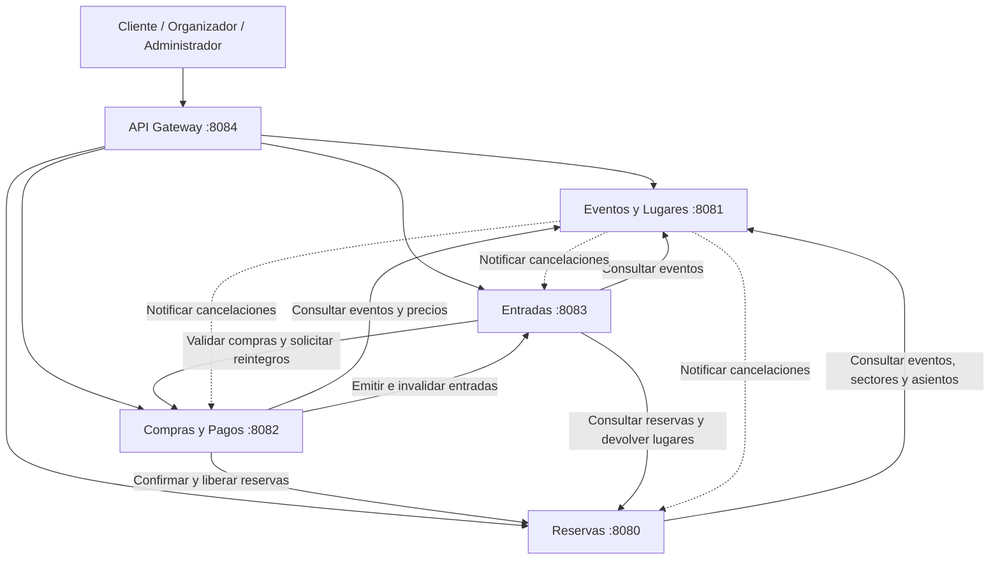

# 02 — Arquitectura general de TicketYa

## 1. Descripción general

TicketYa es una plataforma de venta y gestión de entradas para eventos, desarrollada mediante una arquitectura de microservicios con Spring Boot.

Cada microservicio tiene responsabilidades funcionales específicas, administra sus propios datos y se comunica con los demás mediante APIs REST y clientes HTTP.

La arquitectura está compuesta por cuatro microservicios funcionales y un API Gateway:

- **Eventos y Lugares:** administra eventos, lugares, sectores, asientos, organizadores, participantes, precios y cancelaciones.
- **Reservas:** administra la disponibilidad, las reservas temporales y confirmadas, la concurrencia y la liberación de lugares.
- **Compras y Pagos:** gestiona compras, pagos mediante una pasarela simulada, confirmaciones y reintegros.
- **Entradas:** administra las entradas digitales, códigos QR, solicitudes de devolución e invalidaciones.
- **API Gateway:** centraliza el acceso al sistema y enruta las solicitudes hacia los microservicios correspondientes.

Esta separación permite mantener las responsabilidades de cada servicio y desarrollar sus operaciones de manera independiente.

## 2. Diagrama general de módulos

El diagrama representa las principales relaciones de comunicación entre los servicios.

Las notificaciones de cancelación se procesan mediante registros persistentes y un mecanismo de reintentos.

### 2.1. Puertos de los componentes

| Componente | Puerto |
|---|---|
| `msvc-eventosylugares` | `8081` |
| `msvc-reservas` | `8080` |
| `msvc-compras` | `8082` |
| `msvc-entradas` | `8083` |
| `msvc-gateway` | `8084` |

Los puertos corresponden a la configuración de ejecución local y pueden adaptarse mediante las propiedades de cada servicio.

### 2.2. Persistencia y separación de datos

Cada microservicio administra su propia persistencia y es responsable de mantener la integridad de sus entidades.

Los servicios intercambian identificadores y DTO mediante APIs REST. No comparten entidades JPA ni realizan consultas directas sobre las bases de datos de otros microservicios.

Los modelos de datos, relaciones y restricciones se describen en los documentos específicos de cada servicio.

## 3. Responsabilidades de cada microservicio

### 3.1. Eventos y Lugares

El microservicio `msvc-eventosylugares` administra la información necesaria para organizar, publicar y gestionar eventos.

Sus responsabilidades principales son:

- Registrar lugares y sus sectores.
- Administrar asientos numerados y capacidades de sectores.
- Registrar organizadores y participantes.
- Crear y modificar eventos.
- Configurar precios por sector para cada evento.
- Publicar, suspender, reabrir y cancelar eventos.
- Permitir búsquedas por distintos criterios.
- Informar si un evento se encuentra habilitado para recibir reservas.
- Proporcionar información de sectores, asientos y precios.
- Registrar y procesar notificaciones de cancelación hacia otros microservicios.

Los precios se configuran por evento y sector, mediante la entidad `PrecioSector`.

Eventos y Lugares no administra la ocupación real de lugares ni procesa directamente los pagos y reintegros.

### 3.2. Reservas

El microservicio `msvc-reservas` administra la disponibilidad y ocupación de los lugares de cada evento.

Sus responsabilidades principales son:

- Consultar la disponibilidad de sectores numerados y no numerados.
- Informar asientos disponibles y ocupados.
- Crear reservas temporales con una vigencia de 10 minutos.
- Evitar reservas simultáneas incompatibles.
- Controlar la capacidad de sectores no numerados.
- Gestionar solicitudes repetidas mediante claves de idempotencia.
- Confirmar reservas después de la aprobación del pago.
- Liberar reservas ante pagos rechazados.
- Liberar individualmente lugares correspondientes a entradas devueltas.
- Registrar la cancelación local de eventos e impedir nuevas reservas.

El vencimiento se controla mediante `fechaVencimiento`. Una reserva activa vencida deja de bloquear lugares, aunque su estado persistido todavía sea `ACTIVA`.

Para prevenir la doble venta, Reservas utiliza transacciones locales y bloqueo pesimista mediante `PESSIMISTIC_WRITE` sobre la base de datos.

Consulta Eventos y Lugares para obtener información de eventos, sectores, asientos y precios.

No procesa pagos ni emite entradas digitales.

### 3.3. Compras y Pagos

El microservicio `msvc-compras` administra las operaciones de compra y su procesamiento económico.

Sus responsabilidades principales son:

- Iniciar compras asociadas a reservas.
- Registrar los detalles adquiridos y sus precios históricos.
- Calcular el importe total de las operaciones.
- Procesar pagos mediante una pasarela simulada.
- Gestionar pagos aprobados y rechazados.
- Solicitar a Reservas la confirmación o liberación de lugares.
- Coordinar la emisión de entradas.
- Administrar estados intermedios de confirmación y compensación.
- Procesar reintegros individuales y por cancelación de eventos.
- Evitar pagos y reintegros duplicados mediante mecanismos de idempotencia.

Compras se comunica con Eventos y Lugares, Reservas y Entradas para completar el circuito de venta.

Los importes históricos se conservan en los detalles de compra para calcular los reintegros sin depender de modificaciones posteriores en los precios de los eventos.

### 3.4. Entradas

El microservicio `msvc-entradas` administra las entradas digitales emitidas para las compras.

Sus responsabilidades principales son:

- Emitir una entrada por cada lugar adquirido.
- Asociar las entradas con la compra, reserva, cliente y evento correspondientes.
- Generar códigos QR únicos.
- Evitar la emisión duplicada de entradas.
- Permitir consultas individuales y por cliente.
- Registrar solicitudes de devolución.
- Consultar solicitudes pendientes.
- Aprobar o rechazar solicitudes de devolución.
- Invalidar entradas por devoluciones aprobadas o cancelaciones de eventos.

Las solicitudes de devolución requieren que la entrada esté en estado `EMITIDA` y que falten al menos 72 horas para el evento.

Cuando se aprueba una devolución, Entradas invalida la entrada, solicita a Reservas liberar el lugar y solicita a Compras procesar el reintegro.

### 3.5. API Gateway

El microservicio `msvc-gateway` funciona como punto de entrada para las solicitudes externas.

Se ejecuta localmente en el puerto `8084`.

Sus responsabilidades principales son:

- Recibir las solicitudes dirigidas al sistema.
- Enrutar las peticiones al microservicio correspondiente.
- Centralizar los puntos de acceso a las APIs.

El Gateway permite que los clientes utilicen un punto de entrada común sin necesitar conocer directamente las direcciones internas de todos los microservicios.

## 4. Comunicación entre microservicios

Los servicios se integran mediante solicitudes HTTP y contratos REST.

Para realizar las comunicaciones se utilizan clientes OpenFeign y RestClient, según las necesidades de cada microservicio.

Las principales interacciones son:

| Servicio que inicia | Servicio destinatario | Objetivo |
|---|---|---|
| Reservas | Eventos y Lugares | Consultar eventos, sectores, asientos y precios. |
| Compras | Eventos y Lugares | Consultar información del evento y precios. |
| Compras | Reservas | Consultar, confirmar o liberar reservas. |
| Compras | Entradas | Solicitar emisión e invalidación de entradas. |
| Entradas | Compras | Validar compras y solicitar reintegros. |
| Entradas | Reservas | Consultar reservas y solicitar liberación de lugares. |
| Entradas | Eventos y Lugares | Consultar información y fechas de eventos. |
| Eventos y Lugares | Reservas | Habilitar eventos y notificar cancelaciones. |
| Eventos y Lugares | Entradas | Solicitar la invalidación de entradas por cancelación. |
| Eventos y Lugares | Compras | Notificar cancelaciones para procesar reintegros. |

Cada servicio administra sus propias operaciones y persistencia.

Las llamadas entre microservicios no forman parte de una única transacción distribuida.

## 5. Circuito general de compra

El proceso de compra involucra los cuatro microservicios funcionales y se inicia mediante el API Gateway.

1. El cliente consulta los eventos publicados y sus sectores.
2. Eventos y Lugares devuelve la información del evento, lugares y precios.
3. El cliente consulta la disponibilidad correspondiente.
4. Reservas verifica los datos del evento y crea una reserva temporal para los lugares seleccionados.
5. Compras inicia una operación asociada a la reserva y registra los importes correspondientes.
6. Se procesa el pago mediante la pasarela simulada.
7. Si el pago es rechazado, Compras solicita a Reservas liberar los lugares.
8. Si el pago es aprobado y la reserva permanece vigente, Compras solicita confirmar la reserva.
9. Una vez confirmada, Compras solicita a Entradas la emisión de los tickets.
10. Entradas genera los códigos QR y devuelve las entradas emitidas.
11. Compras completa la confirmación de la operación.

### 5.1. Vencimiento de reservas

Las reservas temporales tienen una vigencia de 10 minutos.

Cuando una reserva vence, sus lugares dejan de considerarse ocupados y pueden ser reservados nuevamente.

Una reserva vencida no puede confirmarse mediante una operación posterior.

### 5.2. Pagos rechazados

Cuando el pago es rechazado, Compras solicita la liberación de la reserva.

La operación permite devolver los lugares al inventario disponible y evita que se emitan entradas correspondientes a una compra rechazada.

### 5.3. Coordinación de confirmaciones

La confirmación de la compra requiere completar correctamente las operaciones de reserva y emisión de entradas.

Compras administra los estados intermedios y los mecanismos de recuperación correspondientes cuando alguna comunicación no puede completarse.

El circuito detallado, incluyendo los escenarios alternativos, se representa en `03-DIAGRAMA-SECUENCIA-COMPRA.md`.

## 6. Circuito de devoluciones y cancelaciones

### 6.1. Devolución individual de una entrada

Cuando un cliente solicita una devolución:

1. Entradas verifica las condiciones de devolución y registra una solicitud en estado `PENDIENTE`.
2. Un administrador aprueba o rechaza la solicitud.
3. Si se rechaza, la entrada permanece en estado `EMITIDA`.
4. Si se aprueba, Entradas cambia la solicitud a `APROBADA` e invalida la entrada.
5. Entradas solicita a Reservas liberar el lugar correspondiente.
6. Entradas solicita a Compras procesar el reintegro.
7. Compras utiliza el importe histórico registrado para determinar el reintegro.

Las operaciones de devolución utilizan identificadores que permiten reconocer solicitudes repetidas y evitar efectos duplicados.

### 6.2. Cancelación de un evento

Cuando un administrador cancela un evento:

1. Eventos y Lugares cambia el estado del evento a `CANCELADO`.
2. Registra una notificación de cancelación dentro de la misma transacción local.
3. Devuelve la respuesta sin esperar a que finalicen las comunicaciones externas.
4. Un proceso programado se encarga de procesar las notificaciones pendientes.
5. Reservas registra la cancelación local, impide nuevas reservas y cancela las reservas temporales activas.
6. Entradas invalida las entradas emitidas correspondientes al evento.
7. Una vez completadas las notificaciones a Reservas y Entradas, se solicita a Compras procesar la cancelación.
8. Compras verifica los reintegros existentes y procesa los importes pendientes.

El proceso de notificaciones utiliza un scheduler con intervalo de 30 segundos y conserva el resultado de cada comunicación para administrar los reintentos.

Los reintegros aprobados no se vuelven a procesar.

## 7. Consideraciones de la arquitectura

### 7.1. Independencia de los servicios

Cada microservicio es responsable de sus entidades y reglas de negocio.

Los datos compartidos entre operaciones se representan mediante identificadores y DTO, sin establecer relaciones JPA entre bases de datos independientes.

### 7.2. Concurrencia

Reservas utiliza bloqueo pesimista y transacciones locales para controlar la ocupación de los lugares.

Esto permite impedir reservas simultáneas incompatibles cuando las operaciones utilizan una misma base de datos.

### 7.3. Idempotencia

Las operaciones de reserva, emisión, liberación y reintegro incorporan mecanismos para evitar efectos duplicados ante solicitudes repetidas.

Cada microservicio implementa estos mecanismos de acuerdo con sus propias responsabilidades.

### 7.4. Consistencia entre servicios

La comunicación mediante HTTP puede producir fallas parciales.

Las operaciones distribuidas utilizan estados intermedios, reintentos, registros persistentes y compensaciones cuando corresponde.

No existe una transacción ACID única entre las bases de datos de todos los microservicios.

## 8. Documentación relacionada

La documentación general del sistema se encuentra en la carpeta `docs/`:

- [01 — Features y User Stories](01-FEATURES-Y-USER-STORIES.md)
- [03 — Diagrama de secuencia de compra](03-DIAGRAMA-SECUENCIA-COMPRA.md)
- [04 — Relaciones entre microservicios](04-RELACIONES-ENTRE-MICROSERVICIOS.md)
- [05 — Contratos de integración](05-CONTRATOS-DE-INTEGRACION.md)
- [06 — Plan de testing](06-PLAN-DE-TESTING.md)

La documentación de cada microservicio se encuentra en las carpetas `docs/` correspondientes:

- [Eventos y Lugares](../msvc-eventosylugares/docs/)
- [Reservas](../msvc-reservas/docs/)
- [Compras y Pagos](../msvc-compras/docs/)
- [Entradas](../msvc-entradas/docs/)

El [README principal](../README.md) contiene los requisitos, puertos e instrucciones de ejecución local de TicketYa.