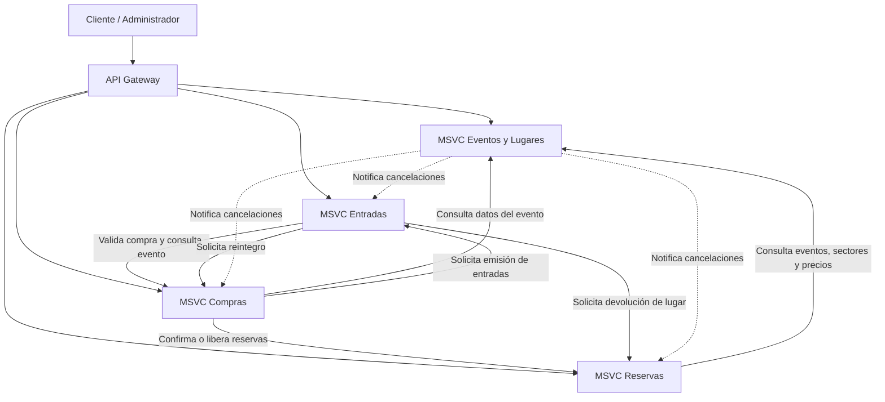

# 02 — Arquitectura general de TicketYa

## 1. Descripción general

TicketYa es una plataforma de venta de entradas para eventos. La aplicación está organizada mediante una arquitectura de microservicios, donde cada servicio tiene una responsabilidad funcional específica y se comunica con los demás mediante contratos REST.

Esta separación permite distribuir las responsabilidades del sistema, facilitar el mantenimiento y permitir que cada microservicio evolucione de manera independiente.

La arquitectura contempla los siguientes microservicios:

- **Gateway:** punto de entrada a la aplicación y encargado de dirigir las solicitudes hacia los servicios correspondientes.
- **Eventos y Lugares:** administra los lugares, sectores, asientos, organizadores, participantes, eventos y sus estados.
- **Reservas:** administra la disponibilidad y las reservas temporales o confirmadas de lugares.
- **Compras:** gestiona las compras, los pagos simulados, las confirmaciones y los reintegros.
- **Entradas:** emite las entradas asociadas a compras confirmadas, genera códigos QR y administra solicitudes de devolución e invalidaciones.

## 2. Diagrama general de módulos

El diagrama representa las responsabilidades y principales relaciones de integración entre los servicios. Las notificaciones de cancelación se procesan mediante un mecanismo de notificaciones pendientes y reintentos.

## 3. Responsabilidades de cada microservicio

### 3.1. Eventos y Lugares

Es responsable de administrar la información necesaria para organizar y publicar eventos.

Sus principales responsabilidades son:

- Registrar lugares y sus sectores.
- Administrar asientos numerados cuando corresponda.
- Registrar organizadores y participantes.
- Crear y modificar eventos.
- Configurar precios por sector.
- Publicar, suspender y cancelar eventos.
- Permitir consultas y búsquedas de eventos.
- Informar si un evento está habilitado y proporcionar la configuración de sus sectores y precios.
- Gestionar las notificaciones derivadas de la cancelación de eventos.

No administra el inventario de reservas ni realiza directamente los reintegros de las compras.

### 3.2. Reservas

Es responsable de administrar la disponibilidad y ocupación de los lugares de cada evento.

Sus principales responsabilidades son:

- Consultar la disponibilidad de sectores y asientos.
- Crear reservas temporales.
- Controlar el vencimiento de las reservas.
- Evitar que un mismo lugar sea reservado simultáneamente por más de un cliente.
- Confirmar reservas una vez aprobado el pago.
- Liberar reservas cuando el pago es rechazado.
- Liberar lugares ante devoluciones o cancelaciones autorizadas.

Consulta a Eventos y Lugares para obtener información del evento, sectores y precios. No procesa pagos ni emite entradas.

### 3.3. Compras

Es responsable de gestionar las operaciones económicas realizadas por los clientes.

Sus principales responsabilidades son:

- Iniciar compras asociadas a reservas.
- Registrar el detalle de los productos adquiridos y sus precios históricos.
- Procesar pagos mediante una pasarela simulada.
- Gestionar la confirmación de compras aprobadas.
- Solicitar la liberación de reservas cuando un pago es rechazado.
- Coordinar la emisión de entradas.
- Procesar reintegros por devoluciones y cancelaciones de eventos.
- Evitar el procesamiento duplicado de pagos y reintegros mediante mecanismos de idempotencia.

Se comunica con Reservas, Eventos y Lugares y Entradas para completar el circuito de compra.

### 3.4. Entradas

Es responsable de administrar las entradas generadas a partir de compras confirmadas.

Sus principales responsabilidades son:

- Emitir una entrada por cada lugar adquirido.
- Asociar cada entrada con su compra, reserva, cliente y evento.
- Generar códigos QR únicos.
- Permitir consultar las entradas de un cliente.
- Administrar solicitudes de devolución.
- Aprobar o rechazar solicitudes de devolución.
- Invalidar entradas ante devoluciones aprobadas o cancelaciones de eventos.

Para completar una devolución, solicita a Reservas la liberación del lugar y a Compras el reintegro correspondiente.

### 3.5. API Gateway

Funciona como punto de entrada para las solicitudes dirigidas a los microservicios.

Su responsabilidad es centralizar el acceso a los servicios y encaminar las solicitudes hacia el microservicio correspondiente, evitando que el cliente tenga que conocer directamente la organización interna de todos ellos.

## 4. Comunicación entre microservicios

Los microservicios se integran principalmente mediante solicitudes HTTP y contratos REST.

Para realizar llamadas entre servicios se utilizan clientes de integración, como los clientes Feign presentes en los microservicios.

Las principales interacciones son:

| Servicio que inicia | Servicio destinatario | Objetivo |
|---|---|---|
| Reservas | Eventos y Lugares | Consultar eventos, sectores y precios. |
| Compras | Eventos y Lugares | Validar información y estado del evento. |
| Compras | Reservas | Confirmar o liberar reservas. |
| Compras | Entradas | Solicitar la emisión de entradas. |
| Entradas | Compras | Validar compras y solicitar reintegros. |
| Entradas | Reservas | Solicitar la liberación de lugares. |
| Eventos y Lugares | Reservas | Informar la cancelación de un evento. |
| Eventos y Lugares | Entradas | Solicitar la invalidación de entradas. |
| Eventos y Lugares | Compras | Informar la cancelación para iniciar reintegros. |

## 5. Circuito general de compra

El proceso de compra involucra principalmente a Reservas, Compras y Entradas, con consultas a Eventos y Lugares.

1. El cliente consulta un evento y sus sectores disponibles.
2. Reservas consulta la información del evento y verifica la disponibilidad.
3. El cliente solicita una reserva temporal.
4. Compras inicia la operación asociada a esa reserva.
5. Compras procesa el pago mediante la pasarela simulada.
6. Si el pago es rechazado, Compras solicita liberar la reserva.
7. Si el pago es aprobado, Compras solicita confirmar la reserva.
8. Una vez confirmada, Compras solicita a Entradas la emisión de las entradas.
9. Entradas genera los códigos QR y devuelve las entradas emitidas.
10. Compras finaliza la operación como confirmada cuando se completa correctamente la emisión.

La confirmación de la compra depende de que se hayan completado las operaciones necesarias de reserva y emisión de entradas.

## 6. Circuito de devolución y cancelación

### 6.1. Devolución de una entrada

Cuando un cliente solicita devolver una entrada:

1. Entradas registra la solicitud de devolución.
2. Un administrador puede aprobarla o rechazarla.
3. Si se aprueba, Entradas invalida la entrada.
4. Entradas solicita a Reservas liberar el lugar correspondiente.
5. Entradas solicita a Compras realizar el reintegro.
6. Compras procesa el reintegro utilizando el importe histórico del artículo adquirido.

Si la solicitud es rechazada, la entrada permanece emitida y no se realizan las operaciones externas de devolución.

### 6.2. Cancelación de un evento

Cuando se cancela un evento:

1. Eventos y Lugares cambia el estado del evento a `CANCELADO`.
2. Registra una notificación pendiente para procesar la cancelación.
3. Se informa a Reservas para liberar las reservas temporales correspondientes.
4. Se solicita a Entradas invalidar las entradas emitidas.
5. Se informa a Compras para gestionar los reintegros de las compras afectadas.

El procesamiento de estas notificaciones se realiza de manera independiente de la respuesta inmediata de la operación de cancelación. Se contemplan reintentos ante fallos de integración.

## 7. Consideraciones de la arquitectura

- Cada microservicio concentra una responsabilidad funcional determinada.
- La comunicación entre servicios se realiza mediante contratos REST.
- Las operaciones de un microservicio no implican automáticamente una transacción distribuida entre todos los servicios.
- Las operaciones que involucran varios servicios deben contemplar fallos parciales y mecanismos de reintento.
- La idempotencia es importante para evitar duplicaciones ante reintentos, especialmente en pagos, emisión de entradas y reintegros.
- Reservas es responsable de controlar la disponibilidad y evitar la doble asignación de lugares.
- Compras coordina el proceso económico de la operación.
- Entradas administra la emisión y el estado de los tickets.
- Eventos y Lugares mantiene la información y el estado de los eventos.

## 8. Documentación relacionada

Para profundizar en cada componente se puede consultar la documentación específica:

- [Microservicio Eventos y Lugares](../msvc-eventosylugares/README.md)
- [Microservicio Reservas](../msvc-reservas/README.md)
- [Microservicio Compras](../msvc-compras/README.md)
- [Microservicio Entradas](../msvc-entradas/README.md)
- [Microservicio Gateway](../msvc-gateway/README.md)