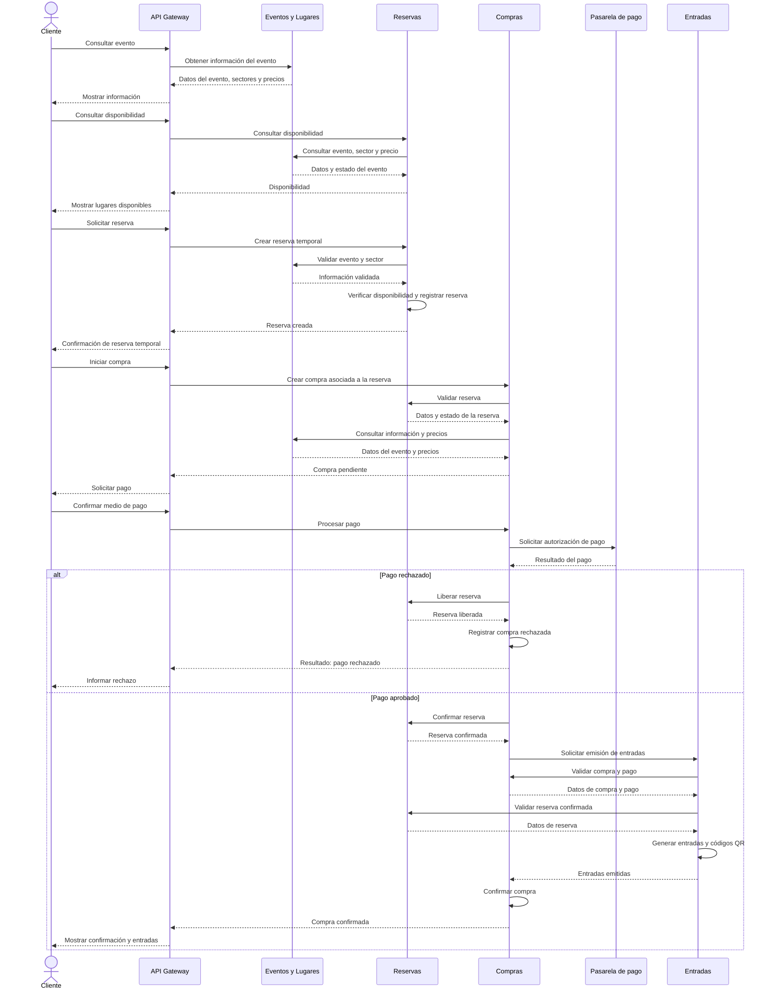

# 03 — Diagrama de secuencia del proceso de compra

## 1. Objetivo

Este documento representa la interacción entre el cliente y los microservicios de TicketYa durante el proceso de compra de entradas.

Se describe el flujo principal desde la consulta de disponibilidad hasta la confirmación de la compra y la emisión de las entradas. También se contempla el escenario alternativo de pago rechazado.

## 2. Participantes

- **Cliente:** usuario que desea adquirir entradas para un evento.
- **API Gateway:** punto de entrada a la aplicación.
- **Eventos y Lugares:** proporciona información del evento, sectores y precios.
- **Reservas:** consulta disponibilidad y administra reservas temporales y confirmadas.
- **Compras:** inicia la compra, procesa el pago y coordina su confirmación.
- **Pasarela de pago:** servicio simulado que informa si el pago fue aprobado o rechazado.
- **Entradas:** emite las entradas y genera sus códigos QR.

## 3. Diagrama de secuencia

## 4. Descripción del flujo

### 4.1. Consulta del evento y disponibilidad

El cliente consulta un evento a través del Gateway. La solicitud se dirige a Eventos y Lugares, que proporciona los datos del evento, sus sectores y precios.

Para conocer los lugares disponibles, se consulta a Reservas. Este microservicio obtiene la configuración necesaria desde Eventos y Lugares y verifica su propio inventario de ocupación.

### 4.2. Creación de la reserva temporal

Cuando el cliente selecciona los lugares, solicita una reserva temporal.

Reservas valida el evento, el sector y la disponibilidad. Si la operación es válida, registra la reserva con un tiempo de vigencia limitado.

La reserva temporal evita que otro cliente pueda ocupar esos mismos lugares mientras se completa la compra.

### 4.3. Inicio de la compra y pago

Compras recibe la solicitud asociada a la reserva y valida que se encuentre activa y vigente.

Luego registra la compra y sus detalles, conservando los precios correspondientes a la operación.

El pago se procesa mediante una pasarela simulada. El resultado puede ser aprobado o rechazado.

### 4.4. Pago rechazado

Si el pago es rechazado:

- Compras registra el resultado.
- Solicita a Reservas liberar los lugares.
- La compra queda registrada como rechazada una vez completada la liberación.

No se emiten entradas.

### 4.5. Pago aprobado

Si el pago es aprobado:

1. Compras solicita a Reservas confirmar la reserva.
2. Una vez confirmada, solicita a Entradas la emisión.
3. Entradas valida la compra, el pago y la reserva.
4. Se genera una entrada por cada lugar adquirido, con su correspondiente código QR.
5. Entradas devuelve las entradas emitidas.
6. Compras confirma la operación cuando verifica que se completó la emisión.

Si la confirmación de la reserva o la emisión no puede completarse, Compras contempla estados pendientes de compensación o reintento, en lugar de considerar automáticamente finalizada la compra.

## 5. Consideraciones

- La reserva temporal tiene una vigencia limitada.
- Reservas es responsable de evitar la asignación simultánea de un mismo lugar.
- Compras conserva el precio histórico de los artículos adquiridos.
- Un pago aprobado no significa por sí solo que la compra ya esté confirmada.
- La compra se confirma cuando se completa la confirmación de la reserva y la emisión de las entradas.
- Los reintentos deben contemplar idempotencia para evitar pagos, confirmaciones o emisiones duplicadas.
- Las interacciones entre microservicios no constituyen una única transacción distribuida.

## 6. Documentación relacionada

- [Arquitectura general](./02-ARQUITECTURA-GENERAL.md)
- [Contratos de integración](./05-CONTRATOS-DE-INTEGRACION.md)
- [Microservicio Reservas](../msvc-reservas/README.md)
- [Microservicio Compras](../msvc-compras/README.md)
- [Microservicio Entradas](../msvc-entradas/README.md)