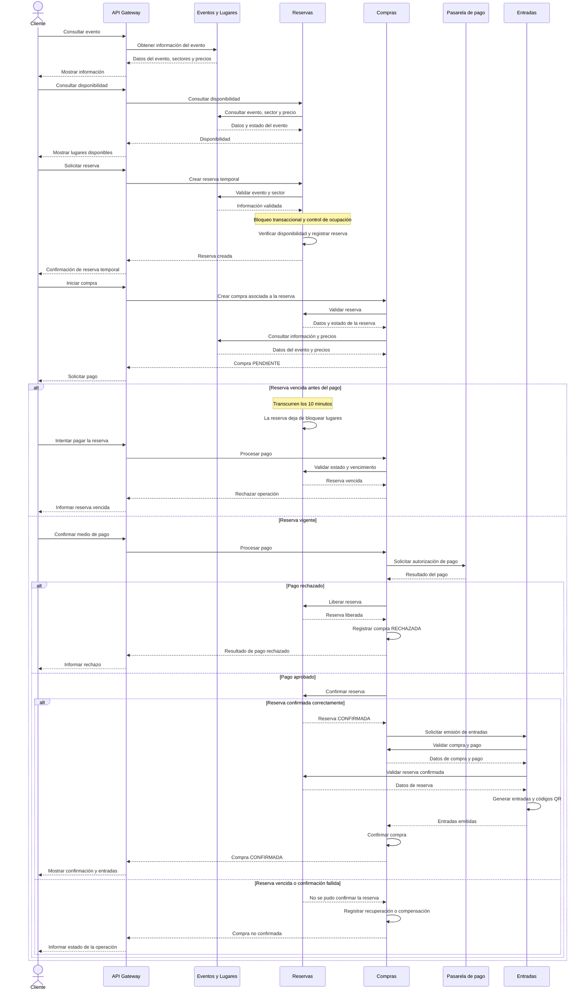

# 03 — Diagrama de secuencia del proceso de compra

## 1. Objetivo

Este documento representa la interacción entre el cliente y los microservicios de TicketYa durante el proceso de compra de entradas.

Se describe el flujo principal desde la consulta de disponibilidad hasta la confirmación de la compra y la emisión de entradas digitales. También se contemplan los escenarios alternativos de pago rechazado y vencimiento de la reserva temporal.

## 2. Participantes

- **Cliente:** usuario que desea adquirir entradas para un evento.
- **API Gateway:** punto de entrada al sistema, ejecutado en el puerto `8084`.
- **Eventos y Lugares:** proporciona información de eventos, sectores, asientos y precios.
- **Reservas:** administra la disponibilidad y las reservas temporales y confirmadas.
- **Compras y Pagos:** inicia compras, procesa pagos y coordina confirmaciones, liberaciones y emisión de entradas.
- **Pasarela de pago:** componente simulado que procesa las operaciones de pago.
- **Entradas:** emite las entradas digitales y genera sus códigos QR.

## 3. Diagrama de secuencia

## 4. Descripción del flujo

### 4.1. Consulta del evento y disponibilidad

El cliente consulta un evento a través del API Gateway.

La solicitud se dirige a Eventos y Lugares, que proporciona la información del evento, sus sectores, asientos y precios configurados.

Para conocer los lugares disponibles, se consulta a Reservas. Este microservicio obtiene la configuración necesaria desde Eventos y Lugares y calcula la ocupación utilizando sus propios registros de reservas.

La consulta de disponibilidad no bloquea lugares. La disponibilidad definitiva se verifica al crear la reserva.

### 4.2. Creación de la reserva temporal

Cuando el cliente selecciona los lugares, solicita una reserva temporal.

Reservas valida la existencia y el estado del evento, la correspondencia de los sectores y asientos y la disponibilidad solicitada.

El microservicio utiliza un mecanismo de bloqueo pesimista y transacciones locales para evitar reservas simultáneas incompatibles.

Si la operación es válida, registra una reserva en estado `ACTIVA`, con una fecha de vencimiento de 10 minutos desde su creación.

Durante ese período, los lugares permanecen temporalmente ocupados.

### 4.3. Inicio de la compra

Compras recibe la solicitud asociada a la reserva y verifica su estado y vigencia.

También consulta los precios configurados para los sectores seleccionados.

A continuación, registra la compra y sus detalles, conservando los importes históricos correspondientes a los lugares adquiridos.

La compra se inicia en estado `PENDIENTE`.

### 4.4. Procesamiento del pago

El pago se procesa mediante una pasarela simulada, que devuelve el resultado de la operación.

El resultado puede ser aprobado o rechazado.

La aprobación del pago no implica automáticamente que la compra esté confirmada, porque todavía deben completarse la confirmación de la reserva y la emisión de las entradas.

### 4.5. Pago rechazado

Si el pago es rechazado:

1. Compras registra el resultado del procesamiento.
2. Solicita a Reservas liberar la reserva temporal.
3. Reservas libera los lugares correspondientes.
4. Compras registra la compra como `RECHAZADA` al completar el procesamiento correspondiente.

No se emiten entradas para una compra cuyo pago fue rechazado.

### 4.6. Pago aprobado

Si el pago es aprobado:

1. Compras solicita a Reservas confirmar la reserva.
2. Reservas verifica que la reserva todavía se encuentre activa y vigente.
3. Si la confirmación es válida, la reserva cambia al estado `CONFIRMADA`.
4. Compras solicita a Entradas la emisión de los tickets.
5. Entradas valida la compra, el pago aprobado y la reserva confirmada.
6. Se genera una entrada por cada lugar adquirido, con su correspondiente código QR.
7. Entradas devuelve las entradas emitidas.
8. Compras completa la confirmación de la operación.

La compra pasa a estado `CONFIRMADA` cuando se completan correctamente la confirmación de la reserva y la emisión de las entradas.

Si alguna operación no puede completarse, Compras utiliza los mecanismos de recuperación, reintento o compensación correspondientes.

### 4.7. Reserva vencida

Las reservas temporales tienen una vigencia de 10 minutos desde su creación.

Cuando se cumple ese plazo, los lugares dejan de considerarse ocupados y pueden ser reservados nuevamente.

Reservas utiliza la fecha `fechaVencimiento` para determinar la ocupación efectiva. Por este motivo, una reserva vencida puede dejar de bloquear lugares aunque su estado persistido todavía sea `ACTIVA`.

Antes de procesar un pago, Compras verifica que la reserva continúe vigente.

Si la reserva ya venció, la operación se rechaza y no se emiten entradas.

Si el pago fue aprobado, pero la confirmación de la reserva no puede completarse, Compras debe gestionar la recuperación o compensación de la operación.

El vencimiento lógico permite liberar capacidad sin necesidad de ejecutar un scheduler.

## 5. Consideraciones del proceso

- Las reservas temporales tienen una vigencia de 10 minutos.
- Reservas controla la ocupación de los lugares y evita las asignaciones simultáneas incompatibles.
- Compras conserva los precios históricos de los lugares adquiridos.
- La consulta de disponibilidad no garantiza la reserva del asiento.
- Un pago aprobado no implica por sí solo una compra confirmada.
- La compra se confirma cuando se completa la confirmación de la reserva y la emisión de entradas.
- Las operaciones utilizan mecanismos de idempotencia para evitar duplicaciones ante reintentos.
- Las comunicaciones entre microservicios se realizan mediante APIs REST y no constituyen una única transacción distribuida.
- Los fallos parciales se gestionan mediante estados intermedios, reintentos y compensaciones.

## 6. Documentación relacionada

- [Arquitectura general](02-ARQUITECTURA-GENERAL.md)
- [Relaciones entre microservicios](04-RELACIONES-ENTRE-MICROSERVICIOS.md)
- [Contratos de integración](05-CONTRATOS-DE-INTEGRACION.md)
- [Microservicio Reservas](../msvc-reservas/docs/)
- [Microservicio Compras y Pagos](../msvc-compras/docs/)
- [Microservicio Entradas](../msvc-entradas/docs/)
- [README principal](../README.md)