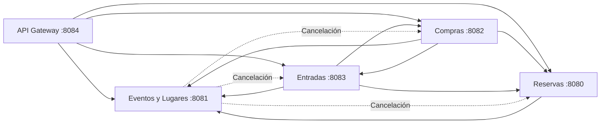

# 04 — Relaciones entre microservicios

## 1. Objetivo

Este documento describe las relaciones entre los microservicios de TicketYa, identificando qué servicio inicia cada comunicación, cuál la recibe y con qué finalidad.

Cada microservicio mantiene la responsabilidad sobre sus propios procesos y datos, y expone operaciones REST para permitir la integración con los demás servicios.

El sistema está compuesto por cuatro microservicios funcionales y un API Gateway, que centraliza el acceso a las APIs.

## 2. Mapa de dependencias

Las flechas continuas representan las integraciones HTTP utilizadas en los procesos habituales de TicketYa.

Las flechas punteadas representan las notificaciones relacionadas con la cancelación de eventos, coordinadas por Eventos y Lugares.

Los puertos indicados corresponden a la configuración local del proyecto.

## 3. Relaciones y responsabilidades

### 3.1. API Gateway → Microservicios

**Finalidad:** centralizar el acceso a las APIs del sistema.

El API Gateway se ejecuta en el puerto `8084` y recibe las solicitudes externas para dirigirlas al microservicio correspondiente.

Permite acceder a las operaciones de consulta, reserva, compra y gestión de entradas desde un punto de entrada común.

No reemplaza la lógica de negocio de los servicios ni administra directamente sus datos.

### 3.2. Reservas → Eventos y Lugares

**Finalidad:** consultar la información necesaria para administrar las reservas y la disponibilidad.

Reservas consulta a Eventos y Lugares para:

- Validar la existencia y el estado del evento.
- Verificar que el evento se encuentre habilitado para recibir reservas.
- Comprobar la pertenencia de sectores y asientos.
- Obtener la configuración y capacidad de los sectores.
- Consultar los precios correspondientes al evento y sector.

La disponibilidad y ocupación real de los lugares es responsabilidad de Reservas, que utiliza sus propios registros para realizar los cálculos.

### 3.3. Compras → Eventos y Lugares

**Finalidad:** validar información del evento y obtener los precios necesarios para iniciar una compra.

Compras consulta el estado del evento y la configuración de los sectores correspondientes.

Los precios utilizados durante la compra se conservan como importes históricos en los detalles de la operación.

De esta manera, las modificaciones posteriores de los precios configurados no afectan las compras ya registradas.

### 3.4. Compras → Reservas

**Finalidad:** coordinar las reservas con el resultado de las operaciones de pago.

Compras se comunica con Reservas para:

- Consultar y validar una reserva.
- Verificar su estado y vigencia.
- Confirmarla después de un pago aprobado.
- Liberarla cuando se rechaza el pago.

Reservas conserva la responsabilidad sobre la ocupación y disponibilidad de los lugares.

La confirmación requiere que la reserva se encuentre activa y vigente.

### 3.5. Compras → Entradas

**Finalidad:** solicitar la emisión de entradas digitales y coordinar su invalidación cuando corresponde.

Una vez aprobado el pago y confirmada la reserva, Compras solicita a Entradas emitir los tickets correspondientes.

Entradas verifica la información de la compra y reserva, y genera una entrada por cada lugar adquirido, con su código QR único.

Los datos de las entradas emitidas permiten a Compras completar la operación.

Durante el procesamiento de cancelaciones, Compras también puede solicitar la invalidación de las entradas antes de ejecutar los reintegros correspondientes.

### 3.6. Entradas → Compras

**Finalidad:** validar compras y coordinar los reintegros de entradas devueltas.

Entradas consulta información de las compras y sus pagos para verificar las condiciones necesarias para emitir entradas.

Cuando una solicitud de devolución es aprobada, solicita a Compras procesar el reintegro correspondiente.

Compras administra los importes históricos, las operaciones de reintegro y sus resultados.

### 3.7. Entradas → Reservas

**Finalidad:** consultar reservas y liberar lugares correspondientes a entradas devueltas.

Entradas consulta los datos de una reserva para verificar la información utilizada durante la emisión.

Cuando se aprueba una devolución, solicita a Reservas liberar el lugar asociado a la entrada.

Reservas registra el identificador de la entrada procesada para evitar una liberación duplicada ante solicitudes repetidas.

### 3.8. Entradas → Eventos y Lugares

**Finalidad:** obtener información del evento y verificar las condiciones de devolución e invalidación.

Entradas consulta a Eventos y Lugares para:

- Verificar el estado de un evento.
- Obtener su fecha y hora.
- Comprobar la anticipación mínima requerida para solicitar una devolución.
- Validar que el evento se encuentre cancelado antes de invalidar sus entradas por ese motivo.

La regla de devolución exige que falten al menos 72 horas para la realización del evento.

### 3.9. Eventos y Lugares → Otros microservicios

**Finalidad:** coordinar las operaciones asociadas a la cancelación de un evento.

Cuando un evento se cancela, Eventos y Lugares cambia su estado a `CANCELADO` y registra una notificación persistente dentro de la misma transacción local.

Posteriormente, comunica la cancelación a los servicios involucrados:

- **Reservas:** registra la cancelación local, cancela las reservas temporales activas e impide nuevas reservas.
- **Entradas:** invalida las entradas emitidas correspondientes al evento.
- **Compras:** identifica las compras afectadas y procesa los reintegros correspondientes.

Las notificaciones a Reservas y Entradas se procesan de forma independiente.

Compras recibe la notificación cuando se completaron correctamente las operaciones de Reservas y Entradas, siempre que las integraciones correspondientes estén habilitadas.

El procesamiento utiliza un scheduler con intervalo de 30 segundos y conserva el estado de cada notificación para permitir reintentos ante errores.

## 4. Información y responsabilidad de los datos

Cada microservicio mantiene la información correspondiente a su dominio.

| Microservicio | Información que administra |
|---|---|
| Eventos y Lugares | Lugares, sectores, asientos, organizadores, participantes, eventos, precios y notificaciones de cancelación. |
| Reservas | Reservas temporales y confirmadas, detalles, asignaciones, ocupación y registros auxiliares de concurrencia e idempotencia. |
| Compras | Compras, detalles de compra, pagos, estados de confirmación, importes históricos y reintegros. |
| Entradas | Entradas digitales, códigos QR, estados de las entradas y solicitudes de devolución. |

### 4.1. Separación de bases de datos

Cada microservicio administra su propia persistencia.

Las referencias a entidades de otros servicios se realizan mediante identificadores como:

- `eventoId`
- `sectorId`
- `asientoId`
- `reservaId`
- `compraId`
- `clienteId`
- `entradaId`

Estos identificadores se intercambian mediante DTO y permiten relacionar operaciones sin compartir entidades JPA ni establecer claves foráneas entre bases de datos independientes.

### 4.2. Propiedad de la información

Eventos y Lugares administra la configuración de eventos, sectores y precios.

Reservas determina la disponibilidad efectiva de los lugares.

Compras conserva los importes históricos y administra las operaciones financieras.

Entradas administra los tickets digitales y sus estados.

Cada servicio constituye la fuente de información de los datos correspondientes a su responsabilidad.

## 5. Consideraciones de integración

### 5.1. Comunicación HTTP

Las integraciones se realizan mediante APIs REST y clientes HTTP, principalmente OpenFeign y RestClient.

Las direcciones de los servicios se configuran mediante propiedades y variables de entorno.

Las comunicaciones utilizan DTO para intercambiar la información necesaria entre servicios.

### 5.2. Manejo de errores

Las comunicaciones entre microservicios pueden presentar errores de red, respuestas inesperadas o servicios temporalmente no disponibles.

Cada operación debe verificar los resultados necesarios antes de completar sus cambios de estado.

Los flujos de compra, devolución y cancelación utilizan mecanismos de recuperación, reintento y compensación según las responsabilidades de cada microservicio.

### 5.3. Idempotencia

La idempotencia permite evitar efectos duplicados cuando una solicitud se repite.

TicketYa utiliza diferentes mecanismos según la operación:

- Reservas utiliza claves de idempotencia para evitar reservas duplicadas.
- Entradas evita emitir nuevamente los tickets de una compra que ya tiene entradas registradas.
- Las devoluciones individuales registran la identificación de la entrada procesada.
- Compras verifica las operaciones de pago y los reintegros registrados para evitar procesamientos duplicados.
- Las notificaciones de cancelación conservan su estado de procesamiento para permitir reintentos.

Las notificaciones de cancelación incluyen el encabezado `X-Operacion-Id`, aunque su tratamiento depende del microservicio receptor.

Reservas y Entradas previenen efectos repetidos principalmente mediante sus validaciones y registros de estado, mientras que Compras exige el identificador y controla los reintegros registrados por ítem.

### 5.4. Consistencia distribuida

Los microservicios utilizan transacciones locales para mantener la consistencia de sus propias bases de datos.

Las operaciones que involucran varios servicios no se ejecutan dentro de una única transacción distribuida.

La coordinación se realiza mediante contratos REST, estados intermedios, registros persistentes, reintentos y compensaciones cuando corresponde.

Esto permite administrar operaciones que requieren varios pasos sin compartir directamente la persistencia de los distintos servicios.

## 6. Documentación relacionada

La documentación general de TicketYa se encuentra en la carpeta `docs/`:

- [Arquitectura general](02-ARQUITECTURA-GENERAL.md)
- [Diagrama de secuencia de compra](03-DIAGRAMA-SECUENCIA-COMPRA.md)
- [Contratos de integración](05-CONTRATOS-DE-INTEGRACION.md)
- [Plan de testing](06-PLAN-DE-TESTING.md)

La documentación específica se encuentra en las carpetas de cada microservicio:

- [Eventos y Lugares](../msvc-eventosylugares/docs/)
- [Reservas](../msvc-reservas/docs/)
- [Compras y Pagos](../msvc-compras/docs/)
- [Entradas](../msvc-entradas/docs/)

El [README principal](../README.md) contiene los requisitos, puertos e instrucciones para ejecutar TicketYa localmente.