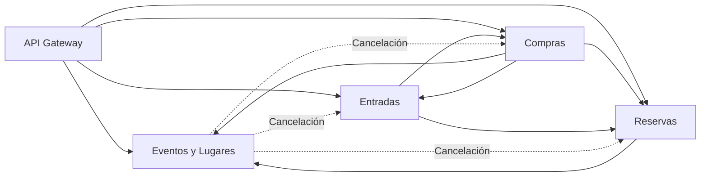

# 04 — Relaciones entre microservicios

## 1. Objetivo

Este documento describe las relaciones entre los microservicios de TicketYa, identificando qué servicio inicia cada comunicación, cuál la recibe y con qué finalidad.

Cada microservicio mantiene la responsabilidad sobre sus propios procesos y expone operaciones para que los demás puedan integrarse sin acceder directamente a su lógica interna.

## 2. Mapa de dependencias

Las flechas continuas representan integraciones utilizadas en los procesos habituales. Las flechas punteadas representan las notificaciones relacionadas con la cancelación de eventos.

## 3. Relaciones y responsabilidades

### 3.1. API Gateway → Microservicios

El Gateway recibe las solicitudes de los clientes y las deriva al microservicio correspondiente.

No reemplaza la lógica de negocio de los servicios ni administra sus datos.

### 3.2. Reservas → Eventos y Lugares

**Finalidad:** obtener información necesaria para gestionar la disponibilidad.

Reservas consulta a Eventos y Lugares para:

- Validar que el evento exista y esté habilitado.
- Verificar que el sector pertenezca al evento y al lugar correspondiente.
- Obtener la configuración de sectores y asientos.
- Consultar los precios correspondientes.

La información de disponibilidad y ocupación es responsabilidad de Reservas.

### 3.3. Compras → Eventos y Lugares

**Finalidad:** validar información del evento durante el proceso de compra.

Compras consulta los datos necesarios para verificar el estado del evento y obtener información de los precios.

El precio utilizado en la compra se conserva como dato histórico en sus detalles.

### 3.4. Compras → Reservas

**Finalidad:** coordinar el estado de la reserva con el resultado del pago.

Compras solicita a Reservas:

- Validar una reserva antes de iniciar o continuar una compra.
- Confirmar una reserva cuando el pago fue aprobado.
- Liberar una reserva cuando el pago fue rechazado.

Reservas conserva la responsabilidad sobre la disponibilidad y ocupación de los lugares.

### 3.5. Compras → Entradas

**Finalidad:** solicitar la emisión de entradas después de confirmar el pago y la reserva.

Compras envía los datos necesarios para que Entradas valide la operación y genere los tickets correspondientes.

Entradas devuelve las entradas emitidas y sus identificadores para que Compras pueda completar la confirmación.

### 3.6. Entradas → Compras

**Finalidad:** validar operaciones y coordinar reintegros.

Entradas consulta información de las compras y sus pagos para validar la emisión o devolución de entradas.

Cuando una devolución es aprobada, solicita a Compras procesar el reintegro correspondiente.

Compras conserva la responsabilidad de procesar los reintegros y registrar sus resultados.

### 3.7. Entradas → Reservas

**Finalidad:** liberar el lugar asociado a una entrada cuya devolución fue aprobada.

Entradas solicita a Reservas devolver la ocupación del lugar correspondiente.

Reservas registra la liberación y evita que se realice dos veces para la misma entrada.

### 3.8. Eventos y Lugares → Otros microservicios

**Finalidad:** comunicar la cancelación de un evento.

Cuando un evento se cancela, Eventos y Lugares registra una notificación pendiente y solicita las operaciones correspondientes a:

- **Reservas:** liberar las reservas temporales asociadas al evento.
- **Entradas:** invalidar las entradas emitidas.
- **Compras:** procesar los reintegros de las compras afectadas.

Las notificaciones se procesan mediante un mecanismo programado con reintentos ante errores de integración.

## 4. Información y responsabilidad de los datos

Cada microservicio mantiene la información correspondiente a su dominio:

| Microservicio | Información que administra |
|---|---|
| Eventos y Lugares | Lugares, sectores, asientos, organizadores, participantes, eventos y precios configurados. |
| Reservas | Reservas temporales y confirmadas, disponibilidad y ocupación de lugares. |
| Compras | Compras, detalles, pagos, estados de confirmación y reintegros. |
| Entradas | Entradas, códigos QR, estados de emisión y solicitudes de devolución. |

Las referencias entre servicios se realizan mediante identificadores. La comunicación REST permite consultar o solicitar operaciones sin compartir directamente las entidades internas de cada microservicio.

## 5. Consideraciones de integración

- Las comunicaciones entre microservicios se realizan mediante HTTP y contratos REST.
- Los clientes Feign permiten invocar operaciones de otros servicios.
- Las direcciones de los servicios pueden configurarse mediante propiedades de integración.
- Los errores de comunicación deben contemplarse para evitar que una operación quede confirmada cuando sus pasos necesarios no se completaron.
- Se utilizan mecanismos de idempotencia en operaciones sensibles para evitar duplicaciones ante reintentos.
- Las notificaciones de cancelación cuentan con procesamiento pendiente y reintentos.
- La propagación de una cancelación o devolución involucra varios servicios y no constituye una transacción distribuida única.

**Nota sobre idempotencia:** aunque se contempla el uso de identificadores de operación en las notificaciones de cancelación, el tratamiento de esos identificadores no es uniforme en todos los receptores. Por lo tanto, no debe asumirse que todas las integraciones garantizan actualmente la misma protección contra duplicaciones.

## 6. Documentación relacionada

- [Arquitectura general](./02-ARQUITECTURA-GENERAL.md)
- [Diagrama de secuencia de compra](./03-DIAGRAMA-SECUENCIA-COMPRA.md)
- [Contratos de integración](./05-CONTRATOS-DE-INTEGRACION.md)
- [Documentación de Eventos y Lugares](../msvc-eventosylugares/README.md)
- [Documentación de Reservas](../msvc-reservas/README.md)
- [Documentación de Compras](../msvc-compras/README.md)
- [Documentación de Entradas](../msvc-entradas/README.md)