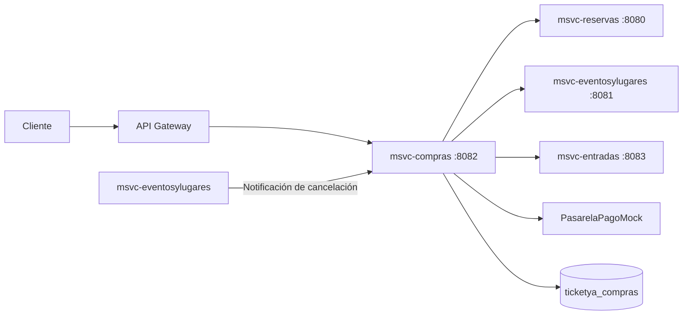
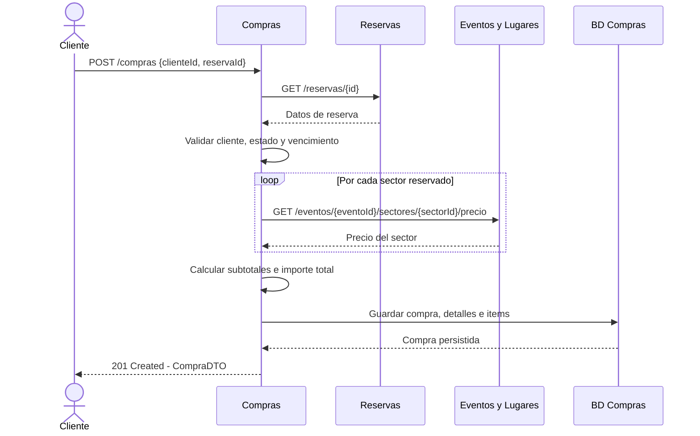
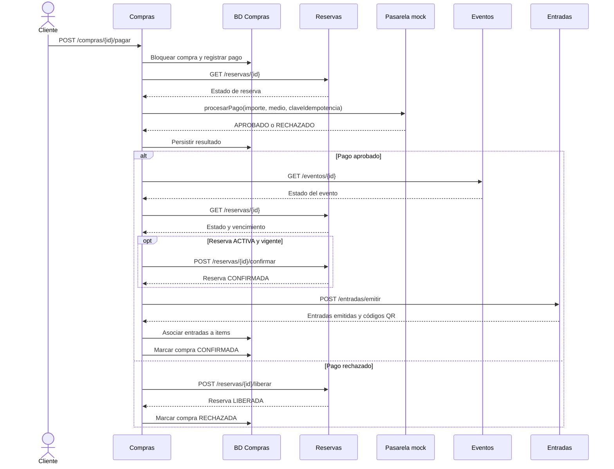
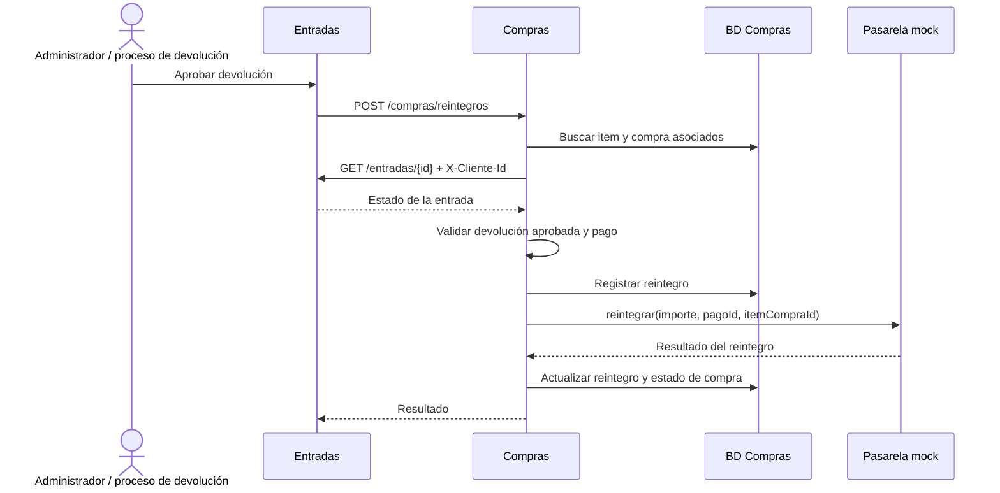
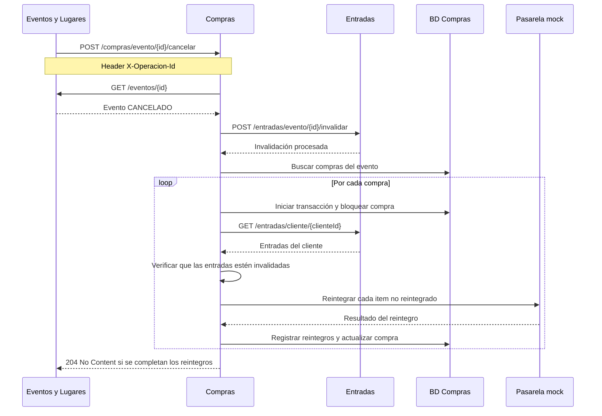

# 02 — Arquitectura y flujos de Compras y Pagos

> **Estado:** arquitectura y flujos contrastados con la implementación actual de `msvc-compras`.

Este documento describe las responsabilidades, integraciones y flujos que se encuentran implementados en el código fuente. Las operaciones entre microservicios se coordinan mediante llamadas REST y no forman parte de una única transacción ACID distribuida.

## Responsabilidad y límites

`msvc-compras` administra el ciclo de vida de las compras, el registro de sus detalles e items, los pagos y los reintegros.

Sus responsabilidades principales son:

- Iniciar compras a partir de reservas temporales existentes.
- Consultar precios de sectores al microservicio Eventos y Lugares y conservar el precio histórico al momento de la compra.
- Registrar compras, detalles e items individuales.
- Procesar pagos mediante una pasarela simulada.
- Evitar cobros duplicados mediante claves de idempotencia y bloqueo de compras.
- Coordinar la confirmación de reservas y la emisión de entradas.
- Procesar reintegros por devoluciones aprobadas y cancelaciones de eventos.
- Gestionar estados intermedios y operaciones de recuperación ante fallas de integración.

`msvc-compras` no administra directamente la disponibilidad de los lugares ni genera los códigos QR. Esas responsabilidades pertenecen a los microservicios Reservas y Entradas, respectivamente.

La pasarela de pago utilizada en esta entrega es `PasarelaPagoMock`, que simula aprobaciones, rechazos y reintegros sin procesar datos financieros reales.

## Diagrama de módulos e integraciones

### Responsabilidades de los componentes

- **msvc-compras:** coordina las operaciones de compra, pago, confirmación y reintegro.
- **msvc-reservas:** administra las reservas temporales, su confirmación y liberación.
- **msvc-eventosylugares:** proporciona información de eventos y precios de sectores, y notifica las cancelaciones.
- **msvc-entradas:** emite entradas, genera sus códigos QR, consulta su estado e invalida entradas.
- **PasarelaPagoMock:** simula el procesamiento de pagos y reintegros.
- **Base de datos de Compras:** almacena compras, detalles, items, pagos y reintegros.

La comunicación con los otros microservicios se realiza mediante clientes Feign configurados en `msvc-compras`.

## Flujo de inicio de compra

El cliente inicia una compra a partir de una reserva temporal previamente creada.

Durante este flujo se verifica que la reserva exista, pertenezca al cliente indicado, esté activa y no haya vencido. También se evita iniciar más de una compra para la misma reserva.

Los precios obtenidos de Eventos y Lugares se conservan como valores históricos en los detalles de compra. De esta manera, una modificación posterior del precio del sector no altera el importe de una compra ya iniciada.

La compra queda inicialmente en estado `PENDIENTE`.

## Flujo de pago, confirmación y emisión de entradas

El cliente solicita el procesamiento del pago mediante `POST /compras/{id}/pagar`.

El servicio registra el resultado del pago y, si es aprobado, intenta completar automáticamente la confirmación de la reserva y la emisión de entradas.

### Confirmación de la compra

La confirmación se implementa en `CompraServiceImpl.confirmarCompra()` y requiere que exista un pago aprobado.

Antes de emitir las entradas se verifica:

- Que el evento exista y esté habilitado para confirmar entradas (`PUBLICADO` o `AGOTADO`).
- Que la reserva corresponda al cliente y al evento de la compra.
- Que la reserva pueda confirmarse y no esté vencida, liberada o cancelada.
- Que existan items de compra para emitir.

Si la reserva está activa y vigente, se solicita su confirmación a `msvc-reservas`.

Luego se envía a `msvc-entradas` una solicitud de emisión que contiene la compra, el cliente, el evento y los items individuales.

La solicitud utiliza una clave de emisión asociada a la compra (`EMISION-COMPRA-{compraId}`), para permitir reintentos sin generar entradas duplicadas.

La compra pasa a `CONFIRMADA` únicamente cuando se reciben todas las entradas esperadas, con identificadores y códigos QR válidos y únicos, y se logra asociar cada entrada con su item correspondiente.

### Estados intermedios y recuperación

El sistema contempla fallas parciales entre el pago, la confirmación de la reserva y la emisión de entradas.

- `CONFIRMACION_PENDIENTE`: el pago fue aprobado, pero la confirmación y emisión todavía no se completaron.
- `COMPENSACION_PENDIENTE`: no fue posible confirmar la reserva o completar el flujo y corresponde recuperar el importe pagado.
- `LIBERACION_PENDIENTE`: el pago fue rechazado, pero todavía no se pudo completar la liberación de la reserva.

La confirmación puede reintentarse mediante `POST /compras/{id}/confirmar`.

Si el evento está cancelado o la reserva ya no puede confirmarse, se inicia el flujo de compensación. El servicio verifica que no existan entradas emitidas antes de procesar los reintegros.

## Flujo de pago rechazado y liberación de reserva

Cuando la pasarela devuelve `RECHAZADO`, la compra pasa a `LIBERACION_PENDIENTE` y se intenta liberar la reserva.

Si Reservas confirma la liberación, la compra pasa a `RECHAZADA`.

Si la comunicación falla, el estado intermedio se conserva para permitir un nuevo intento mediante:

`POST /compras/{id}/reintentar-liberacion`

La operación verifica el estado actual de la reserva para evitar liberarla nuevamente cuando ya se encuentra liberada, vencida o cancelada.

## Flujo de reintegro por devolución de entrada

Cuando una devolución fue aprobada en `msvc-entradas`, Compras puede procesar el reintegro correspondiente.

El reintegro se procesa solamente si la entrada pertenece a una compra, la devolución fue aprobada y existe un pago aprobado.

El importe se obtiene del precio histórico del item de compra, no del precio actual del sector.

Se evita reintegrar dos veces una misma entrada. Cuando se reintegran algunas entradas, pero no todas, la compra puede quedar en estado `REINTEGRO_PARCIAL`. Cuando se reintegran todos sus items, pasa a `REINTEGRADA`.

El historial puede consultarse mediante `GET /compras/{id}/reintegros`.

## Flujo de reintegro por cancelación de evento

Cuando un evento pasa al estado `CANCELADO`, Eventos y Lugares notifica a Compras mediante:

`POST /compras/evento/{eventoId}/cancelar`

La solicitud requiere el encabezado `X-Operacion-Id`.

El servicio verifica que el evento exista y esté cancelado. Antes de reintegrar el dinero solicita a Entradas la invalidación de los tickets y códigos QR.

Luego obtiene las compras asociadas al evento y procesa cada compra en una transacción independiente. De esta manera, una falla en una compra no impide intentar procesar las restantes.

Para cada compra se verifica que sus entradas no puedan seguir utilizándose. Los reintegros se realizan por item, utilizando los precios históricos y evitando duplicaciones.

También se contemplan compras pagadas cuya emisión de entradas quedó pendiente. En esos casos, se verifica que no existan entradas emitidas remotamente antes de realizar la compensación.

Si quedan compras pendientes, la operación informa el error y permite volver a intentar la cancelación para recuperar los reintegros pendientes.

## Consistencia entre servicios

No existe una única transacción ACID que abarque Compras, Reservas, Eventos, Entradas y la pasarela de pago. Cada microservicio administra su propia persistencia y las operaciones distribuidas se coordinan mediante llamadas REST.

Para reducir inconsistencias se implementan los siguientes mecanismos:

- **Transacciones locales:** las operaciones sobre la base de datos de Compras utilizan transacciones propias.
- **Bloqueo de compras:** se utiliza `CompraRepository.bloquearCompra()` para controlar operaciones concurrentes sobre una misma compra.
- **Idempotencia de pagos:** se registra una clave de idempotencia y la información de la solicitud. Los reintentos compatibles recuperan el resultado existente y no generan otro cobro.
- **Idempotencia de emisión:** la solicitud de emisión utiliza una clave asociada a la compra para evitar duplicar entradas ante reintentos.
- **Validación de resultados remotos:** antes de confirmar una compra se comprueba que Entradas haya devuelto todos los tickets esperados.
- **Reintegros por item:** cada reintegro queda asociado a un item de compra, evitando devolver dos veces el mismo importe.
- **Estados intermedios:** se conservan estados pendientes cuando una operación remota no pudo completarse, permitiendo su recuperación posterior.
- **Precio histórico:** el importe a reintegrar se obtiene del precio registrado al iniciar la compra.

El encabezado `X-Operacion-Id` es obligatorio para notificar cancelaciones de eventos. La prevención de reintegros duplicados se realiza por item de compra; el identificador de operación no se registra actualmente como una entidad independiente de idempotencia.

## Seguridad de Entrega 1

La implementación utiliza una pasarela simulada y no requiere almacenar números completos de tarjetas, códigos CVV ni otros datos financieros sensibles.

Los clientes Feign permiten realizar las comunicaciones entre microservicios. La autenticación y autorización mediante JWT, junto con los mecanismos de seguridad adicionales previstos para las siguientes etapas, no forman parte de la implementación documentada en esta entrega.

## Componentes principales implementados

| Componente | Responsabilidad |
|---|---|
| `CompraController` | Inicio, consulta y confirmación de compras |
| `PagoController` | Procesamiento de pagos y reintento de liberación |
| `ReintegroController` | Reintegros individuales, cancelación de eventos, compensación e historial |
| `CompraServiceImpl` | Lógica de negocio de compras y emisión |
| `PagoServiceImpl` | Procesamiento de pagos, idempotencia y liberación de reservas |
| `ReintegroServiceImpl` | Reintegros, cancelaciones y compensaciones |
| `ReservaClient` | Comunicación con Reservas |
| `EventoClient` | Consulta de eventos y precios |
| `EntradaClient` | Emisión, consulta e invalidación de entradas |
| `PasarelaPagoMock` | Simulación de pagos y reintegros |