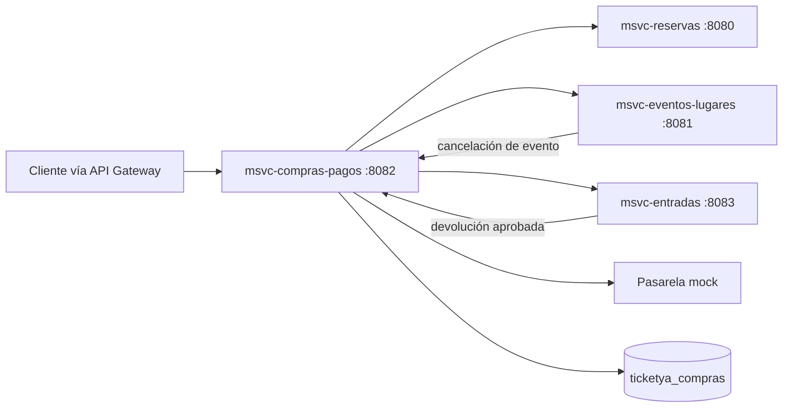
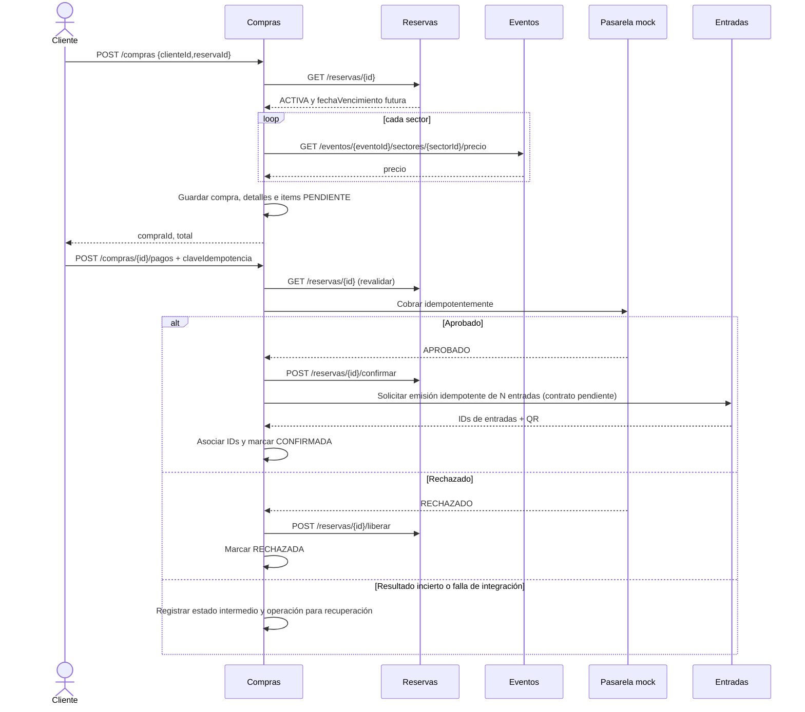

# 02 — Arquitectura y flujos de Compras y Pagos

> Documento de diseño propuesto. Ningún flujo está implementado todavía.

## Responsabilidad y límites

`msvc-compras-pagos` administra compras, instantáneas de precio, intentos de pago y reintegros. **No** controla físicamente los lugares ni genera QR: coordina con Reservas y Entradas. El proveedor de pago de Entrega 1 será un mock detrás de una interfaz, para probar aprobaciones, rechazos e incertidumbre sin datos financieros reales.

## Diagrama de módulos

## Flujo de inicio y pago

## Consistencia entre servicios

- No hay una transacción ACID global entre Compras, Reservas, Entradas y la pasarela.
- Registrar primero un intento de pago **único** y su huella de solicitud. Los reintentos con la misma clave se resuelven sobre ese registro, incluso si hay varios procesos.
- El mock debe aceptar/reconocer una clave de idempotencia; en un timeout NO lanzar un segundo cobro con otra clave sin conciliar el primero.
- Una compra no queda `CONFIRMADA` hasta que la reserva esté confirmada y se hayan asociado todos los IDs de entradas esperados.
- Si falla un paso tras el cobro, persistir `PAGO_APROBADO_PENDIENTE_CONFIRMACION` y gestionar reintento/compensación; no ocultar la falla.
- Rechazos de pago requieren liberar la reserva y manejar reintento de esa comunicación si no responde Reservas.
- Cancelaciones: el aviso de Eventos `POST /compras/evento/{id}/cancelar` usa `X-Operacion-Id`; debe tolerar duplicados y crear reintegros solamente para items no reintegrados.
- Un precio se captura al iniciar compra y no se vuelve a calcular desde Eventos al devolver dinero.

## Seguridad de Entrega 1

No hay JWT aún. Los endpoints de operaciones internas deben exponerse exclusivamente entre servicios mediante Gateway/red. No almacenar PAN, CVV ni números completos de tarjeta.
