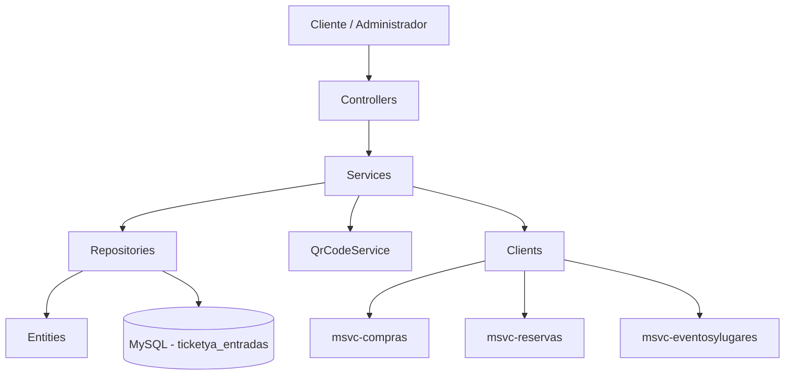
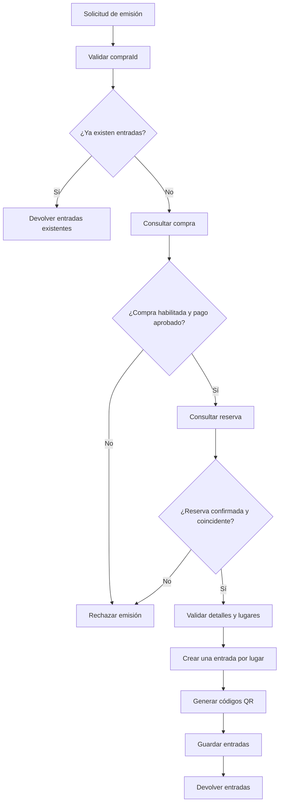
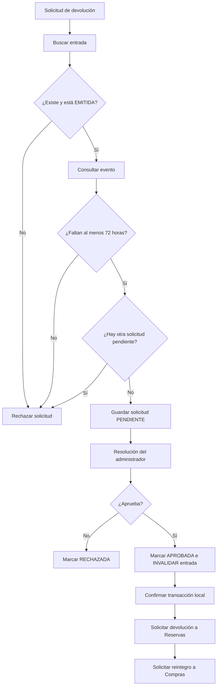

# 02 — Arquitectura y diagramas de Entradas

## 1. Descripción de la arquitectura

El microservicio `msvc-entradas` forma parte de la arquitectura de TicketYa y es responsable de la emisión, consulta, devolución e invalidación de entradas.

Su implementación se organiza en los siguientes componentes:

- **Controllers:** reciben las solicitudes HTTP y exponen los endpoints REST.
- **Services:** implementan las reglas de negocio relacionadas con entradas y devoluciones.
- **Repositories:** permiten acceder y persistir información mediante Spring Data JPA.
- **Entities:** representan las entidades persistentes del microservicio.
- **DTOs:** transfieren información entre las distintas capas y microservicios.
- **Clients:** permiten la comunicación HTTP con otros microservicios.
- **QR Service:** genera las imágenes de los códigos QR.
- **OpenAPI / Swagger:** proporciona la documentación de los endpoints REST.

## 2. Organización del proyecto

El código fuente se organiza en los siguientes paquetes:

| Paquete | Responsabilidad |
|---|---|
| `controllers` | Exposición de endpoints REST. |
| `services` | Interfaces de los servicios. |
| `services.impl` | Implementaciones como `EntradaServiceImpl` y `QrCodeServiceImpl`. |
| `repositories` | Acceso a la base de datos. |
| `entities` | Entidades persistentes `Entrada` y `SolicitudDevolucion`. |
| `dtos` | Objetos de transferencia de información. |
| `clients` | Comunicación con microservicios externos. |

La clase principal es `EntradasApplication`, que inicia Spring Boot y habilita los clientes OpenFeign mediante `@EnableFeignClients`.

## 3. Arquitectura general

Las solicitudes HTTP son recibidas por los controladores, que delegan las operaciones en los servicios correspondientes.

Los servicios ejecutan las validaciones y reglas de negocio, acceden a los repositorios para consultar o modificar información persistente y utilizan clientes HTTP para comunicarse con otros microservicios.

Las entidades se almacenan en una base de datos MySQL propia de Entradas.

### Diagrama de componentes

## 4. Comunicación con otros microservicios

El microservicio utiliza dos mecanismos de comunicación HTTP:

- **RestClient:** consulta información de compras y reservas.
- **OpenFeign:** consulta eventos y ejecuta determinadas operaciones sobre compras y reservas.

Los clientes utilizan las URLs configuradas en `application.properties`.

### 4.1. Comunicación con Compras

Se utilizan dos clientes.

**CompraClient (RestClient)**

Permite consultar el estado de confirmación de una compra:

`GET /compras/{id}/confirmacion`

La respuesta permite verificar que la compra tenga un pago aprobado y se encuentre habilitada para emitir entradas.

**CompraFeignClient (OpenFeign)**

Permite solicitar el reintegro correspondiente a una devolución aprobada:

`POST /compras/reintegros`

La solicitud utiliza `DevolucionRequestDTO`, que contiene el identificador de la entrada y el motivo de devolución.

### 4.2. Comunicación con Reservas

Se utilizan dos clientes.

**ReservaClient (RestClient)**

Permite consultar una reserva:

`GET /reservas/{id}`

La información recibida permite verificar que la reserva esté confirmada y que corresponda a la compra.

**ReservaFeignClient (OpenFeign)**

Expone las siguientes operaciones:

- `POST /reservas/{id}/liberar`: solicita liberar una reserva.
- `POST /reservas/{id}/devolver-entrada`: solicita devolver un lugar específico de una reserva.

La devolución individual utiliza `DevolverEntradaDTO`, con el identificador de la entrada, el sector y el asiento.

### 4.3. Comunicación con Eventos y Lugares

Se utiliza `EventoFeignClient` mediante OpenFeign.

**Endpoint consultado:**

`GET /eventos/{id}`

La respuesta incluye el identificador, la fecha y hora y el estado del evento.

Esta información se utiliza para:

- Verificar que un evento se encuentre cancelado antes de invalidar sus entradas.
- Comprobar que falten al menos 72 horas para el evento cuando se solicita una devolución.

## 5. Flujos principales de funcionamiento

### 5.1. Flujo de emisión de entradas

1. El sistema solicita la emisión de entradas para una compra.
2. `EntradaController` recibe la solicitud y delega la operación en `EntradaService`.
3. `EntradaServiceImpl` verifica si ya existen entradas emitidas para esa compra.
4. Si existen, devuelve las entradas registradas para evitar duplicaciones.
5. Si no existen, consulta el estado de la compra mediante `CompraClient`.
6. Verifica que el pago esté aprobado y que la compra se encuentre habilitada para emitir.
7. Consulta la reserva asociada mediante `ReservaClient`.
8. Verifica que la reserva esté confirmada y que sus datos correspondan a la compra.
9. Recorre los detalles de la reserva y genera una entrada por cada lugar adquirido.
10. Genera un código QR único para cada entrada.
11. Persiste las entradas mediante `EntradaRepository`.
12. Devuelve las entradas con sus respectivos códigos QR.

### Diagrama del flujo de emisión

### 5.2. Flujo de solicitud y resolución de devoluciones

**Solicitud de devolución**

1. El cliente envía el identificador de la entrada y el motivo de devolución.
2. `DevolucionController` recibe la solicitud.
3. `DevolucionServiceImpl` busca la entrada correspondiente.
4. Verifica que se encuentre en estado `EMITIDA`.
5. Consulta los datos del evento mediante `EventoFeignClient`.
6. Comprueba que falten al menos 72 horas para el inicio del evento.
7. Verifica que no exista otra solicitud pendiente para esa entrada.
8. Registra la solicitud con estado `PENDIENTE`.

**Aprobación de devolución**

1. El administrador solicita aprobar una devolución.
2. Se obtiene la solicitud correspondiente.
3. Se verifica que esté pendiente o previamente aprobada, permitiendo reintentar las comunicaciones externas.
4. Cuando la solicitud está pendiente, cambia a `APROBADA`, se registra el administrador y la fecha de resolución y se invalida la entrada.
5. Se confirma la transacción local.
6. Se consulta la solicitud y su entrada asociada.
7. Se solicita a Reservas la devolución del lugar.
8. Se solicita a Compras el reintegro correspondiente.

**Rechazo de devolución**

1. El administrador solicita rechazar una devolución.
2. Se verifica que la solicitud se encuentre en estado `PENDIENTE`.
3. La solicitud cambia a `RECHAZADA`.
4. Se registra el administrador y la fecha de resolución.
5. La entrada conserva su estado `EMITIDA`.

### Diagrama del flujo de devolución

## 6. Persistencia de datos

El microservicio utiliza **MySQL** como sistema de gestión de base de datos.

**Base de datos:** `ticketya_entradas`

Las entidades persistentes son:

- `Entrada`: almacena las entradas emitidas.
- `SolicitudDevolucion`: almacena las solicitudes de devolución.

El acceso a los datos se realiza mediante Spring Data JPA y los repositorios:

- `EntradaRepository`
- `SolicitudDevolucionRepository`

La configuración utiliza `spring.jpa.hibernate.ddl-auto=update`, por lo que Hibernate actualiza el esquema de la base de datos según las entidades definidas.

## 7. Configuración del microservicio

La configuración principal se encuentra en `application.properties`.

| Propiedad | Valor o configuración | Descripción |
|---|---|---|
| `spring.application.name` | `msvc-entradas` | Nombre de la aplicación. |
| `server.port` | `8083` | Puerto del microservicio. |
| Base de datos | `ticketya_entradas` | Base de datos MySQL propia. |
| `msvc.reservas.url` | `http://localhost:8080` | URL de Reservas. |
| `msvc.compras.url` | `http://localhost:8082` | URL de Compras. |
| `msvc.eventos.url` | `http://localhost:8081` | URL de Eventos y Lugares. |

Las credenciales de MySQL se obtienen mediante las variables de entorno `DB_USERNAME` y `DB_PASSWORD`, con valores predeterminados configurados para el entorno local.

## 8. Documentación de la API REST

El microservicio utiliza **Springdoc OpenAPI** para generar la documentación de los endpoints REST.

La documentación se complementa con las siguientes anotaciones:

- `@Tag`: agrupa los endpoints por controlador.
- `@Operation`: describe las operaciones REST.
- `@ApiResponse`: documenta las respuestas HTTP.
- `@Schema`: describe los DTO y sus atributos.

### 8.1. Acceso a la documentación

| Recurso | Dirección |
|---|---|
| Swagger UI directo | `http://localhost:8083/swagger-ui.html` |
| OpenAPI JSON directo | `http://localhost:8083/v3/api-docs` |
| OpenAPI JSON mediante Gateway | `http://localhost:8084/entradas/v3/api-docs` |

Swagger UI permite consultar las operaciones disponibles, sus parámetros, los DTO utilizados y las posibles respuestas.

El Gateway expone el documento OpenAPI del microservicio mediante una ruta que dirige las solicitudes hacia `/v3/api-docs` del servicio original.

## 9. Consideraciones arquitectónicas

- Cada microservicio administra su propia información y base de datos.
- `msvc-entradas` no almacena las entidades de Compras, Reservas ni Eventos; utiliza DTO para intercambiar la información necesaria.
- La comunicación entre microservicios se realiza mediante HTTP.
- Las operaciones locales sobre la base de datos utilizan transacciones de Spring.
- Las llamadas a otros microservicios no forman parte de una única transacción distribuida.
- La emisión de entradas evita duplicaciones comprobando si ya existen entradas asociadas a la compra.
- La aprobación de devoluciones permite reintentar las comunicaciones externas cuando la solicitud ya fue aprobada.
- Ante la cancelación de un evento, Entradas invalida las entradas correspondientes. La coordinación general de la cancelación se realiza desde Eventos y Lugares, con operaciones sobre Reservas, Entradas y Compras para gestionar la liberación de lugares, la invalidación de entradas y los reintegros.
- La documentación de la API REST se genera mediante Springdoc OpenAPI y puede consultarse directamente o a través del Gateway.