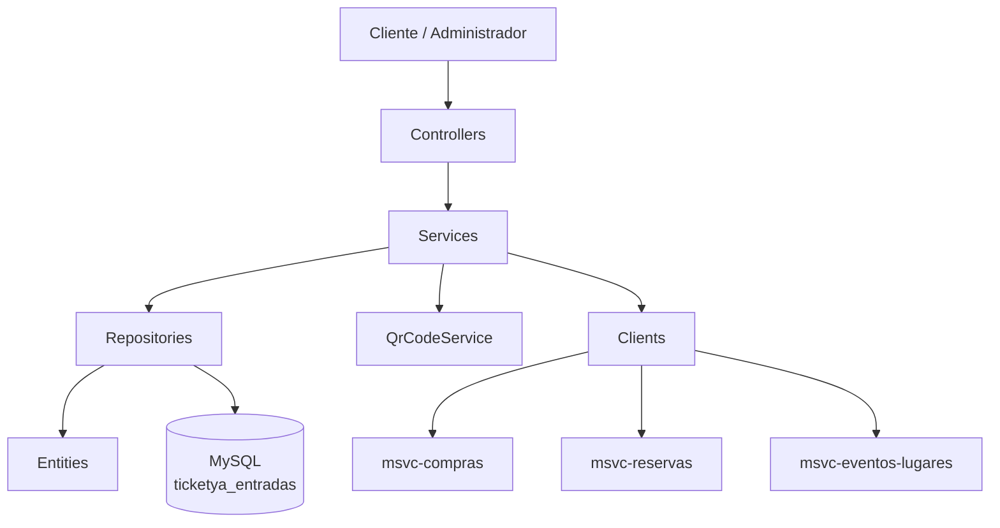
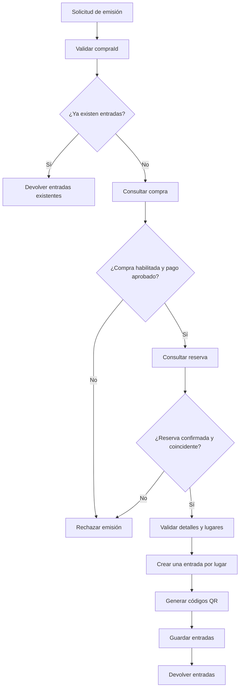
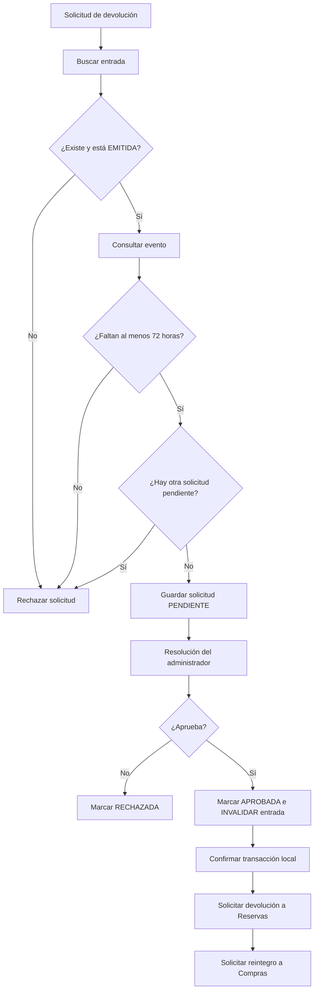

# 02 - Arquitectura y Diagramas

## 1. Descripción de la arquitectura

El microservicio **msvc-entradas** forma parte de la arquitectura de microservicios de TicketYa.

Está desarrollado con **Spring Boot** y utiliza una arquitectura por capas para separar las responsabilidades de recepción de solicitudes, lógica de negocio, acceso a datos y comunicación con otros microservicios.

Sus principales componentes son:

- **Controllers:** reciben las solicitudes HTTP y exponen los endpoints REST.
- **Services:** implementan la lógica de negocio relacionada con entradas y devoluciones.
- **Repositories:** permiten acceder y persistir información en la base de datos mediante Spring Data JPA.
- **Entities:** representan las entidades que se almacenan en la base de datos.
- **DTOs:** permiten transferir información entre las distintas capas y microservicios.
- **Clients:** permiten comunicarse con otros microservicios mediante HTTP.
- **QR Service:** genera las imágenes de los códigos QR de las entradas.
- **OpenAPI / Swagger:** permite generar y visualizar automáticamente la documentación de los endpoints REST del microservicio.

## 2. Organización del proyecto

El código fuente se organiza en los siguientes paquetes:

| Paquete | Responsabilidad |
|---|---|
| `controllers` | Exposición de endpoints REST. |
| `services` | Interfaces y lógica de negocio. |
| `services.impl` | Implementaciones de los servicios, como `EntradaServiceImpl` y `QrCodeServiceImpl`. |
| `repositories` | Acceso a la base de datos. |
| `entities` | Entidades persistentes `Entrada` y `SolicitudDevolucion`. |
| `dtos` | Objetos utilizados para transferir información. |
| `clients` | Comunicación con los microservicios externos. |

La clase principal de la aplicación es `EntradasApplication`, que inicia Spring Boot y habilita los clientes OpenFeign mediante `@EnableFeignClients`.

## 3. Arquitectura general

El microservicio recibe solicitudes HTTP a través de sus controladores. Los controladores delegan las operaciones en los servicios, que ejecutan las validaciones y reglas de negocio.

Cuando necesitan consultar o modificar información, los servicios utilizan los repositorios o los clientes de comunicación con otros microservicios.

Las entidades se almacenan en una base de datos MySQL propia del microservicio.

### Diagrama de componentes

## 4. Comunicación con otros microservicios

El microservicio utiliza dos mecanismos para realizar llamadas HTTP:

- **RestClient:** utilizado para consultar información de compras y reservas.
- **OpenFeign:** utilizado para consultar eventos y ejecutar determinadas operaciones sobre compras y reservas.

Los clientes se configuran mediante las URLs definidas en `application.properties`.

### 4.1. Comunicación con msvc-compras

Se utilizan dos clientes:

**CompraClient (RestClient)**

Permite consultar la confirmación de una compra mediante:

`GET /compras/{id}/confirmacion`

La información recibida se utiliza para verificar que la compra tenga un pago aprobado y se encuentre habilitada para emitir entradas.

**CompraFeignClient (OpenFeign)**

Permite solicitar el reintegro de una entrada mediante:

`POST /compras/reintegros`

Recibe un `DevolucionRequestDTO` con el identificador de la entrada y el motivo de devolución.

### 4.2. Comunicación con msvc-reservas

Se utilizan dos clientes:

**ReservaClient (RestClient)**

Permite consultar una reserva mediante:

`GET /reservas/{id}`

La información recibida se utiliza para verificar que la reserva esté confirmada y corresponda a la compra.

**ReservaFeignClient (OpenFeign)**

Expone las siguientes operaciones:

- `POST /reservas/{id}/liberar`: solicita liberar una reserva.
- `POST /reservas/{id}/devolver-entrada`: solicita devolver un lugar específico de una reserva.

La operación de devolución de una entrada recibe un `DevolverEntradaDTO` con el identificador de la entrada, el sector y el asiento.

### 4.3. Comunicación con msvc-eventos-lugares

Se utiliza `EventoFeignClient` mediante OpenFeign.

Permite consultar un evento mediante:

`GET /eventos/{id}`

La información obtenida incluye su identificador, fecha y hora y estado.

Se utiliza principalmente para:

- Verificar que un evento esté cancelado antes de invalidar sus entradas.
- Obtener la fecha del evento para comprobar el plazo mínimo de 72 horas en las solicitudes de devolución.

## 5. Flujos principales de funcionamiento

### 5.1. Flujo de emisión de entradas

1. El cliente o sistema solicita la emisión enviando el identificador de una compra.
2. `EntradaController` recibe la solicitud y delega la operación en `EntradaService`.
3. `EntradaServiceImpl` verifica si ya existen entradas para esa compra.
4. Si existen, devuelve las entradas anteriores para evitar duplicaciones.
5. Si no existen, consulta el estado de la compra mediante `CompraClient`.
6. Verifica que el pago esté aprobado y que la compra esté habilitada para emitir.
7. Consulta la reserva asociada mediante `ReservaClient`.
8. Verifica que la reserva esté confirmada y que sus datos coincidan con la compra.
9. Recorre los detalles de la reserva y genera una entrada por cada lugar adquirido.
10. Genera un código QR único para cada entrada.
11. Guarda las entradas mediante `EntradaRepository`.
12. Devuelve las entradas con sus respectivos códigos QR.

### Diagrama del flujo de emisión

### 5.2. Flujo de solicitud y aprobación de devolución

**Solicitud:**

1. El cliente envía una solicitud con el identificador de la entrada y el motivo.
2. `DevolucionController` recibe la solicitud.
3. `DevolucionServiceImpl` busca la entrada.
4. Verifica que esté en estado `EMITIDA`.
5. Consulta el evento mediante `EventoFeignClient`.
6. Comprueba que falten al menos 72 horas para el evento.
7. Verifica que no exista otra solicitud pendiente para esa entrada.
8. Guarda la solicitud con estado `PENDIENTE`.

**Aprobación:**

1. El administrador solicita aprobar una devolución.
2. Se busca la solicitud correspondiente.
3. Se verifica que esté pendiente o que ya esté aprobada para permitir reintentar las comunicaciones externas.
4. Si está pendiente, se cambia a `APROBADA`, se registra el administrador y la fecha de resolución, y se invalida la entrada.
5. Se confirma la transacción local.
6. Se consulta nuevamente la solicitud y su entrada.
7. Se solicita a Reservas la devolución del lugar.
8. Se solicita a Compras el reintegro correspondiente.

**Rechazo:**

1. El administrador solicita rechazar una devolución.
2. Se verifica que la solicitud esté pendiente.
3. Se cambia su estado a `RECHAZADA`.
4. Se registra el administrador y la fecha de resolución.
5. La entrada conserva su estado `EMITIDA`.

### Diagrama del flujo de devolución

## 6. Persistencia de datos

El microservicio utiliza **MySQL** como sistema de gestión de base de datos.

La base de datos configurada es:

`ticketya_entradas`

Las entidades persistentes son:

- `Entrada`: almacena las entradas emitidas.
- `SolicitudDevolucion`: almacena las solicitudes de devolución asociadas a las entradas.

El acceso a los datos se realiza mediante Spring Data JPA y los repositorios:

- `EntradaRepository`
- `SolicitudDevolucionRepository`

La configuración actual utiliza `spring.jpa.hibernate.ddl-auto=update`, por lo que Hibernate actualiza el esquema de la base de datos según las entidades.

## 7. Configuración del microservicio

La configuración principal se encuentra en `application.properties`.

| Propiedad | Valor o configuración | Descripción |
|---|---|---|
| `spring.application.name` | `msvc-entradas` | Nombre de la aplicación. |
| `server.port` | `8083` | Puerto en el que se ejecuta el microservicio. |
| Base de datos | `ticketya_entradas` | Base de datos MySQL propia. |
| `msvc.reservas.url` | `http://localhost:8080` | URL del microservicio Reservas. |
| `msvc.compras.url` | `http://localhost:8082` | URL del microservicio Compras. |
| `msvc.eventos.url` | `http://localhost:8081` | URL del microservicio Eventos y Lugares. |

Las credenciales de MySQL se obtienen mediante las variables de entorno `DB_USERNAME` y `DB_PASSWORD`, con valores predeterminados configurados para el entorno local.

## 8. Documentación de la API REST

El microservicio utiliza **Springdoc OpenAPI** para generar automáticamente la documentación de sus endpoints REST.

La documentación se complementa con anotaciones de OpenAPI que permiten describir las operaciones, sus respuestas y los DTOs utilizados.

Se utilizan las siguientes anotaciones:

- `@Tag`: agrupa los endpoints por controlador.
- `@Operation`: describe cada operación REST.
- `@ApiResponse`: documenta las posibles respuestas HTTP.
- `@Schema`: describe los DTOs y sus atributos.

### 8.1. Acceso a la documentación

La documentación puede consultarse de dos maneras:

| Recurso | Dirección |
|---|---|
| Swagger UI directo | `http://localhost:8083/swagger-ui.html` |
| OpenAPI JSON directo | `http://localhost:8083/v3/api-docs` |
| OpenAPI JSON mediante Gateway | `http://localhost:8084/entradas/v3/api-docs` |

Swagger UI permite visualizar los endpoints y consultar sus parámetros, DTOs y respuestas.

El Gateway expone el documento OpenAPI del microservicio mediante una ruta específica, redirigiendo las solicitudes hacia `/v3/api-docs` del servicio original.

### 8.2. Objetivo

La documentación facilita la comprensión y consulta de los contratos REST, permitiendo identificar las operaciones disponibles y los datos necesarios para interactuar con el microservicio.

## 9. Consideraciones arquitectónicas

- Cada microservicio administra su propia información y base de datos.
- `msvc-entradas` no almacena entidades de Compras, Reservas ni Eventos: utiliza DTOs para recibir la información necesaria.
- La comunicación entre microservicios se realiza mediante HTTP.
- Las operaciones locales sobre la base de datos utilizan transacciones de Spring.
- Las llamadas a otros microservicios no forman parte de una transacción distribuida.
- La emisión de entradas evita duplicaciones al comprobar si ya existen entradas asociadas a la compra.
- La aprobación de devoluciones permite reintentar las comunicaciones externas cuando la solicitud ya fue aprobada.
- La invalidación por cancelación de eventos modifica las entradas localmente, pero no coordina actualmente la liberación de reservas ni los reintegros.
- La documentación de los endpoints REST se genera mediante Springdoc OpenAPI y puede consultarse directamente o a través del Gateway.
