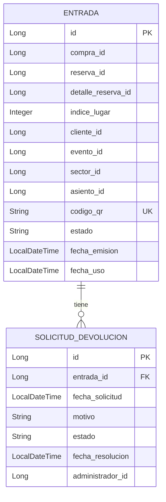

# 03 — Modelo de datos de Entradas

## 1. Descripción general

El microservicio `msvc-entradas` utiliza una base de datos MySQL propia, denominada `ticketya_entradas`.

El modelo de datos está compuesto por dos entidades principales:

- `Entrada`: representa una entrada emitida para un evento.
- `SolicitudDevolucion`: representa una solicitud de devolución asociada a una entrada.

La persistencia se implementa mediante JPA y Spring Data JPA.

## 2. Entidad Entrada

La entidad `Entrada` representa cada uno de los lugares adquiridos por un cliente para asistir a un evento.

Se encuentra asociada a una compra, una reserva y un detalle específico de esa reserva.

### 2.1. Atributos

| Atributo Java | Columna en la base de datos | Tipo | Restricciones |
|---|---|---|---|
| `id` | `id` | Long | Clave primaria autogenerada. |
| `compraId` | `compra_id` | Long | Obligatorio. |
| `reservaId` | `reserva_id` | Long | Obligatorio. |
| `detalleReservaId` | `detalle_reserva_id` | Long | Obligatorio. |
| `indiceLugar` | `indice_lugar` | Integer | Obligatorio. |
| `clienteId` | `cliente_id` | Long | Obligatorio. |
| `eventoId` | `evento_id` | Long | Obligatorio. |
| `sectorId` | `sector_id` | Long | Obligatorio. |
| `asientoId` | `asiento_id` | Long | Opcional. |
| `codigoQr` | `codigo_qr` | String | Obligatorio, único y longitud máxima de 64 caracteres. |
| `estado` | `estado` | String | Obligatorio, longitud máxima de 32 caracteres. |
| `fechaEmision` | `fecha_emision` | LocalDateTime | Obligatorio. |
| `fechaUso` | `fecha_uso` | LocalDateTime | Opcional. |

### 2.2. Descripción de los atributos

- **id:** identificador único de la entrada.
- **compraId:** identifica la compra que originó la entrada.
- **reservaId:** identifica la reserva asociada.
- **detalleReservaId:** identifica el detalle de reserva al que pertenece el lugar.
- **indiceLugar:** indica la posición del lugar dentro del detalle de reserva.
- **clienteId:** identifica al cliente titular de la entrada.
- **eventoId:** identifica el evento al que corresponde.
- **sectorId:** identifica el sector del evento.
- **asientoId:** identifica el asiento cuando el sector es numerado. Puede ser nulo cuando el sector no tiene asientos numerados.
- **codigoQr:** código único utilizado para generar la imagen QR.
- **estado:** indica el estado actual de la entrada.
- **fechaEmision:** fecha y hora en que se emitió la entrada.
- **fechaUso:** campo destinado a registrar la fecha y hora de uso de la entrada.

### 2.3. Restricciones e índices

**Restricción de unicidad del lugar**

Se define una restricción única denominada `uk_entrada_lugar_reservado` sobre las columnas:

- `reserva_id`
- `detalle_reserva_id`
- `indice_lugar`

Esto evita que se registren dos entradas para la misma posición dentro de un mismo detalle de reserva.

**Código QR único**

El atributo `codigoQr` tiene una restricción de unicidad, por lo que no pueden existir dos entradas con el mismo código.

**Índices**

Se definen dos índices para mejorar las consultas:

- `idx_entrada_compra`: sobre `compra_id`.
- `idx_entrada_cliente`: sobre `cliente_id`.

Estos índices permiten optimizar las búsquedas de entradas por compra y por cliente.

## 3. Entidad SolicitudDevolucion

La entidad `SolicitudDevolucion` representa una solicitud de devolución realizada sobre una entrada.

Se almacena en la tabla `solicitud_devolucion`.

### 3.1. Atributos

| Atributo Java | Columna en la base de datos | Tipo | Restricciones |
|---|---|---|---|
| `id` | `id` | Long | Clave primaria autogenerada. |
| `entrada` | `entrada_id` | Entrada | Relación obligatoria con Entrada. |
| `fechaSolicitud` | `fecha_solicitud` | LocalDateTime | Obligatorio. |
| `motivo` | `motivo` | String | Opcional. |
| `estado` | `estado` | String | Obligatorio. |
| `fechaResolucion` | `fecha_resolucion` | LocalDateTime | Opcional. |
| `administradorId` | `administrador_id` | Long | Opcional. |

### 3.2. Descripción de los atributos

- **id:** identificador único de la solicitud.
- **entrada:** entrada sobre la que se realiza la solicitud de devolución.
- **fechaSolicitud:** fecha y hora en que se registró la solicitud.
- **motivo:** descripción del motivo de devolución.
- **estado:** estado actual de la solicitud.
- **fechaResolucion:** fecha y hora en que fue aprobada o rechazada.
- **administradorId:** identificador del administrador que resolvió la solicitud.

### 3.3. Relación con Entrada

La solicitud de devolución tiene una relación `ManyToOne` con la entidad `Entrada`.

Cada solicitud está asociada obligatoriamente a una entrada, mientras que una entrada puede estar relacionada con varias solicitudes a lo largo del tiempo.

La relación se implementa mediante la columna `entrada_id`, definida como obligatoria.

No se define una restricción única sobre `entrada_id`, por lo que la base de datos permite almacenar más de una solicitud para una misma entrada. La lógica del servicio impide que existan dos solicitudes pendientes simultáneamente para la misma entrada.

## 4. Relaciones entre las entidades

Las dos entidades persistentes del microservicio se relacionan de la siguiente manera:

- Una `Entrada` puede estar asociada a varias `SolicitudDevolucion`.
- Cada `SolicitudDevolucion` debe estar asociada a una única `Entrada`.

Las relaciones con Compras, Reservas, Clientes, Eventos y Sectores se representan mediante identificadores (`Long`) y no mediante relaciones JPA entre entidades, debido a que esos datos pertenecen a otros microservicios.

## 5. Diagrama del modelo de datos

## 6. Repositorios

El acceso a las entidades se realiza mediante interfaces que extienden `JpaRepository`.

### 6.1. EntradaRepository

Permite realizar operaciones de persistencia y búsqueda sobre las entradas.

**Métodos personalizados:**

| Método | Función |
|---|---|
| `findByCompraIdOrderByIdAsc(Long compraId)` | Busca las entradas de una compra, ordenadas por identificador ascendente. |
| `findByClienteIdOrderByFechaEmisionDescIdDesc(Long clienteId)` | Busca las entradas de un cliente, ordenadas desde las más recientes. |
| `findByClienteId(Long clienteId)` | Busca las entradas de un cliente. |
| `findByEventoId(Long eventoId)` | Busca las entradas de un evento. |
| `findByEventoIdAndEstado(Long eventoId, String estado)` | Busca las entradas de un evento que tienen un estado determinado. |

Además, hereda las operaciones habituales de `JpaRepository`, como buscar por ID, guardar, eliminar y listar registros.

### 6.2. SolicitudDevolucionRepository

Permite realizar operaciones de persistencia y búsqueda sobre las solicitudes de devolución.

**Métodos personalizados:**

| Método | Función |
|---|---|
| `findByEstado(String estado)` | Busca las solicitudes que tienen un estado determinado. |
| `findByEntrada_IdAndEstado(Long entradaId, String estado)` | Busca una solicitud asociada a una entrada específica y con un estado determinado. Devuelve un `Optional<SolicitudDevolucion>`, ya que puede existir o no una solicitud que cumpla las condiciones. |

El segundo método permite consultar si una entrada tiene una solicitud pendiente. La lógica del servicio evita que existan dos solicitudes pendientes simultáneamente para la misma entrada.

## 7. Consideraciones del modelo

- Cada entrada representa un lugar adquirido dentro de una reserva.
- Los sectores no numerados pueden tener `asientoId` nulo.
- El código QR se almacena como texto único; la imagen se genera cuando se construye el DTO de respuesta.
- Las solicitudes de devolución conservan su historial mediante su estado, fecha de resolución y administrador.
- Los identificadores de entidades pertenecientes a otros microservicios se almacenan como valores simples, sin relaciones JPA.
- La prevención de solicitudes de devolución pendientes duplicadas se realiza mediante lógica de negocio y no mediante una restricción única en la base de datos.