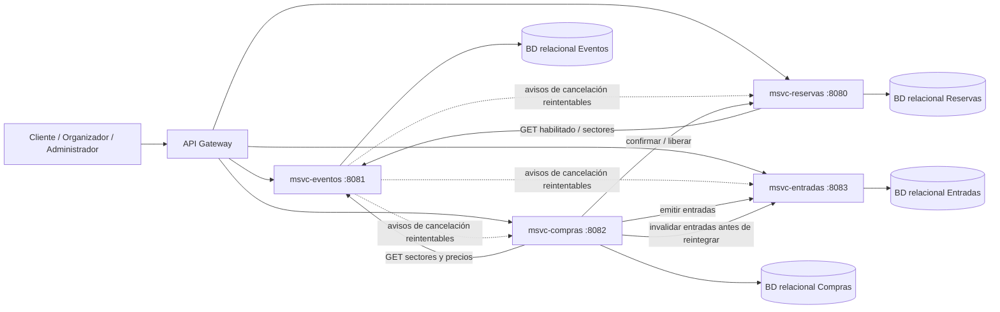
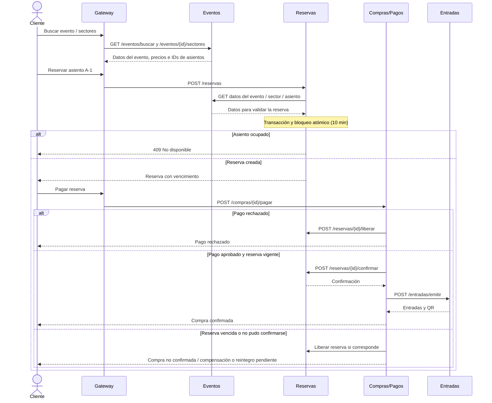
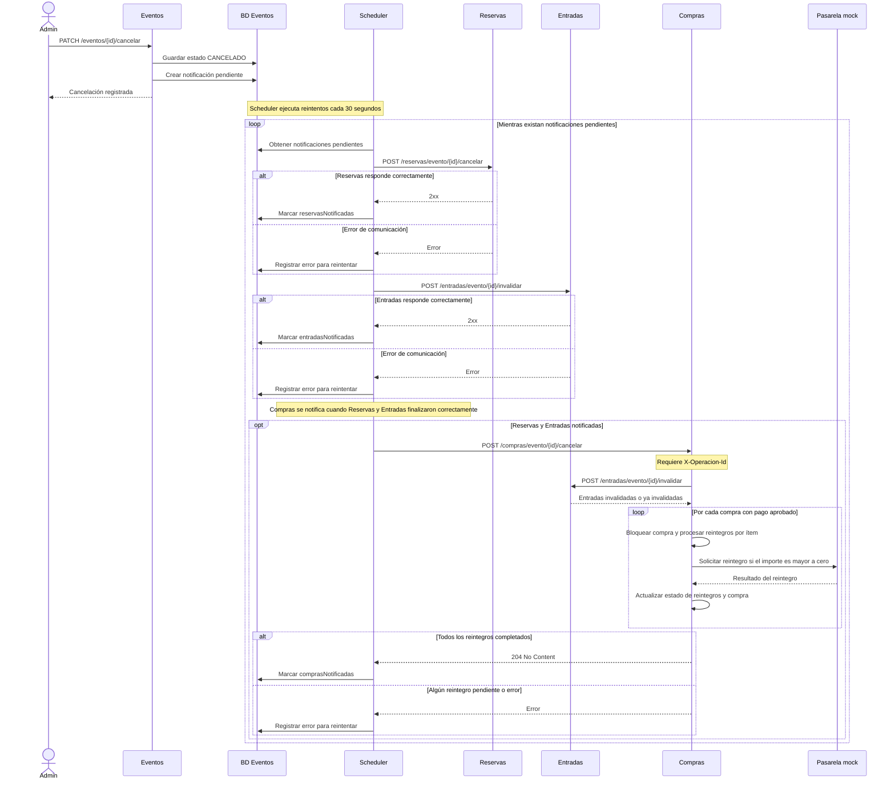

# Arquitectura de microservicios — Entrega 1

## 1. Diagrama de módulos (Mermaid)

**Puertos:** según la configuración predeterminada actual, Eventos utiliza `8081`, Reservas `8080`, Compras `8082` y Entradas `8083`. Pueden modificarse mediante variables de entorno.

**Datos compartidos:** los microservicios intercambian identificadores y DTOs mediante HTTP/Feign. No existe acceso cruzado a las bases de datos.

## 2. Diagrama de secuencia — compra numerada

Este diagrama representa el flujo de compra del grupo. No implica que todas las operaciones estén implementadas dentro del microservicio Eventos.

La prueba que demuestra la **no doble venta** requiere el servicio Reservas funcionando con bloqueo y actualización atómica en la base de datos. Eventos consulta el estado y los datos del evento, sector y asiento.

## 3. Secuencia — cancelación de evento

La cancelación se registra primero en la base de datos de Eventos. Las notificaciones a los demás microservicios se realizan posteriormente mediante un proceso programado que reintenta las operaciones pendientes.

### Comportamiento real de la cancelación

- **Eventos:** cambia el estado del evento a `CANCELADO` y registra una notificación pendiente dentro de su propia transacción. La respuesta al administrador no espera a que terminen las notificaciones externas.
- **Scheduler:** se ejecuta con un intervalo de 30 segundos (`fixedDelay`). Conserva el estado de notificación de cada servicio, registra errores y vuelve a intentar las operaciones que siguen pendientes.
- **Reservas:** recibe `POST /reservas/evento/{id}/cancelar` para cancelar las reservas del evento e impedir nuevas operaciones sobre ellas.
- **Entradas:** recibe `POST /entradas/evento/{id}/invalidar`. Las entradas emitidas pasan a `INVALIDADA`, dejando de ser utilizables.
- **Compras:** recibe `POST /compras/evento/{id}/cancelar`. Antes de procesar los reintegros vuelve a solicitar la invalidación de las entradas y verifica que estén `INVALIDADA` o `DEVUELTA`.

### Estados de las compras y reintegros

Compras procesa individualmente cada compra que tenga un pago aprobado. Para cada ítem utiliza el precio histórico registrado en la compra.

- Si todos los ítems tienen reintegros aprobados, la compra pasa a `REINTEGRADA`.
- Si algunos ítems fueron reintegrados y otros no, pasa a `REINTEGRO_PARCIAL`.
- Si no se aprobó ningún reintegro, el método no asigna un nuevo estado a la compra.
- Los ítems gratuitos se marcan como reintegrados sin invocar la pasarela.
- Si un ítem ya tiene un reintegro aprobado, no se procesa nuevamente.

Las compras sin pago aprobado no requieren una devolución de dinero. Si alguna compra no puede completar sus reintegros, Compras informa el error y la notificación permanece pendiente para un nuevo intento.

### Identificador de operación

Eventos envía el encabezado `X-Operacion-Id` con un identificador estable para la cancelación.

- Reservas recibe el encabezado, pero su implementación lo utiliza como dato informativo.
- Entradas recibe el encabezado desde Feign, aunque su endpoint no lo procesa.
- Compras exige el encabezado y lo valida. La protección contra reintegros duplicados se apoya en el registro de reintegros por ítem y en la verificación de los ya aprobados.

**Importante:** un `2xx` de una notificación indica que el servicio receptor completó su operación HTTP. En el caso de Compras, el `204` se devuelve cuando el procesamiento del evento no deja compras con reintegros pendientes. La cancelación no constituye una transacción distribuida única entre las bases de datos.

No se implementa una saga distribuida completa ni notificación por correo en esta entrega.

## 4. Estructura de código

- `controller`: endpoints HTTP y DTO Request/Response.
- `service`: servicios de negocio (Lugar, Sector, Asiento, Evento, Organizador, Participante).
- `repository`: interfaces `JpaRepository` para las entidades persistidas; Evento incluye `JpaSpecificationExecutor`.
- `model`: entidades locales, enums, `PrecioSector` y `EventoParticipante` para relaciones N:M.
- `integration`: clientes Feign y gestión de notificaciones reintentables de cancelación (outbox básico).
- `exception` y `config`: reglas de error, reloj, REST y Swagger.

**Datos compartidos:** `eventoId`, `sectorId`, `asientoId`, `reservaId`, `compraId` y `clienteId` viajan en DTOs de integración como identificadores. No se definen claves foráneas entre bases de datos de distintos microservicios.