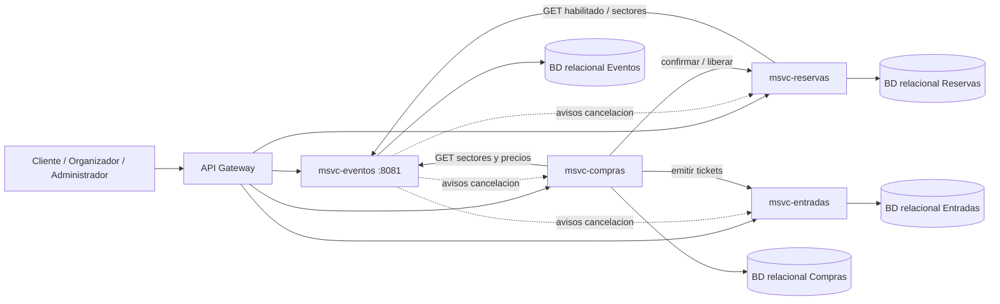
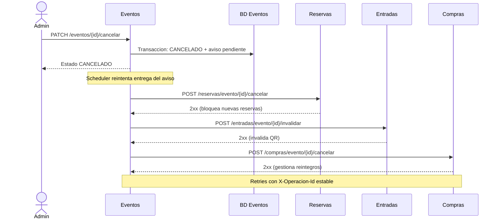

# Arquitectura de microservicios — Entrega 1

## 1. Diagrama de módulos (Mermaid)

**Puertos ajenos:** los de Reservas, Compras y Entradas se acuerdan con el grupo. `8081` solo corresponde a Eventos. **No hay acceso cruzado a bases**.

## 2. Diagrama de secuencia — compra numerada (contrato del grupo, no implementación de Eventos)

La prueba que demuestra la **no doble venta** requiere el servicio Reservas funcionando con bloqueo/actualización atómica en BD. Eventos solo consulta estado y geometría del lugar.

## 3. Secuencia — cancelación de evento

**Importante:** las rutas salientes son un **contrato propuesto**, no prueban que otros equipos ya las implementaron. Un 2xx confirma recepción, no que todos los reintegros terminaron. No se implementa notificación por correo ni saga completa en Entrega 1.

## 4. Estructura de código

- `controller`: endpoints HTTP y DTO Request/Response.
- `service`: seis servicios de negocio (Lugar, Sector, Asiento, Evento, Organizador, Participante).
- `repository`: una interfaz `JpaRepository` por entidad persistida; Evento incluye `JpaSpecificationExecutor`.
- `model`: entidades locales, enums, `PrecioSector` y `EventoParticipante` para relaciones N:M.
- `integration`: avisos reintentables de cancelación (outbox básico).
- `exception` y `config`: reglas de error, reloj, REST y Swagger.

**Datos compartidos:** `eventoId`, `sectorId`, `asientoId`, `reservaId`, `compraId`, `clienteId` viajan en DTOs de integración como IDs; no se definen FKs de una base a otra.
