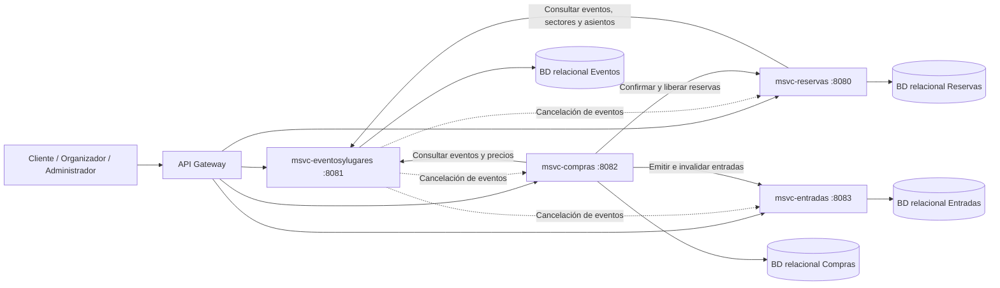
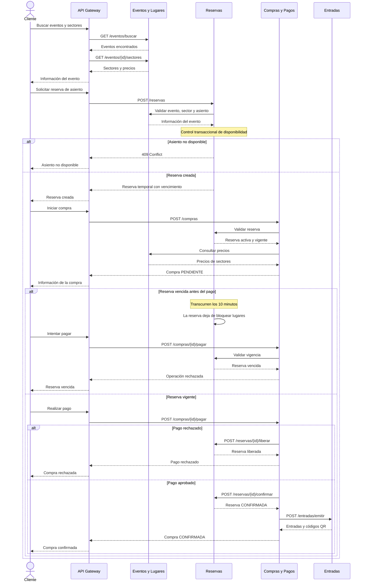
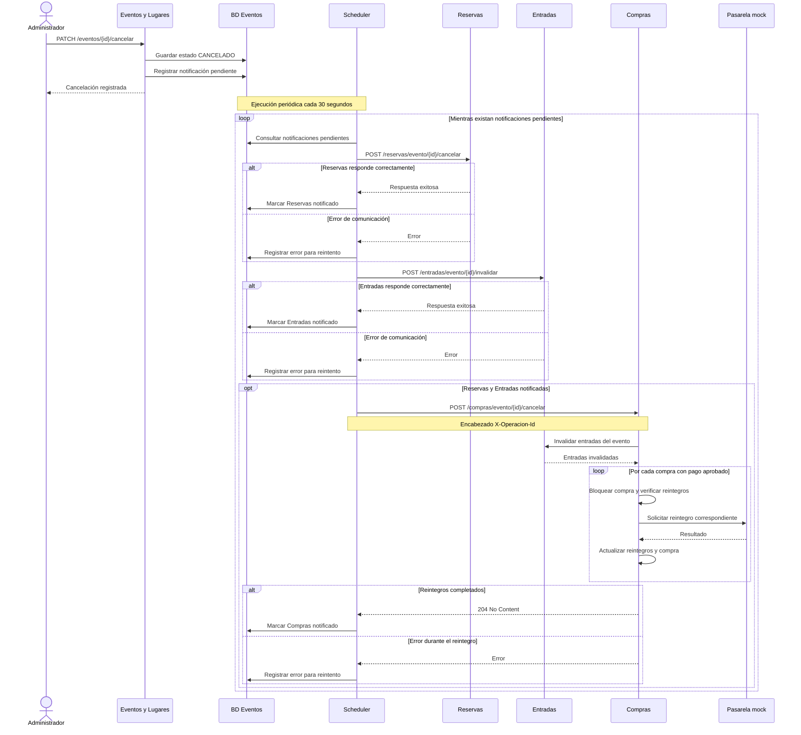

# 02 — Arquitectura y diagramas de Eventos y Lugares

## 1. Arquitectura de microservicios

TicketYa utiliza una arquitectura de microservicios desarrollados con Spring Boot. Cada servicio administra sus propias responsabilidades y su base de datos relacional.

El API Gateway constituye el punto de entrada para las solicitudes externas. La comunicación entre microservicios se realiza mediante APIs REST y clientes HTTP.

### Diagrama de módulos

### Puertos y persistencia

| Componente | Puerto | Responsabilidad |
|---|---|---|
| Eventos y Lugares | `8081` | Gestión de eventos, lugares, sectores, participantes, precios y cancelaciones. |
| Reservas | `8080` | Disponibilidad, reservas temporales y prevención de doble venta. |
| Compras | `8082` | Compras, procesamiento de pagos y reintegros. |
| Entradas | `8083` | Emisión, consulta, devolución e invalidación de entradas. |

Los puertos corresponden a la configuración local y pueden modificarse mediante las propiedades del entorno.

Los microservicios intercambian identificadores y DTO mediante HTTP y OpenFeign. No existe acceso directo entre sus bases de datos ni se establecen claves foráneas entre entidades pertenecientes a distintos servicios.

## 2. Diagrama de secuencia de compra de entrada numerada

El circuito de compra integra los microservicios Eventos y Lugares, Reservas, Compras y Entradas.

Eventos y Lugares proporciona la información del evento, los sectores, los asientos y los precios. Reservas administra la disponibilidad y evita la doble venta mediante operaciones transaccionales sobre su base de datos.

### Diagrama de secuencia

### Control de concurrencia

La disponibilidad de los lugares se administra desde Reservas, que utiliza mecanismos de bloqueo y transacciones sobre su base de datos.

El control de concurrencia impide que dos operaciones simultáneas confirmen el mismo asiento o superen la capacidad de un sector.

Las reservas temporales tienen una vigencia de 10 minutos. Una reserva vencida deja de bloquear los lugares correspondientes y no puede utilizarse para completar una nueva operación de pago.

## 3. Cancelación de eventos

El microservicio Eventos y Lugares coordina las operaciones asociadas a la cancelación de un evento.

Cuando un administrador cancela un evento, se actualiza su estado a `CANCELADO` y se registra una notificación pendiente dentro de la misma transacción local.

La comunicación con los otros microservicios se realiza posteriormente mediante un proceso programado que permite reintentar las operaciones si ocurre una falla.

### Diagrama de secuencia de cancelación

### 3.1. Responsabilidades durante la cancelación

**Eventos y Lugares**

- Actualiza el evento al estado `CANCELADO`.
- Registra la notificación correspondiente dentro de la transacción local.
- Coordina las comunicaciones con Reservas, Entradas y Compras.
- Conserva el estado de las notificaciones y permite reintentar aquellas que no se completaron.

**Reservas**

- Recibe la solicitud de cancelación del evento.
- Cancela las reservas asociadas.
- Impide nuevas operaciones sobre las reservas canceladas.

**Entradas**

- Recibe la solicitud de invalidación.
- Cambia las entradas emitidas del evento a estado `INVALIDADA`.
- Evita modificar nuevamente entradas que ya fueron invalidadas.

**Compras y Pagos**

- Recibe la notificación de cancelación.
- Verifica que las entradas correspondientes estén invalidadas.
- Identifica las compras con pagos aprobados.
- Procesa los reintegros por ítem.
- Evita reintegrar nuevamente importes que ya fueron devueltos.

### 3.2. Reintentos de notificaciones

El proceso de notificaciones utiliza un scheduler configurado con un intervalo de 30 segundos mediante `fixedDelay`.

Cada notificación conserva el resultado de las comunicaciones con los distintos servicios.

Si una comunicación falla, se registra el error y la operación puede reintentarse posteriormente.

Compras recibe la notificación una vez completadas las operaciones correspondientes de Reservas y Entradas.

La respuesta al administrador se realiza después de registrar la cancelación, sin esperar a que finalice el procesamiento externo.

### 3.3. Estados de compras y reintegros

Compras procesa individualmente las compras que tienen un pago aprobado.

Para calcular el reintegro de cada entrada utiliza el precio histórico registrado al realizar la compra.

- `REINTEGRADA`: todos los ítems de la compra tienen sus reintegros completados.
- `REINTEGRO_PARCIAL`: algunos ítems fueron reintegrados y otros no.
- Los ítems sin importe se registran como reintegrados sin solicitar una operación financiera a la pasarela.
- Los ítems que ya cuentan con un reintegro aprobado no se procesan nuevamente.

Las compras sin pagos aprobados no requieren devolución de dinero.

Si alguna operación de reintegro no se completa, se conserva la información necesaria para permitir su reintento.

### 3.4. Identificación e idempotencia de cancelaciones

Las notificaciones de cancelación utilizan el encabezado `X-Operacion-Id`, que identifica la operación correspondiente al evento.

- Reservas recibe el identificador de operación y realiza las validaciones de estado correspondientes.
- Entradas evita repetir la invalidación sobre entradas que ya se encuentran invalidadas.
- Compras verifica los reintegros registrados por ítem para impedir devoluciones duplicadas.

La coordinación utiliza transacciones locales y operaciones reintentables. No existe una transacción ACID distribuida que abarque las bases de datos de todos los microservicios.

## 4. Estructura del código

El microservicio Eventos y Lugares organiza su implementación en los siguientes paquetes:

| Paquete | Responsabilidad |
|---|---|
| `controller` | Exposición de endpoints HTTP y procesamiento de solicitudes y respuestas. |
| `service` | Lógica de negocio de lugares, sectores, asientos, eventos, organizadores y participantes. |
| `repository` | Acceso a datos mediante Spring Data JPA y `JpaSpecificationExecutor`. |
| `model` | Entidades persistentes, enumeraciones y relaciones entre eventos, sectores y participantes. |
| `integration` | Clientes Feign y coordinación de notificaciones de cancelación. |
| `exception` | Tratamiento de errores y excepciones de negocio. |
| `config` | Configuración de la aplicación, reloj, REST y Swagger. |

## 5. Relaciones con otros microservicios

Los microservicios intercambian información mediante identificadores como:

- `eventoId`
- `sectorId`
- `asientoId`
- `reservaId`
- `compraId`
- `clienteId`

Estos identificadores se transportan mediante DTO de integración y permiten relacionar operaciones entre servicios sin compartir entidades JPA ni establecer claves foráneas entre sus bases de datos.

Eventos y Lugares administra la información de los eventos y la configuración de sectores y precios.

Reservas mantiene el control de disponibilidad y ocupación.

Compras administra el procesamiento financiero y la confirmación de compras.

Entradas administra la emisión, devolución e invalidación de entradas.