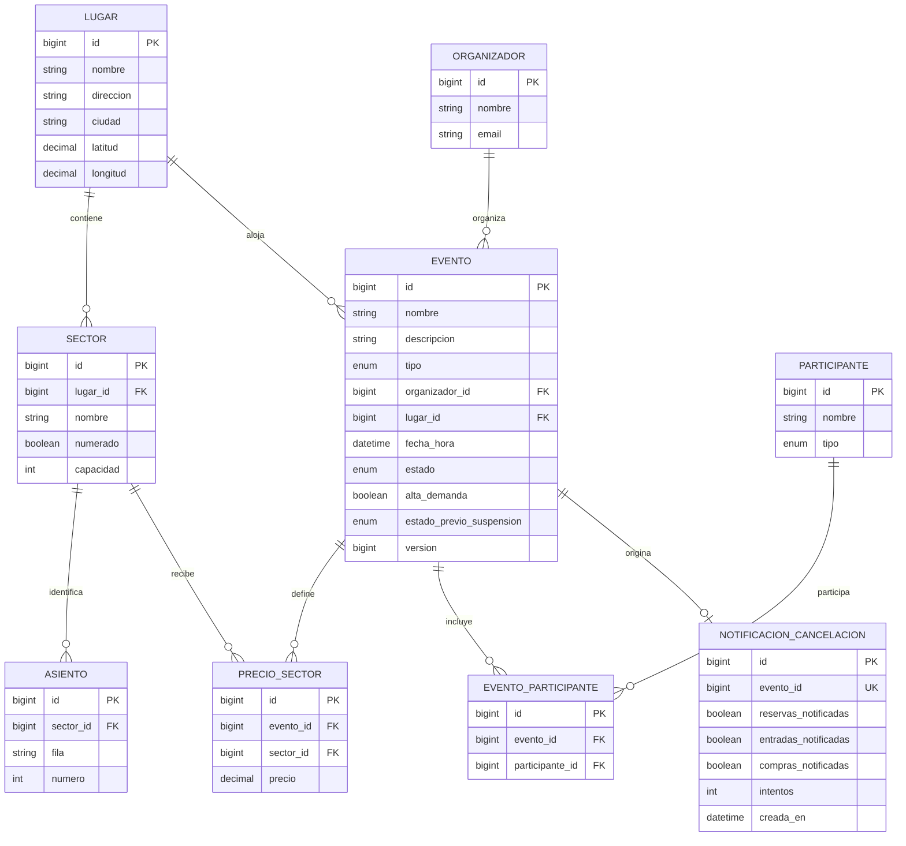

# Modelo de datos — msvc-eventos

## Diagrama ER (Mermaid)

`NOTIFICACION_CANCELACION.evento_id` es una referencia lógica a `EVENTO` en la misma base, **no** está mapeada como clave foránea JPA. Permite registrar la intención de aviso en la misma transacción.

## Relaciones y restricciones

| Relación | Cardinalidad | Implementación |
|---|---|---|
| Lugar → Sector | 1:N | `Sector.lugar` (`@ManyToOne`) |
| Sector → Asiento | 1:N | `Asiento.sector` (`@ManyToOne`) |
| Lugar → Evento | 1:N | `Evento.lugar` |
| Organizador → Evento | 1:N | `Evento.organizador` |
| Evento ↔ Participante | N:M | Entidad intermedia `EventoParticipante` |
| Evento ↔ Sector | N:M con atributo `precio` | Entidad intermedia `PrecioSector` |
| Evento → aviso | 1:0..1 | `NotificacionCancelacion.eventoId` único |

**Unicidades:** `(lugar_id, nombre)` en `Sector`; `(sector_id, fila, numero)` en `Asiento`; `(evento_id, sector_id)` en `PrecioSector`; `(evento_id, participante_id)` en `EventoParticipante`.

**Por qué existe PrecioSector:** un mismo estadio puede tener un sector Platea con $30.000 para un recital y $45.000 para otro. Poner el precio en `Sector` impediría diferenciarlo por evento.

**Por qué existe EventoParticipante:** un mismo artista/equipo puede estar en muchos eventos, y un evento puede tener varios artistas/equipos. La tabla intermedia permite registrar el vínculo sin duplicar la entidad participante.

## Entidades solapadas y relaciones entre microservicios

| Servicio | Identificadores que consume de Eventos | Dueño de la información |
|---|---|---|
| Reservas | eventoId, sectorId, asientoId | Eventos define geometría; Reservas guarda ocupación, vencimientos y asignaciones |
| Compras | eventoId, sectorId, asientoId y precio consultado | Eventos define precio vigente; Compras guarda **snapshot** del importe al comprar |
| Entradas | eventoId, sectorId, asientoId | Eventos define el evento; Entradas guarda ticket, QR y estado |

No se comparten entidades JPA ni bases de datos, aunque algunos nombres y IDs se repitan en DTOs. El servicio de disponibilidad es **Reservas**, no Eventos.
