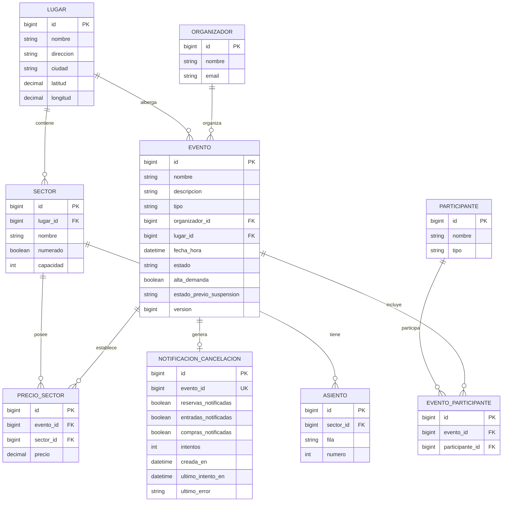

# 03 — Modelo de datos de Eventos y Lugares

## 1. Descripción general

El microservicio `msvc-eventosylugares` administra la información de eventos, organizadores, participantes, lugares, sectores, asientos y precios.

Utiliza una base de datos relacional propia y Spring Data JPA para la persistencia.

El modelo incluye entidades intermedias para representar los participantes de cada evento y los precios definidos para sus sectores. También incorpora el registro de notificaciones utilizado para coordinar las cancelaciones con otros microservicios.

## 2. Diagrama entidad-relación

La relación entre `EVENTO` y `NOTIFICACION_CANCELACION` es lógica. El atributo `eventoId` de la notificación es único, pero no está mapeado como una relación JPA con clave foránea.

Esto permite registrar la cancelación y su notificación dentro de una misma transacción local, manteniendo el seguimiento de las comunicaciones con los demás servicios.

## 3. Relaciones y cardinalidades

| Relación | Cardinalidad | Implementación |
|---|---|---|
| Lugar → Sector | 1:N | `Sector.lugar` mediante `@ManyToOne`. |
| Sector → Asiento | 1:N | `Asiento.sector` mediante `@ManyToOne`. |
| Lugar → Evento | 1:N | `Evento.lugar`. |
| Organizador → Evento | 1:N | `Evento.organizador`. |
| Evento ↔ Participante | N:M | Entidad intermedia `EventoParticipante`. |
| Evento ↔ Sector | N:M con atributo `precio` | Entidad intermedia `PrecioSector`. |
| Evento → Notificación de cancelación | 1:0..1 | Referencia lógica mediante `NotificacionCancelacion.eventoId`, con valor único. |

### 3.1. Restricciones de unicidad

El modelo define las siguientes restricciones:

| Entidad | Columnas | Restricción |
|---|---|---|
| `Sector` | `lugar_id`, `nombre` | No se permite repetir el nombre de un sector dentro del mismo lugar. |
| `Asiento` | `sector_id`, `fila`, `numero` | No se permite repetir la combinación de fila y número dentro del mismo sector. |
| `PrecioSector` | `evento_id`, `sector_id` | Cada sector puede tener un único precio configurado para un mismo evento. |
| `EventoParticipante` | `evento_id`, `participante_id` | No se permite asociar dos veces el mismo participante a un evento. |
| `NotificacionCancelacion` | `evento_id` | Cada evento puede tener un único registro de notificación de cancelación. |

## 4. Entidades intermedias

### 4.1. PrecioSector

La entidad `PrecioSector` representa la relación entre un evento y un sector, incorporando el precio definido para esa combinación.

Un mismo sector puede utilizarse en distintos eventos con precios diferentes.

Por ejemplo, un sector Platea puede tener un precio de $30.000 para un recital y $45.000 para otro.

Al mantener el precio en `PrecioSector`, cada evento puede configurar sus propios valores sin modificar la estructura del lugar ni de sus sectores.

### 4.2. EventoParticipante

La entidad `EventoParticipante` representa la relación entre eventos y participantes.

Un evento puede contar con varios artistas, equipos o disertantes, mientras que un mismo participante puede intervenir en múltiples eventos.

La entidad intermedia permite registrar estas asociaciones sin duplicar los datos de los participantes.

## 5. Notificaciones de cancelación

La entidad `NotificacionCancelacion` permite registrar y controlar las comunicaciones derivadas de la cancelación de un evento.

Sus principales atributos son:

- `eventoId`: identifica el evento cancelado.
- `reservasNotificadas`: indica si Reservas recibió y procesó la cancelación.
- `entradasNotificadas`: indica si Entradas recibió y procesó la invalidación.
- `comprasNotificadas`: indica si Compras recibió y procesó la cancelación y los reintegros.
- `intentos`: registra la cantidad de intentos de procesamiento.
- `creadaEn`: fecha y hora de creación.
- `ultimoIntentoEn`: fecha y hora del último intento.
- `ultimoError`: información del último error registrado, si corresponde.

El registro se crea dentro de la misma transacción local que actualiza el estado del evento a `CANCELADO`.

El procesamiento posterior utiliza estos atributos para identificar las comunicaciones completadas y reintentar aquellas que no finalizaron correctamente.

## 6. Relaciones y entidades solapadas entre microservicios

Los microservicios mantienen sus propias bases de datos e intercambian información mediante identificadores y DTO.

| Microservicio | Información relacionada con Eventos | Responsabilidad |
|---|---|---|
| Reservas | `eventoId`, `sectorId`, `asientoId` | Eventos define la configuración de lugares, sectores y asientos. Reservas administra la ocupación, los vencimientos y las asignaciones. |
| Compras | `eventoId`, `sectorId`, `asientoId` y precios consultados | Eventos administra los precios configurados. Compras conserva el precio histórico utilizado al realizar la compra. |
| Entradas | `eventoId`, `sectorId`, `asientoId` | Eventos administra la información del evento. Entradas registra las entradas emitidas, sus códigos QR y sus estados. |

### 6.1. Separación de responsabilidades

**Eventos y Lugares** administra la configuración de los eventos, lugares, sectores, asientos y precios.

**Reservas** administra la disponibilidad real, la ocupación de los lugares y las reservas temporales.

**Compras** administra las operaciones de compra, pagos y reintegros, conservando los importes históricos.

**Entradas** administra la emisión, consulta, devolución e invalidación de las entradas.

Los identificadores compartidos permiten relacionar operaciones entre servicios sin compartir entidades JPA ni acceder directamente a las bases de datos de otros microservicios.

## 7. Consideraciones del modelo

- Cada microservicio administra su propia base de datos.
- Las entidades `PrecioSector` y `EventoParticipante` permiten representar relaciones de muchos a muchos con información propia.
- Los sectores numerados almacenan asientos identificados por fila y número.
- Los sectores no numerados utilizan una capacidad máxima.
- La ocupación de los lugares pertenece a Reservas y no se almacena en Eventos y Lugares.
- Los precios de los sectores se definen para cada evento.
- Compras conserva los precios históricos para mantener la información financiera de las operaciones realizadas.
- Las notificaciones de cancelación permiten coordinar operaciones con otros microservicios mediante registros persistentes y reintentos.
- No se establecen relaciones JPA ni claves foráneas entre las bases de datos de distintos microservicios.