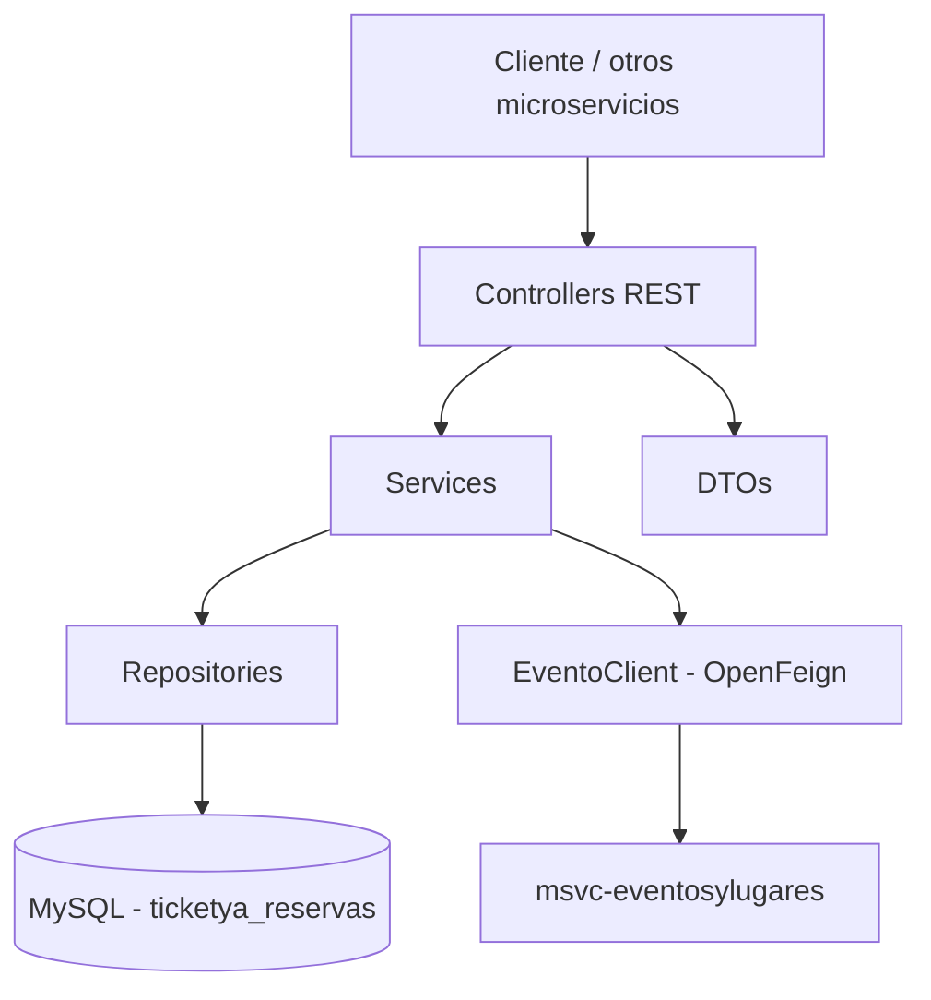
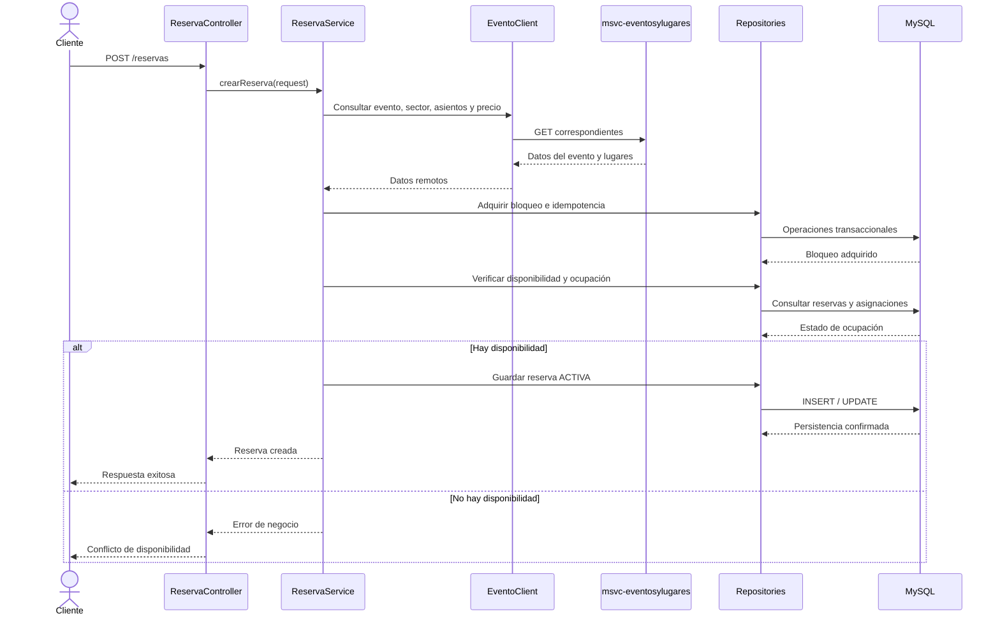
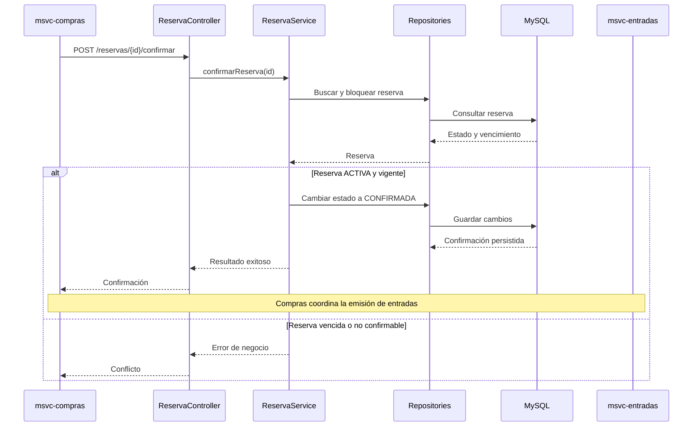
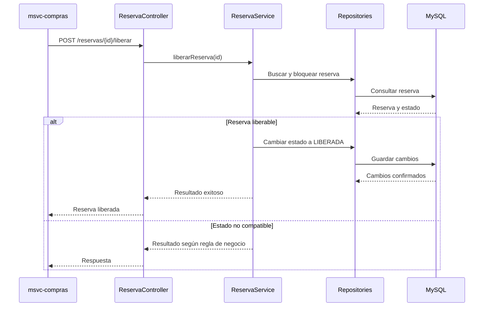
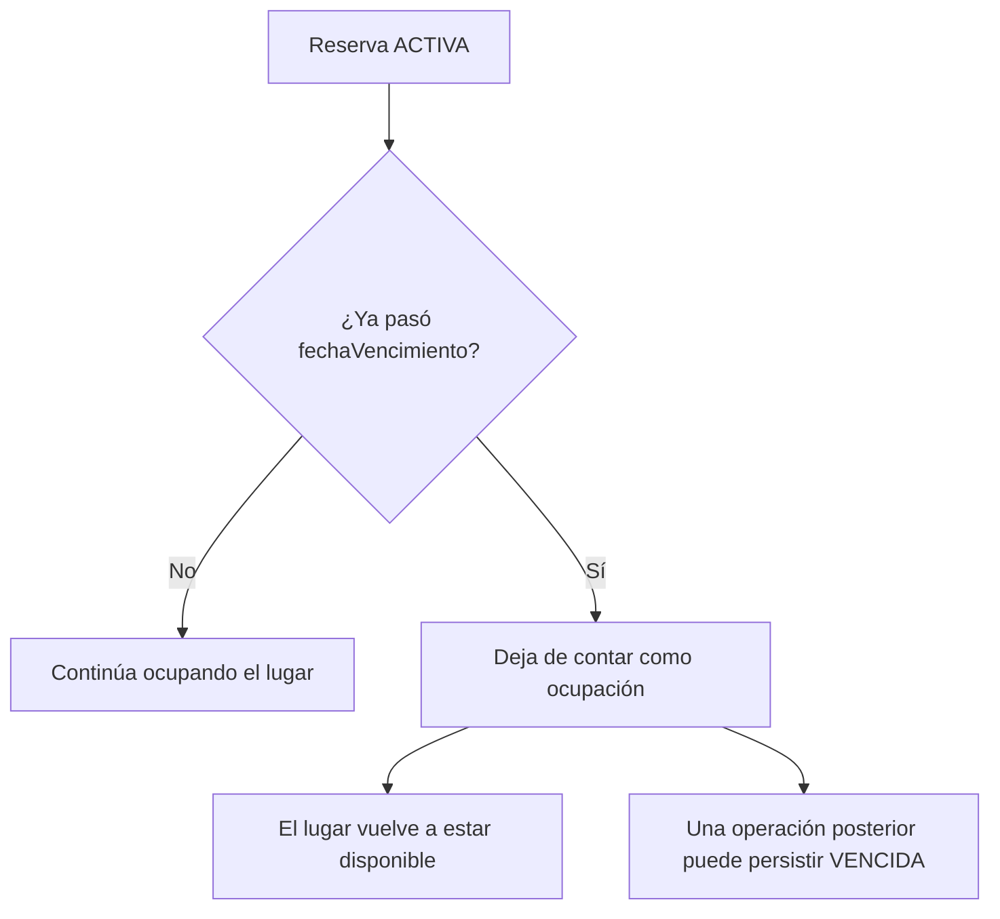
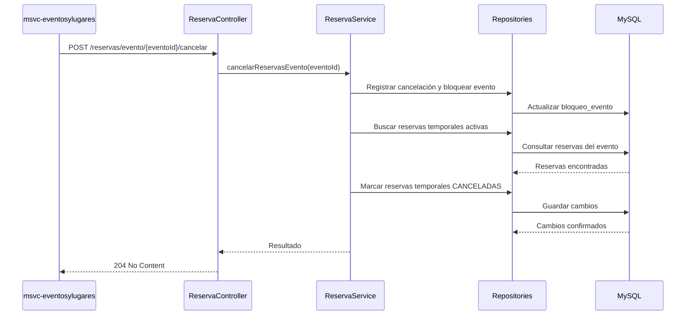

# 02 — Arquitectura y diagramas de Reservas

**Proyecto:** TicketYa · Microservicio `msvc-reservas` · Entrega 1

## 1. Responsabilidad del microservicio

`msvc-reservas` administra la disponibilidad y el ciclo de vida de las reservas temporales de lugares para eventos.

Sus responsabilidades principales son:

- Consultar disponibilidad de sectores numerados y no numerados.
- Crear reservas temporales con vencimiento de 10 minutos.
- Evitar la doble asignación de asientos y la sobreventa de capacidad.
- Gestionar la idempotencia de las solicitudes.
- Confirmar reservas cuando Compras informa un pago aprobado.
- Liberar reservas cuando el pago es rechazado.
- Cancelar reservas temporales cuando se cancela un evento.
- Liberar individualmente un lugar cuando un servicio autorizado informa una devolución aprobada.

No administra los eventos ni sus precios, no procesa pagos y no emite entradas ni códigos QR.

## 2. Arquitectura lógica

El microservicio sigue una arquitectura por capas:

- **Controllers:** reciben las solicitudes HTTP, validan los parámetros de entrada y delegan las operaciones.
- **Services:** contienen las reglas de negocio y coordinan las operaciones.
- **Repositories:** acceden a la base de datos mediante Spring Data JPA.
- **Entities:** representan las entidades persistidas.
- **DTOs:** definen los datos de entrada y salida de la API.
- **Clients:** permiten comunicarse con otros microservicios mediante OpenFeign.

La base de datos de Reservas es propia del microservicio. Los datos de eventos, sectores, asientos y precios se consultan a través de Eventos y Lugares; no se debe asumir que Reservas comparte su base de datos.

## 3. Comunicación con otros microservicios

### 3.1. Reservas → Eventos y Lugares

La comunicación se realiza mediante `EventoClient`, implementado con OpenFeign.

Operaciones declaradas en el cliente:

| Método HTTP | Ruta | Uso |
|---|---|---|
| GET | `/eventos/{id}` | Consultar un evento |
| GET | `/sectores/{id}` | Consultar un sector |
| GET | `/asientos/{id}` | Consultar un asiento |
| GET | `/sectores/{id}/asientos` | Consultar los asientos de un sector |
| GET | `/eventos/{eventoId}/sectores/{sectorId}/precio` | Consultar el precio del sector para el evento |

La URL base se configura mediante `msvc.eventos.url`, cuyo valor local predeterminado es `http://localhost:8081`.

**Estado:** el cliente Feign está implementado. Las pruebas realizadas con un simulador permiten probar el comportamiento local, pero no demuestran por sí solas la compatibilidad completa con el servicio real de Eventos y Lugares.

### 3.2. Compras → Reservas

Reservas expone operaciones para que Compras confirme o libere una reserva según el resultado del pago:

- `POST /reservas/{id}/confirmar`
- `POST /reservas/{id}/liberar`

El cliente de Compras para invocar estas operaciones está desarrollado.

**Estado:** existen los endpoints y el cliente. La coordinación completa del flujo de pago aprobado o rechazado debe quedar respaldada por una prueba integrada entre ambos microservicios.

### 3.3. Eventos y Lugares → Reservas

Reservas expone operaciones internas para preparar la venta o cancelar un evento:

- `POST /reservas/evento/{eventoId}/habilitar`
- `POST /reservas/evento/{eventoId}/cancelar`

La primera prepara el registro de bloqueo del evento cuando se habilita la venta. La segunda registra la cancelación local, impide nuevas reservas y cancela las reservas temporales correspondientes.

**Estado:** los endpoints están implementados en Reservas. Debe verificarse el envío real de las solicitudes desde Eventos y Lugares y la coordinación completa de la cancelación.

### 3.4. Entradas → Reservas

Reservas expone:

- `POST /reservas/{id}/devolver-entrada`

Esta operación permite liberar individualmente una entrada previamente aprobada para devolución. El registro de `entradaId` permite evitar una segunda liberación.

**Estado:** el endpoint está implementado. La validación de titularidad, aprobación de la devolución y plazo correspondiente pertenece a los servicios responsables. La coordinación completa debe probarse entre los microservicios involucrados.

### 3.5. Gateway y seguridad

Los endpoints de confirmación, liberación, cancelación, habilitación y devolución son operaciones internas.

La etiqueta de endpoint interno en Swagger no constituye una medida de seguridad. Su protección debe verificarse mediante la configuración del Gateway y/o las restricciones de red correspondientes.

La configuración del Gateway no forma parte de este microservicio, por lo que no se afirma aquí que esos endpoints ya estén protegidos.

## 4. Flujo de creación de una reserva temporal

El cliente consulta disponibilidad y luego solicita una reserva. La consulta de disponibilidad no bloquea lugares: la disponibilidad definitiva se valida nuevamente al crear la reserva.

La creación registra la reserva y sus detalles, junto con la fecha de vencimiento. En sectores numerados se validan los asientos solicitados; en sectores no numerados se controla que la cantidad no supere la capacidad disponible.

El bloqueo de concurrencia y las validaciones dentro de la transacción permiten evitar que dos solicitudes incompatibles confirmen la ocupación del mismo lugar.

## 5. Flujo de confirmación después del pago

El procesamiento del pago corresponde a Compras. Cuando el pago se aprueba, Compras informa a Reservas para confirmar la reserva.

La confirmación solo corresponde a una reserva activa y vigente. Una reserva vencida no debe confirmarse.

La emisión de entradas es responsabilidad de Compras y Entradas. El diagrama representa la coordinación funcional esperada, no una prueba de extremo a extremo ya acreditada.

## 6. Flujo de liberación por pago rechazado

Cuando Compras recibe un rechazo de pago, solicita a Reservas liberar la reserva temporal.

La liberación debe ser idempotente: los reintentos no deben provocar una segunda liberación ni modificar indebidamente una reserva confirmada.

## 7. Vencimiento lógico de reservas

Cada reserva temporal tiene una fecha de vencimiento de 10 minutos.

La disponibilidad se calcula excluyendo las reservas activas cuyo vencimiento ya pasó. Por eso, aunque el registro permanezca temporalmente como `ACTIVA` en MySQL, el lugar deja de contarse como ocupado y puede reservarse nuevamente.

**Decisión para Entrega 1:** no se incorpora un Scheduler. La liberación de capacidad se obtiene mediante el filtro temporal aplicado en las consultas de ocupación y disponibilidad. El equipo informó que verificó manualmente que la capacidad vuelve a estar disponible al cumplirse los 10 minutos.

La actualización del estado persistido a `VENCIDA` puede producirse cuando una operación posterior procesa la reserva. Esto no impide que el lugar vuelva a estar disponible.

Las reservas `CONFIRMADA` no se liberan por vencimiento.

## 8. Cancelación de un evento

Cuando un evento se cancela, Reservas debe impedir nuevas operaciones de compra y cancelar las reservas temporales todavía activas.

La cancelación queda registrada localmente mediante el indicador `cancelado` asociado al evento. En esta versión, el registro de cancelación es irreversible.

Las reservas confirmadas y las entradas emitidas requieren coordinación con Compras y Entradas para gestionar las consecuencias económicas y operativas. Reservas no realiza por sí mismo reintegros ni anula entradas emitidas.

## 9. Concurrencia e idempotencia

La solución utiliza mecanismos de concurrencia en la base MySQL de Reservas:

- Bloqueo pesimista `PESSIMISTIC_WRITE` sobre el registro de `bloqueo_evento`.
- Registro de claves de idempotencia para solicitudes de reserva.
- Restricciones de unicidad en la base de datos para evitar duplicaciones.
- Transacciones para mantener consistentes los cambios locales.
- Control de ocupación para asientos numerados y capacidad de sectores no numerados.

El bloqueo por evento permite serializar las operaciones que modifican la ocupación de un mismo evento entre instancias que comparten la misma base de datos.

Esto no significa que exista una transacción distribuida entre microservicios: las llamadas HTTP a otros servicios no quedan cubiertas por la transacción local de Reservas. Los errores de red y los resultados inciertos de operaciones remotas deben tratarse mediante reintentos y compensaciones en los servicios responsables.

La prueba `ConcurrenciaMySQLIT` contempla diez solicitudes simultáneas por el mismo asiento sobre una base MySQL de pruebas. La verificación de varias instancias reales conectadas a la misma base queda como prueba adicional.

## 10. Diagramas y documentación relacionada

| Documento | Contenido |
| [`01-FUNCIONALIDADES-Y-USER-STORIES.md`](01-FUNCIONALIDADES-Y-USER-STORIES.md) | Requisitos, criterios de aceptación y cobertura de US01–US07 |
| [`03-MODELO-DE-DATOS-RESERVAS.md`](03-MODELO-DE-DATOS-RESERVAS.md) | Entidades, relaciones y modelo de datos |
| [`05-TESTING-RESERVAS.md`](05-TESTING-RESERVAS.md) | Pruebas unitarias, concurrencia y pruebas manuales |
| [`06-DECISIONES-Y-LIMITACIONES-RESERVAS.md`](06-DECISIONES-Y-LIMITACIONES-RESERVAS.md) | Decisiones técnicas, riesgos y limitaciones |
| [`contrato-eventos.md`](contrato-eventos.md) | Contrato de comunicación con Eventos y Lugares |
| [`openapi.yaml`](openapi.yaml) | Contrato REST de Reservas |

**Nota sobre el estado de los diagramas:** los flujos muestran las responsabilidades y contratos implementados o previstos según el estado documentado. No deben interpretarse como evidencia de que todos los microservicios ya ejecutan esos recorridos de extremo a extremo.