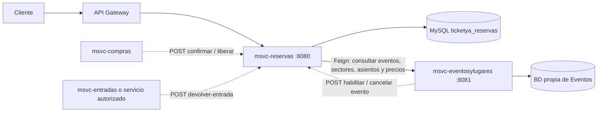
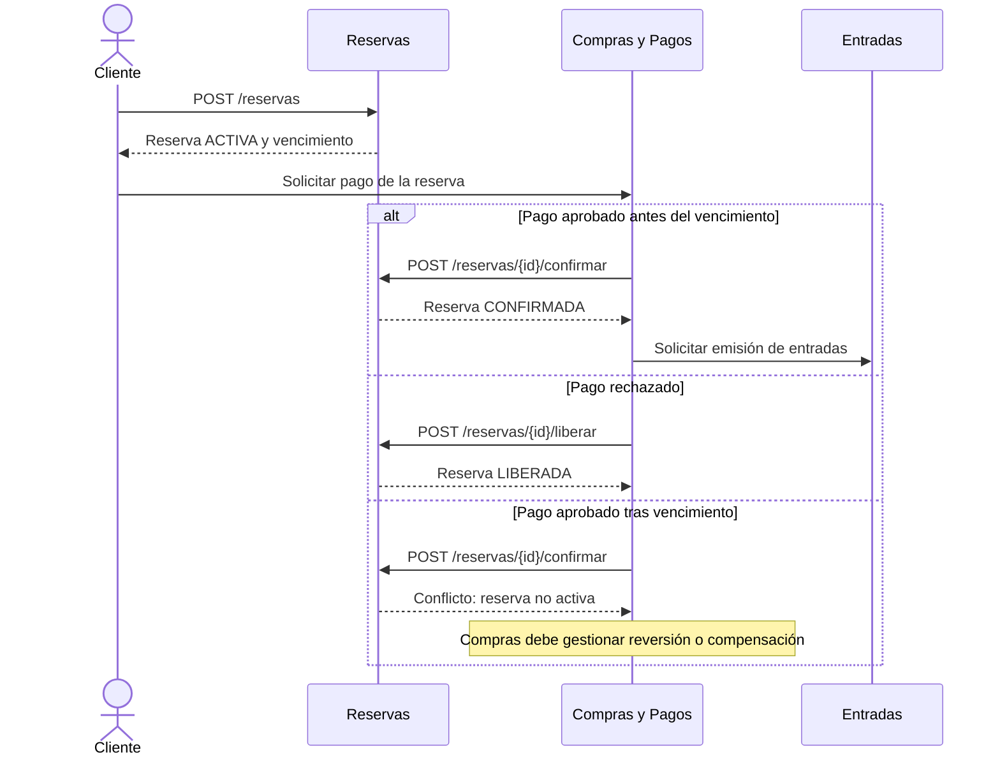

# Arquitectura y diagramas — msvc-reservas (Entrega 1)

## 1. Responsabilidad del microservicio

`msvc-reservas` administra la ocupación temporal y confirmada de lugares en los eventos de TicketYa. Permite crear reservas con vencimiento a los **10 minutos**, consultar disponibilidad, confirmar o liberar reservas, bloquear nuevas ventas ante la cancelación de un evento y liberar entradas individuales después de recibir una solicitud de devolución aprobada.

No administra los datos maestros de eventos, lugares, sectores, asientos ni precios; tampoco procesa pagos, emite entradas o comprueba por sí solo la titularidad y aprobación de una devolución.

## 2. Diagrama de arquitectura



**Estado de integración:** las rutas de Reservas y el cliente Feign están implementados. La conexión real con Eventos y Lugares, Compras, Entradas y Gateway debe verificarse con todos los servicios funcionando. Las flechas punteadas indican comunicaciones previstas por el contrato; no afirman que el flujo de extremo a extremo ya esté probado.

Cada microservicio utiliza su propia base de datos. Reservas guarda `eventoId`, `sectorId`, `asientoId` y `clienteId` como identificadores, sin relaciones JPA ni claves foráneas hacia la base de Eventos.

## 3. Organización interna

- **Controllers:** `ReservaController` expone creación, consulta y cambios de estado; `DisponibilidadController` expone consulta de disponibilidad.
- **Services:** `ReservaServiceImpl` aplica validaciones, vencimientos, idempotencia y bloqueo concurrente; `DisponibilidadServiceImpl` calcula lugares libres.
- **Repositories:** interfaces Spring Data JPA para `Reserva`, `DetalleReserva`, `AsignacionAsiento`, `BloqueoEvento`, `ClaveIdempotenciaBloqueo` y `EntradaLiberada`.
- **Feign:** `EventoClient` consulta por HTTP los datos que son propiedad de Eventos y Lugares.
- **Persistencia:** MySQL; esquema `ticketya_reservas`. `ddl-auto=update` se utiliza para desarrollo.

## 4. Secuencia de creación de una reserva

```mermaid
sequenceDiagram
  actor Cliente
  participant R as Reservas
  participant DB as MySQL Reservas
  participant E as Eventos y Lugares
  Cliente->>R: POST /reservas (claveIdempotencia, eventoId, detalles)
  R->>DB: Transacción: bloquear clave de idempotencia
  R->>DB: Bloquear fila del evento (PESSIMISTIC_WRITE)
  R->>DB: Buscar reserva por clave (si existe, validar reintento)
  R->>E: GET evento, sector, asiento y precio
  E-->>R: Estado, lugar, sector, asientos y precio
  R->>DB: Consultar ocupación y límites del cliente
  alt Sin cupo / asiento ocupado / datos inválidos
    R-->>Cliente: 400, 404 o 409 según el error
  else Reserva válida
    R->>DB: Guardar reserva ACTIVA y detalles; vence en 10 min
    R-->>Cliente: 201 + datos de la reserva
  end
```

Para reservar se exige que el evento esté previamente habilitado en `bloqueo_evento` y que Eventos informe un evento futuro en estado `PUBLICADO`. Se comprueba la pertenencia del sector al lugar, la existencia del precio del evento-sector y, para sectores numerados, la pertenencia de cada asiento.

## 5. Disponibilidad y vencimiento

Para un **sector numerado**, se consultan los asientos definidos en Eventos y se excluyen los ocupados por reservas `CONFIRMADA` o `ACTIVA` no vencida que no hayan sido liberados individualmente. Para un **sector no numerado**, se resta de su capacidad la cantidad ocupada por esas reservas. La consulta de disponibilidad es informativa: no bloquea lugares por sí misma.

Las reservas `ACTIVA` vencen a los 10 minutos. Las consultas de ocupación dejan de contarlas al vencer, aunque su estado persistido puede actualizarse a `VENCIDA` cuando una operación posterior procesa esa reserva. En esta implementación no hay un scheduler de vencimientos.

Si un evento figura como cancelado en `bloqueo_evento`, la consulta de disponibilidad se rechaza (HTTP 409).

## 6. Concurrencia e idempotencia

La creación se ejecuta en una transacción con aislamiento `READ_COMMITTED`. Se bloquea primero la **clave de idempotencia** y luego la **fila del evento**, con orden fijo de adquisición. El bloqueo del evento emplea `PESSIMISTIC_WRITE` sobre la tabla local `bloqueo_evento`.

La fila de bloqueo del evento debe existir antes de habilitar nuevas ventas, mediante `POST /reservas/evento/{eventoId}/habilitar`; no se crea durante una reserva concurrente. La clave de idempotencia tiene control de unicidad. Reintentos equivalentes con la misma clave recuperan la reserva existente, sin duplicarla; una solicitud distinta con la misma clave debe rechazarse.

La seguridad de los bloqueos se limita a las transacciones de la base **de Reservas**. No existe una transacción ACID distribuida entre Reservas, Eventos, Compras y Entradas: los fallos entre servicios requieren coordinación, reintentos o compensaciones.

## 7. Secuencia de pago y confirmación (integración prevista)



Este diagrama representa el **contrato a integrar** con Compras y Entradas; no implica que dichos servicios ya estén conectados.

## 8. Publicación, cancelación y devoluciones

- **Publicación:** Eventos debe llamar al endpoint interno `POST /reservas/evento/{eventoId}/habilitar` una vez confirmada la publicación. Reservas verifica que el evento exista y esté `PUBLICADO`, y registra su bloqueo local.
- **Cancelación:** Eventos debe llamar a `POST /reservas/evento/{eventoId}/cancelar`. Reservas marca el evento cancelado, impide nuevas reservas y pasa reservas temporales `ACTIVA` a `CANCELADA`. Las reservas `CONFIRMADA` y sus reintegros deben ser coordinados con los otros servicios.
- **Devolución individual:** `POST /reservas/{id}/devolver-entrada` libera una entrada asociada a una reserva confirmada y utiliza `entradaId` para evitar liberaciones duplicadas. La verificación de titularidad, aprobación y plazo de 72 horas corresponde al servicio autorizado que realiza la llamada.

Los endpoints internos deben restringirse mediante el Gateway o la red del despliegue; las anotaciones Swagger no brindan autenticación ni autorización.

## 9. Material de apoyo

- Especificación de endpoints: `docs/openapi.yaml`.
- Contrato Feign con Eventos: `docs/contrato-eventos.md`.
- Colección de pruebas manuales: `docs/TicketYa-Reservas.postman_collection.json`.
- Implementación de concurrencia con MySQL: `src/test/java/com/ticketya/reservas/services/ConcurrenciaMySQLIT.java`.
