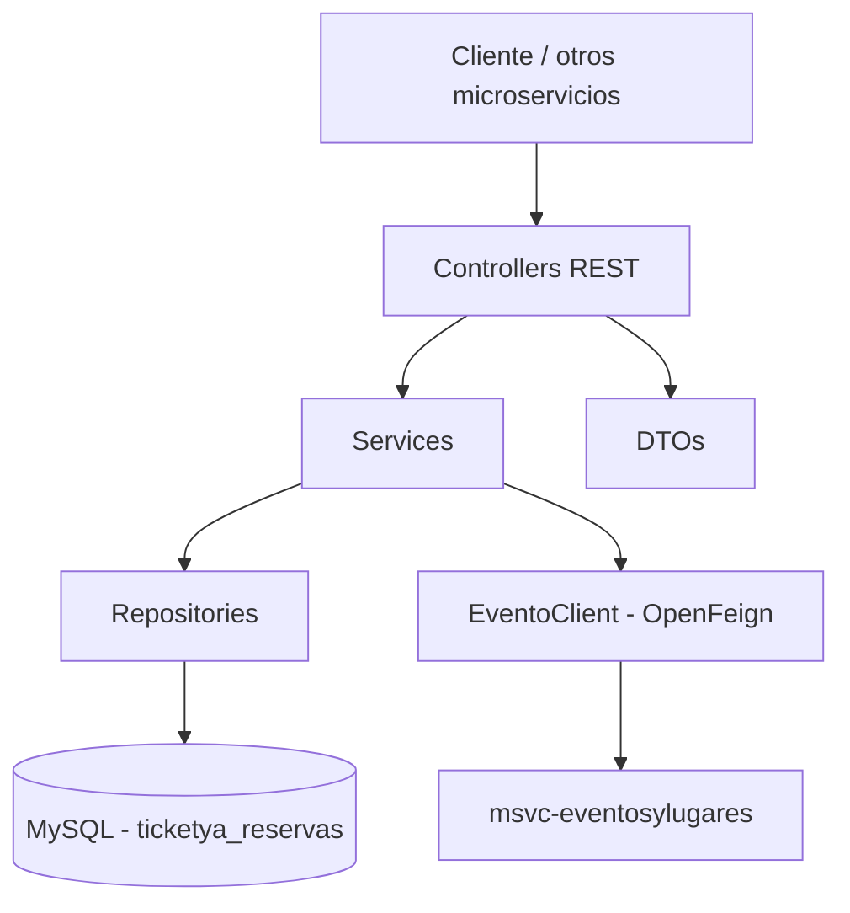
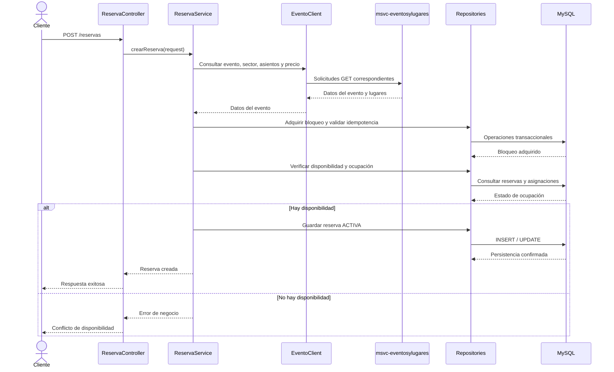
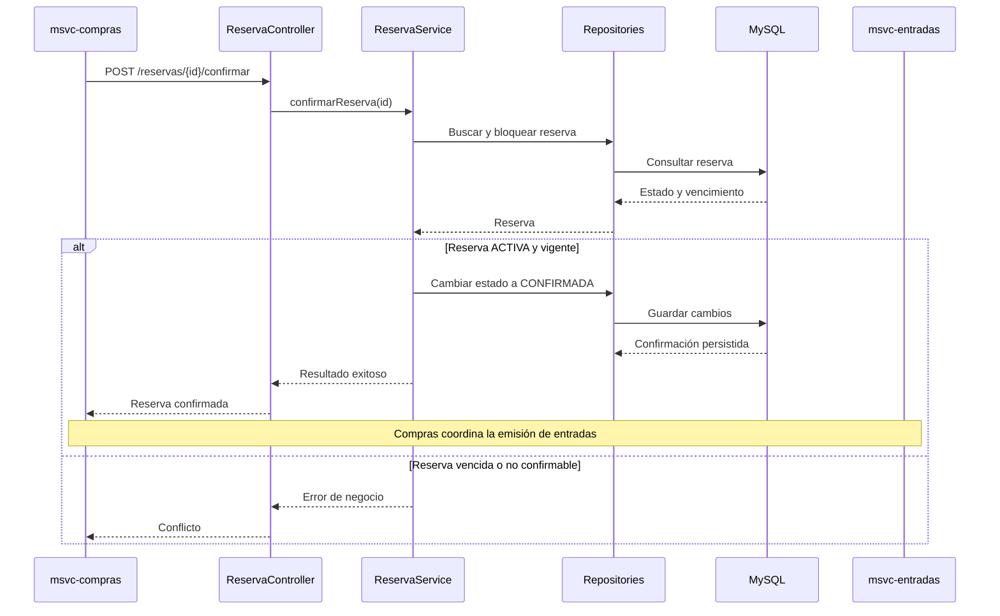
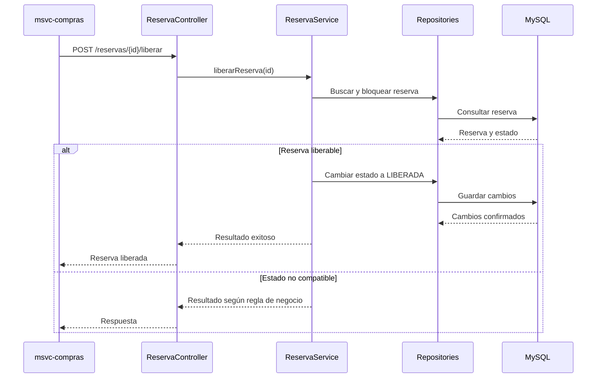
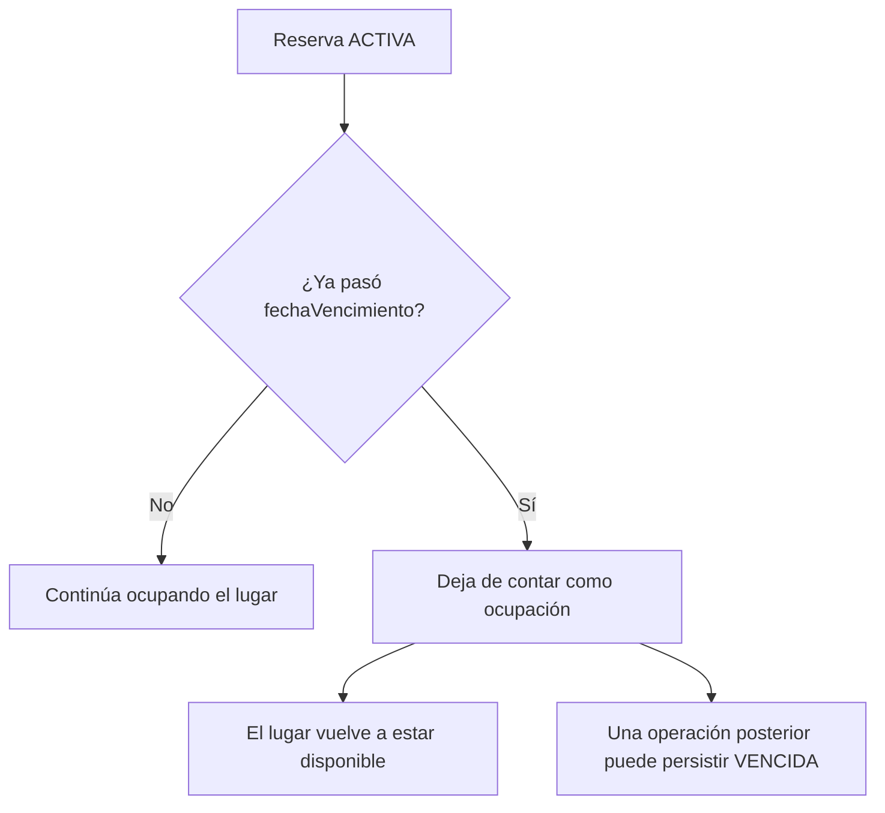
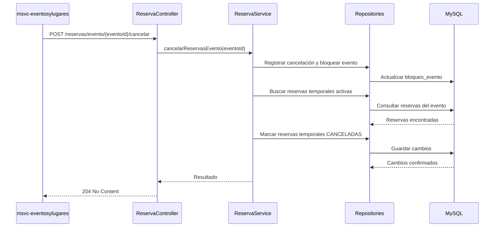

# 02 — Arquitectura y diagramas de Reservas

## 1. Responsabilidad del microservicio

El microservicio `msvc-reservas` administra la disponibilidad y el ciclo de vida de las reservas temporales de lugares para eventos dentro del sistema TicketYa.

Sus responsabilidades principales son:

- Consultar la disponibilidad de sectores numerados y no numerados.
- Crear reservas temporales con una vigencia de 10 minutos.
- Evitar la doble asignación de asientos y la sobreventa de capacidad.
- Gestionar la idempotencia de las solicitudes de reserva.
- Confirmar reservas cuando Compras informa un pago aprobado.
- Liberar reservas cuando el pago es rechazado.
- Cancelar reservas temporales cuando se cancela un evento.
- Liberar individualmente un lugar cuando se aprueba la devolución de una entrada.

Reservas no administra los eventos ni sus precios, no procesa pagos y no emite entradas ni códigos QR. Estas responsabilidades corresponden a los demás microservicios.

## 2. Arquitectura lógica

El microservicio utiliza una arquitectura por capas, desarrollada con Spring Boot y Spring Data JPA.

Sus componentes principales son:

- **Controllers:** reciben las solicitudes HTTP, validan los parámetros de entrada y delegan las operaciones.
- **Services:** implementan las reglas de negocio y coordinan las operaciones.
- **Repositories:** acceden a la base de datos mediante Spring Data JPA.
- **Entities:** representan las entidades persistentes.
- **DTOs:** definen los datos de entrada y salida de la API REST.
- **Clients:** permiten la comunicación con otros microservicios mediante OpenFeign.

### Diagrama de componentes

La base de datos `ticketya_reservas` es propia del microservicio.

Los datos de eventos, sectores, asientos y precios se consultan a través de Eventos y Lugares. No existe acceso directo a la base de datos de ese microservicio.

## 3. Comunicación con otros microservicios

### 3.1. Reservas → Eventos y Lugares

La comunicación se realiza mediante `EventoClient`, implementado con OpenFeign.

| Método HTTP | Ruta | Uso |
|---|---|---|
| GET | `/eventos/{id}` | Consultar un evento. |
| GET | `/sectores/{id}` | Consultar un sector. |
| GET | `/asientos/{id}` | Consultar un asiento. |
| GET | `/sectores/{id}/asientos` | Consultar los asientos de un sector. |
| GET | `/eventos/{eventoId}/sectores/{sectorId}/precio` | Consultar el precio de un sector para el evento. |

La URL base se configura mediante la propiedad `msvc.eventos.url`, cuyo valor predeterminado para la ejecución local es `http://localhost:8081`.

La información obtenida permite validar que el evento exista, que los sectores y asientos correspondan al lugar indicado y que se cumplan las condiciones para realizar la reserva.

### 3.2. Compras → Reservas

Reservas expone las siguientes operaciones para que Compras gestione las reservas según el resultado del pago:

- `POST /reservas/{id}/confirmar`
- `POST /reservas/{id}/liberar`

La confirmación se solicita cuando el pago fue aprobado y permite establecer el estado `CONFIRMADA`.

La liberación se solicita cuando el pago es rechazado y permite devolver los lugares al inventario disponible.

Las operaciones verifican el estado de la reserva para evitar modificaciones incompatibles o duplicadas.

### 3.3. Eventos y Lugares → Reservas

Reservas expone operaciones de integración para habilitar y cancelar eventos:

- `POST /reservas/evento/{eventoId}/habilitar`
- `POST /reservas/evento/{eventoId}/cancelar`

La primera prepara el registro de bloqueo correspondiente al evento cuando se habilita la venta.

La segunda registra la cancelación local del evento, impide nuevas reservas y cancela las reservas temporales correspondientes.

Estas operaciones forman parte de la coordinación entre Eventos y Lugares y Reservas.

### 3.4. Entradas → Reservas

Reservas expone la operación:

`POST /reservas/{id}/devolver-entrada`

Permite liberar individualmente el lugar correspondiente a una entrada cuya devolución fue aprobada.

La solicitud utiliza la información de la entrada, el sector y el asiento asociado.

El registro de `entradaId` permite reconocer solicitudes repetidas y evitar liberar dos veces el mismo lugar.

La validación de titularidad, el plazo de devolución y la aprobación de la solicitud corresponden al microservicio Entradas.

### 3.5. API Gateway

Las solicitudes externas ingresan al sistema mediante el API Gateway, que centraliza el acceso a las APIs de los microservicios.

Reservas expone operaciones de consulta y creación de reservas, además de endpoints utilizados para la comunicación interna con Eventos y Lugares, Compras y Entradas.

Durante la entrega 1, la identificación de los clientes se realiza mediante los identificadores incluidos en las solicitudes, de acuerdo con el alcance de seguridad definido para esta etapa.

## 4. Flujo de creación de una reserva temporal

El cliente consulta la disponibilidad de un evento y posteriormente solicita reservar los lugares seleccionados.

La consulta de disponibilidad no bloquea lugares. La disponibilidad definitiva se verifica nuevamente durante la creación de la reserva, dentro de una operación transaccional.

### Diagrama de secuencia

La creación registra la reserva, sus detalles y la fecha de vencimiento.

En sectores numerados se validan los asientos seleccionados. En sectores no numerados se verifica que la cantidad solicitada no supere la capacidad disponible.

El bloqueo de concurrencia y las validaciones transaccionales impiden que dos solicitudes incompatibles ocupen simultáneamente el mismo lugar.

## 5. Flujo de confirmación después del pago

El procesamiento del pago corresponde al microservicio Compras.

Cuando el pago es aprobado, Compras solicita a Reservas la confirmación de los lugares adquiridos.

### Diagrama de secuencia

La confirmación requiere que la reserva se encuentre en estado `ACTIVA` y que no haya superado su fecha de vencimiento.

Una vez confirmada, la reserva permanece ocupando los lugares correspondientes.

Compras coordina posteriormente la emisión de las entradas mediante el microservicio Entradas.

Una reserva vencida, liberada o cancelada no puede confirmarse.

## 6. Flujo de liberación por pago rechazado

Cuando la pasarela de pago rechaza una operación, Compras solicita la liberación de la reserva temporal.

### Diagrama de secuencia

Cuando la reserva pasa al estado `LIBERADA`, los lugares dejan de considerarse ocupados y pueden volver a reservarse si el evento continúa habilitado.

La operación es idempotente: repetir una solicitud de liberación no provoca una segunda liberación ni modifica indebidamente una reserva confirmada.

## 7. Vencimiento lógico de reservas

Las reservas temporales tienen una vigencia de 10 minutos desde su creación.

El sistema utiliza la fecha de vencimiento para determinar si una reserva activa continúa bloqueando lugares.

Cuando el plazo expira, la reserva deja de contarse como ocupación, aunque su estado persistido todavía sea `ACTIVA`.

### Diagrama de vencimiento

La liberación de capacidad se realiza mediante las condiciones temporales aplicadas en las consultas de ocupación y disponibilidad.

Por este motivo, no se requiere una tarea programada para que los lugares de una reserva vencida vuelvan a estar disponibles.

Una operación posterior sobre la reserva puede actualizar su estado persistido a `VENCIDA`.

Las reservas en estado `CONFIRMADA` no se liberan por el vencimiento temporal.

## 8. Cancelación de un evento

Cuando un evento se cancela, Reservas registra la cancelación local, impide nuevas reservas y cancela las reservas temporales activas correspondientes.

La cancelación es comunicada por el microservicio Eventos y Lugares.

### Diagrama de secuencia

La cancelación queda registrada localmente mediante el indicador `cancelado` asociado al evento.

Este registro impide que se creen nuevas reservas o se confirmen reservas temporales del evento cancelado.

La cancelación local es irreversible.

Las entradas emitidas y los reintegros correspondientes son gestionados por Entradas y Compras, respectivamente. Eventos y Lugares coordina las comunicaciones entre los servicios involucrados.

## 9. Concurrencia e idempotencia

La prevención de la doble venta es una responsabilidad central de Reservas.

El microservicio utiliza mecanismos de concurrencia y consistencia implementados sobre su base de datos MySQL.

### 9.1. Bloqueo pesimista

Se utiliza `PESSIMISTIC_WRITE` sobre el registro correspondiente de la tabla `bloqueo_evento`.

El bloqueo permite serializar las operaciones que modifican la ocupación de un mismo evento.

De esta manera, dos solicitudes simultáneas no pueden confirmar una ocupación incompatible sobre el mismo asiento o superar la capacidad de un sector no numerado.

El mecanismo se apoya en la base de datos compartida por las instancias del microservicio, permitiendo coordinar las operaciones concurrentes.

### 9.2. Idempotencia

Las solicitudes de creación de reservas utilizan claves de idempotencia.

Cuando se recibe nuevamente una solicitud con la misma clave y los mismos datos, el sistema recupera la reserva original sin generar otra.

Las restricciones de unicidad de la base de datos complementan este mecanismo y evitan duplicaciones.

Las operaciones de confirmación, liberación y devolución también verifican los estados y registros correspondientes para evitar efectos duplicados.

### 9.3. Transacciones locales

Las operaciones que modifican reservas y asignaciones se ejecutan mediante transacciones locales.

Estas transacciones permiten mantener consistentes los cambios sobre la base de datos de Reservas.

La comunicación HTTP con otros microservicios no forma parte de la misma transacción de base de datos.

Cada servicio administra su persistencia y las operaciones distribuidas se coordinan mediante los mecanismos de confirmación, liberación, compensación y reintento correspondientes.

### 9.4. Prueba de concurrencia

La clase `ConcurrenciaMySQLIT` contiene una prueba que simula diez solicitudes simultáneas para reservar el mismo asiento utilizando una base de datos MySQL.

El escenario verifica que solamente una de las solicitudes consiga reservar el lugar y que no se generen reservas simultáneas incompatibles.

Esta prueba permite comprobar el mecanismo de bloqueo y control de ocupación en condiciones de concurrencia sobre la base de datos.

## 10. Documentación relacionada

La documentación específica del microservicio se complementa con:

- `01-FUNCIONALIDADES-Y-USER-STORIES.md`: historias de usuario y criterios de aceptación.
- `03-MODELO-DE-DATOS-RESERVAS.md`: entidades, relaciones, restricciones y diagrama entidad-relación.
- `05-TESTING-RESERVAS.md`: pruebas unitarias, pruebas de concurrencia y pruebas de API.

El contrato REST se encuentra documentado mediante OpenAPI y Swagger.

La documentación general del proyecto describe la arquitectura completa de TicketYa, el circuito de compra y las integraciones entre microservicios.