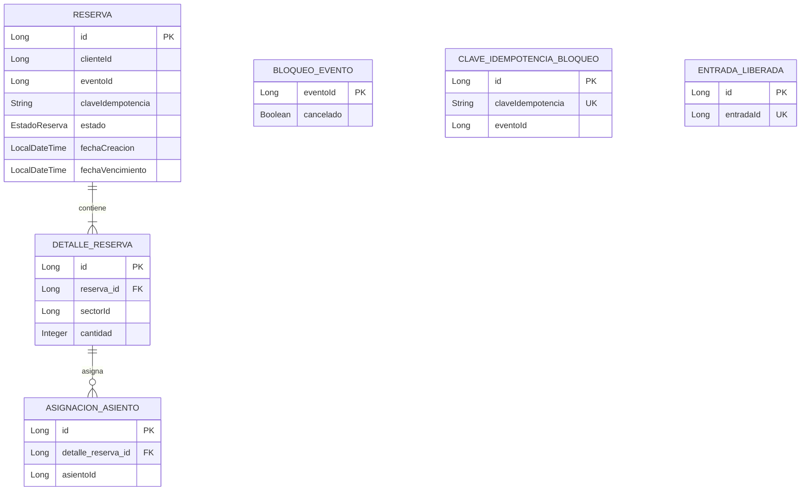

# 03 — Modelo de datos de Reservas

## 1. Descripción general

El modelo de datos de `msvc-reservas` permite registrar reservas temporales y confirmadas de lugares para eventos, controlar su ocupación y evitar duplicaciones ante solicitudes simultáneas o reintentos.

El microservicio utiliza una base de datos MySQL propia, denominada `ticketya_reservas`.

Los datos de eventos, sectores, asientos y precios pertenecen al microservicio Eventos y Lugares. Reservas consulta esta información mediante `EventoClient`, implementado con OpenFeign, sin almacenar las entidades externas en su propia base de datos.

## 2. Entidades principales

### 2.1. Reserva

Representa una reserva realizada por un cliente para un evento.

| Atributo | Descripción |
|---|---|
| `id` | Identificador único de la reserva. |
| `clienteId` | Identificador del cliente que realiza la reserva. |
| `eventoId` | Identificador del evento asociado. |
| `claveIdempotencia` | Clave utilizada para reconocer reintentos de creación. |
| `estado` | Estado actual de la reserva. |
| `fechaCreacion` | Fecha y hora de creación. |
| `fechaVencimiento` | Fecha y hora límite de la reserva temporal. |

**Estados de una reserva:**

- `ACTIVA`: reserva temporal registrada que puede continuar vigente según su fecha de vencimiento.
- `CONFIRMADA`: reserva confirmada después de la aprobación del pago.
- `VENCIDA`: reserva cuyo plazo de validez terminó y cuyo estado fue actualizado.
- `LIBERADA`: reserva liberada mediante una operación correspondiente.
- `CANCELADA`: reserva invalidada por la cancelación del evento.

El vencimiento se calcula a partir de la fecha de creación. La disponibilidad deja de considerar una reserva cuando su fecha de vencimiento ya pasó, aunque su estado persistido todavía figure como `ACTIVA`.

### 2.2. DetalleReserva

Representa cada sector y cantidad de lugares incluidos en una reserva.

| Atributo | Descripción |
|---|---|
| `id` | Identificador del detalle. |
| `reserva` | Reserva a la que pertenece. |
| `sectorId` | Identificador del sector en Eventos y Lugares. |
| `cantidad` | Cantidad de lugares solicitados. |

Una reserva puede contener uno o varios detalles correspondientes a los sectores seleccionados.

### 2.3. AsignacionAsiento

Representa la asignación de un asiento específico dentro de una reserva de un sector numerado.

| Atributo | Descripción |
|---|---|
| `id` | Identificador de la asignación. |
| `detalleReserva` | Detalle de reserva al que pertenece. |
| `asientoId` | Identificador del asiento en Eventos y Lugares. |

Esta entidad permite registrar los asientos seleccionados y controlar que no existan asignaciones incompatibles.

En sectores no numerados no se registran asignaciones individuales de asiento. La ocupación se controla utilizando la cantidad reservada y la capacidad máxima del sector.

### 2.4. BloqueoEvento

Mantiene información de bloqueo y cancelación para coordinar las operaciones que modifican la ocupación de un evento.

| Atributo | Descripción |
|---|---|
| `eventoId` | Identificador del evento. |
| `cancelado` | Indica si el evento fue cancelado localmente. |

El registro se utiliza para adquirir un bloqueo pesimista sobre el evento antes de modificar su ocupación.

Cuando `cancelado` es verdadero, el sistema impide realizar nuevas reservas para ese evento.

### 2.5. ClaveIdempotenciaBloqueo

Registra las claves de idempotencia utilizadas en la creación de reservas.

| Atributo | Descripción |
|---|---|
| `id` | Identificador del registro. |
| `claveIdempotencia` | Clave única que identifica la solicitud. |
| `eventoId` | Evento asociado a la solicitud. |

Permite coordinar solicitudes repetidas y evitar que un reintento genere reservas duplicadas.

### 2.6. EntradaLiberada

Registra las entradas que ya fueron procesadas para su liberación individual.

| Atributo | Descripción |
|---|---|
| `id` | Identificador del registro. |
| `entradaId` | Identificador único de la entrada liberada. |

El registro permite reconocer solicitudes repetidas y evitar que una misma entrada provoque dos liberaciones del lugar correspondiente.

La aprobación de las devoluciones y la validación de titularidad pertenecen a los servicios responsables de esas operaciones.

## 3. Relaciones entre entidades

Las relaciones principales son:

- Una `Reserva` puede contener varios `DetalleReserva`.
- Cada `DetalleReserva` pertenece a una única `Reserva`.
- Un `DetalleReserva` puede tener varias `AsignacionAsiento`.
- Cada `AsignacionAsiento` pertenece a un único `DetalleReserva`.

Las entidades `BloqueoEvento`, `ClaveIdempotenciaBloqueo` y `EntradaLiberada` son registros auxiliares utilizados para administrar concurrencia, cancelaciones e idempotencia.

Los atributos `eventoId`, `sectorId`, `asientoId` y `clienteId` representan identificadores de datos administrados por otros componentes. No constituyen relaciones JPA con entidades externas.

## 4. Diagrama entidad-relación

El diagrama representa las relaciones internas del microservicio y distingue las claves primarias, las claves foráneas locales y los identificadores únicos utilizados para prevenir duplicaciones.

## 5. Integridad y concurrencia

### 5.1. Integridad de datos

El modelo utiliza claves primarias, relaciones entre entidades y restricciones de unicidad para mantener la integridad de los registros.

- Las claves primarias identifican cada entidad.
- Las relaciones entre reservas, detalles y asignaciones se mantienen mediante claves foráneas.
- Las claves de idempotencia identifican las solicitudes de creación.
- Cada entrada liberada se registra mediante un identificador único.
- Los identificadores de entidades externas se almacenan como valores simples, sin claves foráneas hacia otras bases de datos.

### 5.2. Control de concurrencia

La entidad `BloqueoEvento` permite adquirir un bloqueo pesimista mediante `PESSIMISTIC_WRITE` antes de realizar operaciones que modifican la ocupación de un evento.

Este bloqueo permite serializar operaciones concurrentes sobre el mismo evento cuando las instancias del microservicio comparten la misma base de datos MySQL.

Las restricciones de unicidad y las claves de idempotencia complementan el control de concurrencia, evitando asignaciones y solicitudes duplicadas.

### 5.3. Vencimiento de reservas

La fecha `fechaVencimiento` determina hasta qué momento una reserva temporal continúa ocupando lugares.

Las consultas de disponibilidad consideran las reservas confirmadas y las reservas activas cuyo vencimiento todavía no ocurrió.

Las reservas activas vencidas dejan de bloquear lugares, aunque su estado persistido aún sea `ACTIVA`.

Una operación posterior puede actualizar su estado a `VENCIDA`.

Este mecanismo permite liberar capacidad sin necesidad de ejecutar una tarea programada.

## 6. Relaciones con otros microservicios

Reservas utiliza información administrada por otros microservicios sin replicar sus entidades persistentes.

| Dato | Microservicio responsable | Uso en Reservas |
|---|---|---|
| Evento | Eventos y Lugares | Verificar existencia, estado y habilitación del evento. |
| Sector | Eventos y Lugares | Verificar pertenencia al lugar, tipo y capacidad. |
| Asiento | Eventos y Lugares | Validar los asientos seleccionados. |
| Precio | Eventos y Lugares | Verificar que exista un precio configurado para el evento y sector. |
| Cliente | Identificado mediante `clienteId` | Asociar la reserva con el cliente correspondiente. |
| Entrada | Entradas | Identificar la entrada asociada a una devolución. |
| Pago | Compras | Determinar la confirmación o liberación de la reserva según el resultado del pago. |

Las referencias se realizan mediante identificadores y comunicación entre microservicios.

No se establecen relaciones JPA directas ni claves foráneas entre bases de datos independientes.

## 7. Consideraciones del modelo

- Cada reserva corresponde a un cliente y un evento.
- Una reserva puede contener varios detalles asociados a distintos sectores.
- Los asientos específicos se registran mediante `AsignacionAsiento`.
- Los sectores no numerados utilizan la capacidad y la cantidad reservada para calcular la ocupación.
- El vencimiento de las reservas temporales se controla mediante `fechaVencimiento`.
- La entidad `BloqueoEvento` permite coordinar operaciones concurrentes y registrar cancelaciones.
- Las claves de idempotencia evitan crear reservas duplicadas ante reintentos.
- `EntradaLiberada` permite reconocer devoluciones individuales que ya fueron procesadas.
- Los identificadores externos permiten relacionar información entre microservicios sin compartir sus entidades ni sus bases de datos.