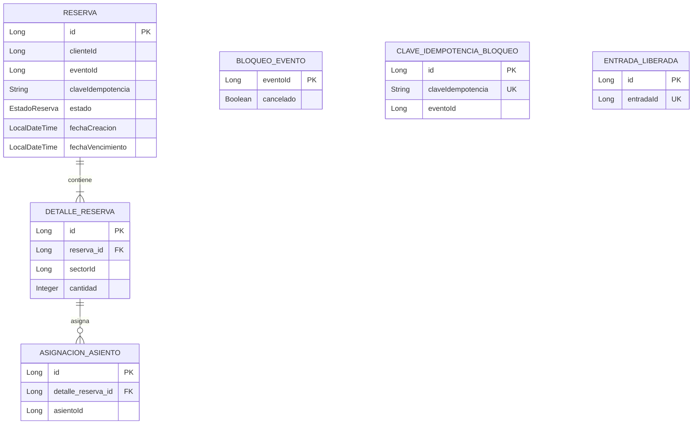

# 03 — Modelo de datos de Reservas

**Proyecto:** TicketYa · Microservicio `msvc-reservas` · Entrega 1

## 1. Objetivo

El modelo de datos de `msvc-reservas` permite registrar las reservas temporales y confirmadas de lugares para eventos, controlar su ocupación y evitar duplicaciones ante solicitudes simultáneas o reintentos.

La base de datos es propia del microservicio y se denomina `ticketya_reservas`.

Los datos maestros de eventos, sectores, asientos y precios pertenecen a `msvc-eventosylugares`. Reservas consulta esa información mediante `EventoClient` (OpenFeign), pero no administra esas entidades en su propia base.

## 2. Entidades principales

### 2.1. Reserva

Representa una solicitud de reserva realizada por un cliente para un evento.

| Atributo | Descripción |
| `id` | Identificador único de la reserva |
| `clienteId` | Identificador del cliente que realiza la reserva |
| `eventoId` | Identificador del evento asociado |
| `claveIdempotencia` | Clave utilizada para reconocer reintentos de creación |
| `estado` | Estado actual de la reserva |
| `fechaCreacion` | Fecha y hora de creación |
| `fechaVencimiento` | Fecha y hora límite de la reserva temporal |

Estados principales:

- `ACTIVA`: reserva temporal vigente.
- `CONFIRMADA`: reserva confirmada después de la aprobación del pago.
- `VENCIDA`: reserva cuyo plazo terminó.
- `LIBERADA`: reserva liberada por una operación correspondiente.
- `CANCELADA`: reserva invalidada por la cancelación del evento.

El vencimiento se calcula a partir de la fecha de creación. La disponibilidad deja de considerar una reserva cuando su fecha de vencimiento ya pasó, aunque el estado persistido todavía figure como `ACTIVA`.

### 2.2. DetalleReserva

Representa cada sector y cantidad de lugares incluidos en una reserva.

| Atributo | Descripción |
| `id` | Identificador del detalle |
| `reserva` | Reserva a la que pertenece |
| `sectorId` | Identificador del sector en Eventos y Lugares |
| `cantidad` | Cantidad de lugares solicitados |

Una reserva puede tener uno o varios detalles, según los sectores seleccionados.

### 2.3. AsignacionAsiento

Representa la asignación de un asiento concreto para una reserva de un sector numerado.

| Atributo | Descripción |
| `id` | Identificador de la asignación |
| `detalleReserva` | Detalle de reserva al que pertenece |
| `asientoId` | Identificador del asiento en Eventos y Lugares |

Se utiliza para registrar los asientos elegidos y controlar que no existan asignaciones incompatibles.

En los sectores no numerados no se registran asignaciones individuales de asiento: la ocupación se controla mediante la cantidad reservada y la capacidad del sector.

### 2.4. BloqueoEvento

Mantiene información de bloqueo y cancelación para serializar operaciones que modifican la ocupación de un evento.

| Atributo | Descripción |
| `eventoId` | Identificador del evento |
| `cancelado` | Indica si el evento fue cancelado localmente |

Se utiliza como punto de bloqueo pesimista para coordinar las operaciones concurrentes sobre un mismo evento.

Cuando `cancelado` es verdadero, no se permiten nuevas reservas para ese evento.

### 2.5. ClaveIdempotenciaBloqueo

Registra las claves de idempotencia utilizadas en la creación de reservas.

| Atributo | Descripción |
| `id` | Identificador del registro |
| `claveIdempotencia` | Clave única de la solicitud |
| `eventoId` | Evento asociado a la solicitud |

Permite coordinar solicitudes repetidas y evitar que un reintento genere una reserva duplicada.

### 2.6. EntradaLiberada

Registra las entradas que ya fueron procesadas para su liberación individual.

| Atributo | Descripción |
| `id` | Identificador del registro |
| `entradaId` | Identificador de la entrada liberada |

La identificación de la entrada permite reconocer reintentos y evitar que se procese dos veces la misma liberación.

La aprobación de la devolución y la validación de titularidad corresponden a los servicios responsables; este registro no reemplaza esas validaciones.

## 3. Relaciones entre entidades

Las relaciones principales del modelo son:

- Una `Reserva` puede contener varios `DetalleReserva`.
- Cada `DetalleReserva` pertenece a una única `Reserva`.
- Un `DetalleReserva` puede tener varias `AsignacionAsiento`.
- Cada `AsignacionAsiento` pertenece a un único `DetalleReserva`.
- `BloqueoEvento`, `ClaveIdempotenciaBloqueo` y `EntradaLiberada` son registros auxiliares utilizados para concurrencia e idempotencia.

Los identificadores `eventoId`, `sectorId`, `asientoId` y `clienteId` son referencias a datos administrados por otros componentes del sistema. No representan relaciones JPA con entidades de otros microservicios.

## 4. Diagrama entidad-relación

El diagrama representa las relaciones funcionales y las claves lógicas del modelo. Los nombres exactos de las columnas y restricciones deben contrastarse con las entidades y el esquema generado por Hibernate.

## 5. Consideraciones de integridad y concurrencia

### 5.1. Integridad de los datos

- Las claves primarias identifican cada registro.
- Las relaciones entre reserva, detalle y asignación se mantienen mediante claves foráneas.
- La clave de idempotencia debe identificar una solicitud de creación.
- La entrada liberada se registra una sola vez.
- Los identificadores de entidades externas no deben interpretarse como claves foráneas locales si no existe una tabla correspondiente en esta base.

### 5.2. Control de concurrencia

El registro `BloqueoEvento` se utiliza para adquirir un bloqueo pesimista sobre el evento antes de modificar su ocupación.

Esto permite serializar operaciones concurrentes sobre un mismo evento cuando las instancias de Reservas comparten la base MySQL.

Además, las restricciones de unicidad y el registro de claves de idempotencia contribuyen a evitar duplicaciones.

### 5.3. Vencimiento de reservas

La fecha `fechaVencimiento` determina si una reserva temporal sigue ocupando lugares.

Las consultas de disponibilidad excluyen reservas activas cuyo vencimiento ya pasó. Por lo tanto, no es necesario modificar inmediatamente el estado persistido para liberar capacidad.

Una operación posterior puede actualizar el estado a `VENCIDA`.

## 6. Datos que no pertenecen a esta base

Reservas no mantiene copias propias de las siguientes entidades:

| Dato | Microservicio responsable | Uso en Reservas |
| Evento | Eventos y Lugares | Verificar existencia y estado |
| Sector | Eventos y Lugares | Verificar pertenencia y capacidad |
| Asiento | Eventos y Lugares | Validar los asientos seleccionados |
| Precio | Eventos y Lugares | Verificar que exista precio para el evento y sector |
| Cliente | Servicio responsable de clientes | Identificar al comprador |
| Entrada | Entradas | Identificar la entrada asociada a una devolución |
| Pago | Compras | Determinar si corresponde confirmar o liberar la reserva |

Las referencias se realizan mediante identificadores y comunicación entre microservicios. No se establecen relaciones JPA directas entre bases de datos independientes.

## 7. Documentación relacionada

- [01 — Funcionalidades e historias de usuario](01-FUNCIONALIDADES-Y-USER-STORIES.md)
- [02 — Arquitectura y diagramas](02-ARQUITECTURA-Y-DIAGRAMAS-RESERVAS.md)
- [05 — Testing](05-TESTING-RESERVAS.md)
- [06 — Decisiones y limitaciones](06-DECISIONES-Y-LIMITACIONES-RESERVAS.md)
- [Contrato con Eventos y Lugares](contrato-eventos.md)

**Nota:** este documento describe el modelo lógico de Reservas. Ante cualquier diferencia entre el diagrama y las clases Java, prevalecen las entidades y las restricciones efectivamente implementadas en el código.