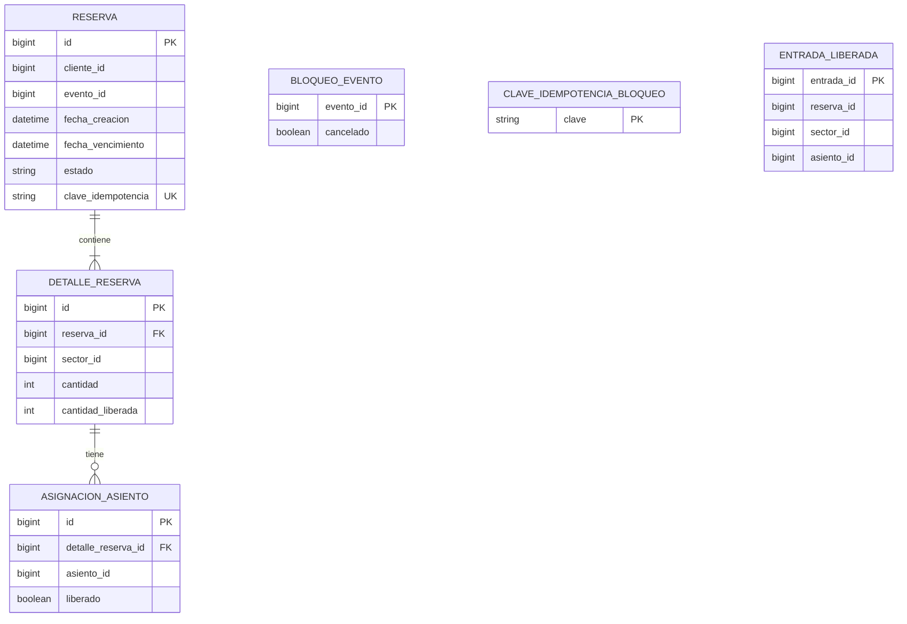

# Modelo de datos — msvc-reservas (Entrega 1)

## 1. Base de datos y responsabilidad

`msvc-reservas` utiliza su propia base de datos relacional, `ticketya_reservas` (MySQL). Aquí persiste reservas, detalles, asignaciones de asientos y registros auxiliares para concurrencia e idempotencia. Los catálogos de eventos, lugares, sectores, asientos y precios pertenecen a **msvc-eventosylugares**.

Los campos `eventoId`, `sectorId`, `asientoId` y `clienteId` son **referencias por identificador**; no representan asociaciones JPA ni claves foráneas a tablas de otros microservicios.

## 2. Diagrama entidad-relación (Mermaid)

**Importante:** las tres tablas `BLOQUEO_EVENTO`, `CLAVE_IDEMPOTENCIA_BLOQUEO` y `ENTRADA_LIBERADA` aparecen separadas porque, en la implementación actual, **no tienen relaciones `@ManyToOne` / `@OneToMany` con `Reserva`**. Sus identificadores permiten relacionarlas lógicamente con reservas, eventos o entradas, pero no se deben dibujar como FKs JPA inexistentes.

## 3. Relaciones persistentes (JPA)

| Relación | Cardinalidad | Implementación |
|---|---|---|
| `Reserva` → `DetalleReserva` | 1:N | `Reserva.detalles` (`@OneToMany`) y `DetalleReserva.reserva` (`@ManyToOne`); FK `detalle_reserva.reserva_id` |
| `DetalleReserva` → `AsignacionAsiento` | 1:N | `DetalleReserva.asignaciones` (`@OneToMany`) y `AsignacionAsiento.detalleReserva` (`@ManyToOne`); FK `asignacion_asiento.detalle_reserva_id` |

En ambos casos, la colección padre utiliza `cascade = ALL` y `orphanRemoval = true`. Una reserva tiene uno o más detalles válidos; cada detalle de un sector numerado puede tener múltiples asignaciones de asiento. Un detalle de sector no numerado no requiere asignaciones individuales.

## 4. Responsabilidad de cada tabla

| Tabla | Propósito |
|---|---|
| `reserva` | Identifica cliente, evento, fechas, estado y clave de idempotencia de cada reserva. |
| `detalle_reserva` | Guarda el sector, cantidad original y número de entradas liberadas. |
| `asignacion_asiento` | Registra cada asiento reservado y si fue liberado individualmente. |
| `bloqueo_evento` | Mantiene una fila por evento habilitado, utilizada para el bloqueo pesimista y para marcar eventos cancelados. |
| `clave_idempotencia_bloqueo` | Mantiene filas bloqueables por clave para serializar reintentos simultáneos. |
| `entrada_liberada` | Registra una única vez el `entradaId` ya liberado, junto con `reservaId`, `sectorId` y `asientoId` opcional. |

## 5. Restricciones y reglas principales

- `reserva.clave_idempotencia` tiene restricción de unicidad; representa la misma operación ante reintentos.
- `entrada_liberada.entrada_id` es clave primaria y evita registrar dos veces la liberación de una misma entrada.
- `bloqueo_evento.evento_id` es clave primaria: una fila representa el evento que Reservas puede bloquear durante operaciones concurrentes.
- `clave_idempotencia_bloqueo.clave` es clave primaria: permite un bloqueo por clave antes del bloqueo por evento.
- En sectores numerados, se guarda una `AsignacionAsiento` por asiento seleccionado; solo las asignaciones no liberadas de reservas vigentes cuentan como ocupación.
- En sectores no numerados, se cuenta `cantidad - cantidadLiberada` por detalle para determinar la ocupación.
- Solo las reservas `CONFIRMADA` o `ACTIVA` con `fechaVencimiento` futura ocupan capacidad. Las reservas vencidas dejan de contar incluso si su estado aún figura como `ACTIVA` en MySQL.
- Una reserva temporal se crea con `fechaVencimiento = fechaCreacion + 10 minutos`.
- Los estados persistidos son `ACTIVA`, `CONFIRMADA`, `VENCIDA`, `LIBERADA` y `CANCELADA`.
- El límite de entradas por cliente y evento es configurable (`reservas.max-entradas-por-cliente`, valor local 4).

## 6. Por qué existen las tablas auxiliares

### `bloqueo_evento`

Permite ejecutar operaciones concurrentes del mismo evento bajo `PESSIMISTIC_WRITE`: cuando varios clientes intentan reservar el mismo asiento o último lugar, el cálculo de disponibilidad y la persistencia quedan serializados dentro de Reservas. La fila se crea al habilitar el evento, **antes de iniciar las ventas**. También permite rechazar nuevas ventas tras una cancelación.

### `clave_idempotencia_bloqueo`

El bloqueo de la clave se adquiere antes que el del evento. Así, dos solicitudes simultáneas con la misma `claveIdempotencia` no generan dos reservas diferentes. Los bloqueos forman parte de una transacción local de MySQL.

### `entrada_liberada`

Permite registrar que una devolución individual ya fue aplicada. No sustituye a la entidad `Entrada` de otro microservicio ni acredita por sí sola la titularidad o la aprobación de la devolución.

## 7. Límites de consistencia entre microservicios

No existe una transacción distribuida que abarque las bases de Reservas, Eventos, Compras y Entradas. Por lo tanto, la publicación y cancelación de un evento, la aprobación de un pago y los reintegros requieren llamadas internas coordinadas, reintentos y, cuando corresponda, compensaciones. Las relaciones con entidades de otros microservicios se mantienen únicamente mediante IDs y contratos REST.

## 8. Código fuente de referencia

- `src/main/java/com/ticketya/reservas/entities/` — entidades JPA.
- `src/main/java/com/ticketya/reservas/repositories/` — consultas y bloqueos sobre MySQL.
- `src/main/java/com/ticketya/reservas/services/ReservaServiceImpl.java` — creación, estados, idempotencia y concurrencia.
- `src/main/java/com/ticketya/reservas/services/DisponibilidadServiceImpl.java` — cálculo de capacidad y asientos libres.
