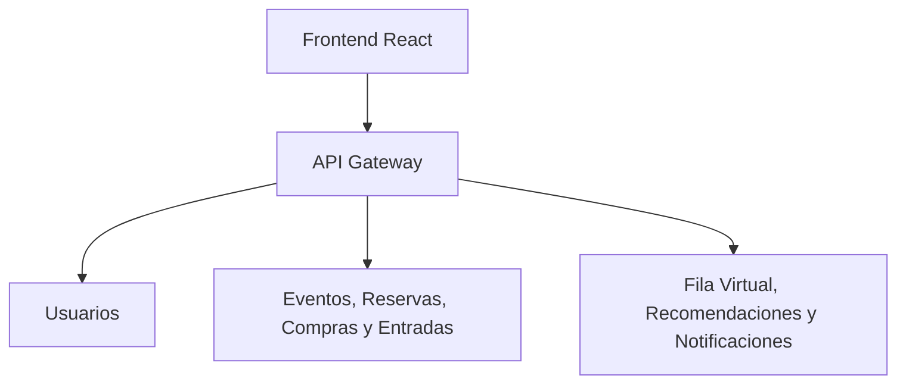

# Arquitectura general — TicketYa

## Descripción

TicketYa está desarrollado con una arquitectura de microservicios. Cada servicio tiene responsabilidades definidas, administra su propia persistencia y se comunica con los demás mediante APIs REST.

El frontend está implementado con React y utiliza el API Gateway como punto de acceso al backend.

## Componentes

## Servicios y persistencia

| Servicio | Puerto | Persistencia |
|---|---:|---|
| Usuarios | 8085 | MySQL |
| Eventos y Lugares | 8081 | MySQL |
| Reservas | 8080 | MySQL |
| Compras y Pagos | 8082 | MySQL |
| Entradas | 8083 | MySQL |
| Fila Virtual | 8088 | MySQL |
| Recomendaciones | 8086 | MongoDB |
| Notificaciones | 8087 | MySQL |
| API Gateway | 8084 | No posee base de datos |

Cada servicio conserva la propiedad de sus datos. Las relaciones entre información de distintos servicios se representan mediante identificadores y contratos REST.

## Comunicaciones principales

- Reservas consulta eventos, sectores y asientos para calcular la disponibilidad.
- Compras coordina la confirmación de reservas y la emisión de entradas.
- Entradas se comunica con Reservas y Compras para gestionar devoluciones.
- Eventos comunica cancelaciones y cambios a los servicios involucrados.
- Fila Virtual participa en el control de acceso a compras de alta demanda.
- Recomendaciones consulta el catálogo y las sugerencias derivadas de compras.
- Notificaciones recibe solicitudes internas y procesa correos electrónicos.

## Seguridad

Usuarios emite JWT firmados con RS256. El Gateway y los microservicios validan la autenticación y aplican permisos según roles e identidad.

Las operaciones internas protegidas utilizan credenciales de servicio.

## Consistencia y concurrencia

Las operaciones transaccionales se realizan dentro de cada microservicio.

Para coordinar procesos entre servicios se utilizan validaciones de estado, identificadores de operación, mecanismos de idempotencia y reintentos cuando corresponde.

Reservas emplea bloqueos transaccionales para evitar asignaciones incompatibles de lugares.

No existe una transacción única compartida por todas las bases de datos.

## Despliegue

La aplicación se ejecuta mediante Docker Compose. Cada microservicio utiliza su propio contenedor y las conexiones internas se realizan mediante los nombres de servicio configurados.

El frontend se sirve mediante Nginx y accede al backend a través del API Gateway.

Las decisiones y los modelos internos se describen en la documentación específica de cada microservicio.