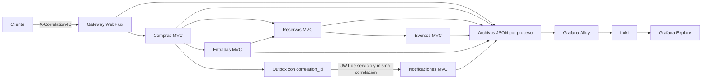

# Logging HTTP y trazabilidad de TicketYa

## Alcance y diagnóstico inicial

Se trabajó en `TPE-micro2`, la entrega integrada del repositorio, a partir del commit
`30f40ea61117d6ff2e70d327fd36bb054a310510`. `TPE-micro1` e `integrador1/2/3` se conservaron.
La carpeta originalmente abierta en el IDE contenía ejercicios de grafos; esta copia
del repositorio está en `ESTUDIO_FINAL_/arquitecturasGrupo12`.

Ya existían logs puntuales de negocio y de reintentos con SLF4J. No existían filtros
generales HTTP, MDC de correlación, configuración de logging estructurado, colector
ni almacenamiento centralizado. Los clientes reales son OpenFeign y RestClient;
el Gateway usa WebFlux/Netty. No hay Eureka configurado en esta entrega: las URLs
se parametrizan mediante variables de entorno y se conservaron.

Hay tareas `@Scheduled` y outboxes persistentes. No se encontraron métodos `@Async`
ni clientes WebClient/RestTemplate usados por el negocio. Por eso se cubrieron las
llamadas reales y los trabajos persistentes; no se agregó un sistema de mensajería.

## Arquitectura implementada



El módulo Java `observability` es una biblioteca pequeña. Sus dependencias Spring,
Security, Servlet, WebFlux y Feign son opcionales: no arrastra Boot 3 al runtime de
Boot 4 ni obliga al Gateway a iniciar un servidor Servlet. Cada servicio conserva
su parent y su BOM. El agregador raíz no es parent de los servicios.

Cada aplicación importa `classpath:ticketya-logging.properties`. Spring Boot 3.5 y
4.1 ya proporcionan el formato JSON Logstash; no se agregó otro encoder Jackson
ni una dependencia que mezcle Jackson 2 y 3.

| Proceso / `spring.application.name` | Registro y propagación |
|---|---|
| `msvc-gateway` | WebFilter reactivo; contexto Reactor; header normalizado en el intercambio reenviado. |
| `msvc-usuarios` | Filtro Servlet, identidad de JWT validado y logs de `/auth` y `/usuarios`. |
| `msvc-eventos-lugares` | Filtro Servlet, Feign, RestClient de credenciales y dos outboxes. Es el nombre real del servicio del directorio `msvc-eventosylugares`. |
| `msvc-reservas` | Filtro Servlet, Feign, credenciales y finalizaciones persistentes de Fila Virtual. |
| `msvc-compras` | Filtro Servlet, Feign, credenciales y outbox de compra confirmada. |
| `msvc-entradas` | Filtro Servlet, Feign y RestClient; incluye consultas usadas en emisión y reintegros. |
| `msvc-notificaciones` | Filtro Servlet y correlación restaurada durante el envío/reintento SMTP. |
| `msvc-fila-virtual` | Filtro Servlet y cliente Feign de Eventos. El vencimiento periódico sin solicitud no hereda identidad de otro usuario. |
| `msvc-recomendaciones` | Filtro Servlet y Feign; reenvía únicamente el JWT del usuario autenticado. |

## Solicitudes MVC

`ServletHttpLoggingFilter` se registra antes de Spring Security. Crea o acepta un ID
seguro, normaliza el header para las capas interiores y lo coloca en la respuesta.
El reloj monotónico `System.nanoTime()` mide la duración hasta finalizar la petición.

`HttpIdentityFilter` se agrega dentro de cada cadena de seguridad después de
`BearerTokenAuthenticationFilter` y antes de autorizar. Sólo lee un principal JWT
que ya validó el Resource Server. Captura su `sub` antes de que Security limpie el
contexto, también cuando la autorización responde 403. Un token ausente o rechazado
se registra como `anonimo`; `X-Cliente-Id` y otros headers no identifican al actor.

Un observador de `HandlerExceptionResolver` guarda únicamente la clase de la excepción
y devuelve `null`: los manejadores existentes siguen definiendo las respuestas.
Los errores no manejados también se registran y se relanzan. Se registran 400, 401,
403, 404, 409, 500 y errores de dependencias, además de respuestas exitosas.

Hay un solo evento `http_request` por solicitud. Un estado compartido evita duplicarlo
en despachos asíncronos Servlet; un AsyncListener espera la finalización cuando existe
ese tipo de procesamiento. La duración incluye la ejecución, no se obtiene de un header.

## Gateway reactivo

`ReactiveHttpLoggingFilter` es un WebFilter exterior a Security. A diferencia de un
GlobalFilter de rutas, también ve solicitudes rechazadas antes de enrutar. El ID viaja
en el header mutado y en Reactor Context. `ReactiveIdentityFilter`, colocado después
de autenticación, captura el sujeto validado en atributos del intercambio.

No se mantiene un MDC abierto durante un Publisher. Cada evento recibe sus campos
explícitamente: cambiar de hilo o ejecutar solicitudes simultáneas no mezcla usuarios.
La respuesta conserva el header en 401/403 y en fallos de conexión. Cancelaciones de
una petición sin respuesta se representan como 499 en el registro, no como una
respuesta HTTP que se haya enviado al cliente.

## Correlación y clientes

- Header: `X-Correlation-ID`.
- Formato aceptado: `[A-Za-z0-9][A-Za-z0-9._-]{0,63}`, entre 1 y 64 caracteres.
- Un valor ausente, vacío, demasiado largo, con espacios/controles, con comas o con
  múltiples headers se reemplaza por un UUID. No se concatenan valores del cliente.
- El ID es trazabilidad y no concede permisos ni certifica identidad.
- Los servicios también generan un ID cuando reciben una petición directa sin Gateway.
- El interceptor Feign elimina valores previos y propaga el ID actual. Una Capability
  registra `http_client`, incluso si el servidor destino nunca recibió la llamada.
- Un interceptor RestClient/RestTemplate se instala en los builders/beans administrados.
  Los cuatro RestClient construidos manualmente para obtener credenciales lo incluyen
  explícitamente. El proyecto no usa RestTemplate en su negocio.
- `InternalRestSecurity` y los interceptores Bearer existentes siguen autenticando las
  llamadas. Correlación y autenticación se propagan por mecanismos independientes.

`Correlation.Scope` restaura el MDC anterior en un `finally`, también ante errores.
Al emitir un evento HTTP se evita duplicar sus campos entre MDC y pares SLF4J: el
encoder de Boot rechaza claves repetidas. Una prueba de integración lee el JSON real.

## Tareas programadas y reintentos

Se añadió una columna nullable `correlation_id` a las cinco entidades existentes:
`AvisoCompraPendiente`, `AvisoEventoPendiente`, `NotificacionCancelacion`,
`FinalizacionFilaPendiente` y `Notificacion`. Al crear un trabajo se captura el ID;
al procesarlo se abre su scope y se restaura al salir. El ID sobrevive a reintentos y
a reinicios porque queda en la base, no sólo en un ThreadLocal. Una fila anterior sin
ID obtiene uno al procesarse y lo conserva al persistir su actualización.

Un proceso sin petición original no inventa un usuario humano: el receptor de HTTP
registra `service:compras`, `service:eventos`, etc., según el JWT de servicio validado.
El usuario inicial puede localizarse en el primer registro de la misma correlación.

Los perfiles de desarrollo que usan `ddl-auto=update` agregan las columnas. Para una
base existente de Eventos con `ddl-auto=validate`, aplicar una vez
[`sql/03-observabilidad-eventos-mariadb.sql`](sql/03-observabilidad-eventos-mariadb.sql).
No se agregaron claves foráneas entre bases de microservicios.

## Formato del registro

Ejemplo de la forma emitida; duración e identificadores dependen de cada ejecución:

```json
{"@timestamp":"2026-11-19T17:39:40.123-03:00","@version":"1","message":"http_request","logger_name":"ticketya.http","thread_name":"http-nio-18082-exec-2","level":"INFO","level_value":20000,"evento":"http_request","correlationId":"defensa-compra-001","usuario":"6","metodo":"POST","endpoint":"/compras","status":201,"duracionMs":145,"servicio":"msvc-compras"}
```

| Campo | Significado |
|---|---|
| `@timestamp` | Fecha/hora ISO 8601 con zona, generada al escribir el evento. |
| `servicio` | Nombre real de la aplicación, añadido a todos sus logs. |
| `evento` | `http_request` recibido o `http_client` saliente. |
| `correlationId` | Identificador validado de la operación. |
| `usuario` | `sub` de JWT validado, sujeto de servicio o `anonimo`. |
| `metodo`, `endpoint` | Método y patrón MVC cuando está disponible; en Gateway y clientes, path sin query. |
| `status` | Número HTTP observado; en un cliente que falla antes de responder, 502 en el log saliente. |
| `duracionMs` | Número de milisegundos medidos con reloj monotónico. |
| `error` | Clase de excepción o `HTTP_<estado>`, únicamente cuando corresponde. |

El Gateway no conoce las plantillas MVC y registra el path. En una denegación anterior
al controlador, MVC también registra el path porque todavía no existe un patrón resuelto.

No se registran cuerpos, parámetros de consulta, Authorization, JWT completos, cookies,
emails ni contraseñas. Los logs de reintentos evitan mensajes/stack traces de Feign o
SMTP que podrían incluir cuerpos remotos. SQL, bindings y detalles de requests no se
habilitan en esta configuración. El smoke comprueba que sus tokens y secretos no estén
en la evidencia recolectada.

## Centralización

Se eligieron **Grafana + Loki + Grafana Alloy**: Loki almacena líneas e indexa pocas
etiquetas; Alloy lee archivos y no requiere montar `docker.sock`. Es una instalación
local de un solo nodo, más pequeña que incorporar Elasticsearch. Se usan versiones
fijas y configuraciones versionadas, con persistencia y retención de siete días.

Cada proceso escribe JSON en consola y en un archivo rotativo: 10 MB por archivo,
100 MB y siete días como límites por servicio. En contenedores se usa el volumen
`application-logs`, compartido con Alloy sólo para lectura. Todos los contenedores de
aplicación usan UID 10001 para que ese volumen sea escribible sin ejecutar Java como root.
Un contenedor breve `logs-init` fija el propietario del volumen antes de iniciar Java,
también si Alloy lo montó primero. Reutiliza la imagen JRE y sólo monta el volumen de
logs; no accede a las bases ni a secretos. Las aplicaciones esperan a que finalice.

En ejecución local, desde la carpeta de cada módulo, el destino predeterminado es
`../logs/<spring.application.name>.log`; Alloy monta esa carpeta como segunda fuente.
Si se ejecuta un JAR desde otra carpeta, hay que definir `TICKETYA_LOG_DIR` con la ruta
absoluta de `TPE-micro2/logs`. El smoke lo establece explícitamente.

El colector extrae `servicio`, `level` y fecha desde JSON. Las etiquetas son `job`,
`runtime`, `servicio` y `level` (más el nombre de archivo). `correlationId` permanece
en la línea y se filtra con `| json`; no se convierte en una etiqueta de alta cardinalidad.
Los offsets de lectura, los datos de Loki y Grafana se conservan en volúmenes separados.

Grafana tiene el datasource `TicketYa Logs` provisionado. Grafana y Loki sólo publican
puertos en `127.0.0.1`; Alloy no publica puertos. La red de observabilidad es interna y
no se agregaron dependencias de inicio que bloqueen microservicios si falla Loki.

Consulta real de LogQL en Explore, seleccionando un intervalo que incluya la operación:

```logql
{job="ticketya"} | json | correlationId="defensa-compra-001"
```

```logql
{job="ticketya", servicio=~"msvc-(compras|reservas|entradas)"} | json | correlationId="defensa-compra-001"
```

```logql
{job="ticketya"} | json | correlationId="defensa-compra-001" | status >= 500
```

La configuración contempla Docker y ejecución local. **La ingesta y la consulta real
en Loki todavía requieren ejecutarse con Docker iniciado en este entorno.** Validar
Compose no prueba que Alloy haya enviado una línea. Los comandos y el verificador que
exige al menos dos servicios están en [la guía](09-EJECUCION-OBSERVABILIDAD.md).

## Referencias técnicas

- [Spring Boot: logging estructurado, Logstash y MDC](https://docs.spring.io/spring-boot/reference/features/logging.html).
- [Alloy: lectura de archivos](https://grafana.com/docs/alloy/latest/reference/components/loki/loki.source.file/).
- [Alloy: procesamiento JSON y etiquetas](https://grafana.com/docs/alloy/latest/reference/components/loki/loki.process/).
- [Loki: configuración de un nodo y filesystem](https://grafana.com/docs/loki/latest/configure/examples/configuration-examples/).
- [Grafana: provisioning](https://grafana.com/docs/grafana/latest/administration/provisioning/).
