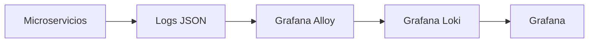

# Observabilidad y trazabilidad — TicketYa

## Objetivo

TicketYa utiliza registros estructurados en JSON para observar solicitudes HTTP, operaciones de negocio y errores distribuidos.

Los registros incorporan información del servicio, endpoint, estado HTTP, duración, identidad y correlación de la solicitud.

## Arquitectura



Los servicios escriben registros en un volumen compartido. Grafana Alloy los recolecta y envía a Loki para su consulta desde Grafana.

## Correlación

El encabezado `X-Correlation-ID` identifica las solicitudes relacionadas a través de los distintos servicios.

Esto permite seguir una operación completa, incluso cuando intervienen varias llamadas HTTP internas.

Los registros utilizan la identidad obtenida del JWT validado. No se registran contraseñas ni tokens completos.

## Ejecución

Con Docker y la configuración local disponibles:

```powershell
docker compose -f docker-compose.yml -f docker-compose.observability.yml up -d
```

Grafana: `http://localhost:3000`

Loki: `http://localhost:3100`

Las credenciales de Grafana se configuran mediante variables de entorno.

## Consultas

Ejemplos de consultas LogQL:

```logql
{servicio="msvc-reservas"}
```

```logql
{servicio="msvc-compras"} |= "compra_confirmada"
```

## Validaciones registradas

Las pruebas documentadas comprobaron:

- Correlación entre Reservas y Eventos y Lugares.
- Seguimiento de operaciones de compra.
- Registros de reintegros.
- Validación de entradas por QR.
- Cancelación de eventos.
- Propagación de errores de comunicación entre servicios.

## Evidencia

La carpeta `docs/evidence/` conserva capturas de Grafana, resultados de verificación y ejemplos de trazas de compra y errores.

Estas evidencias permiten consultar los resultados obtenidos durante las pruebas de observabilidad.