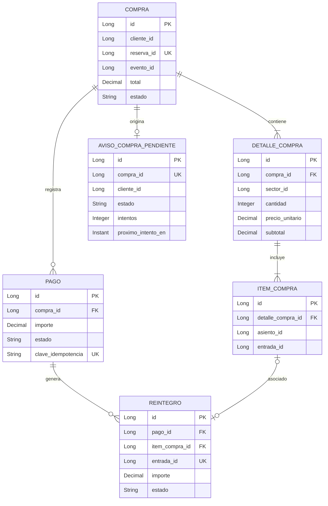

# 02 — Arquitectura y flujos

## Responsabilidad

`msvc-compras` administra compras, pagos, reintegros y la coordinación necesaria para completar la adquisición de entradas.

Está desarrollado con Java 21, Spring Boot, Spring Data JPA, Spring Security y OpenFeign. Utiliza una base de datos MySQL propia y se comunica con otros microservicios mediante REST.

El servicio se ejecuta en el puerto **8082** y se encuentra disponible a través del API Gateway, en el puerto **8084**.

## Integraciones

| Componente | Integración |
|---|---|
| Reservas | Verificación, confirmación y liberación de reservas |
| Eventos y Lugares | Consulta de eventos y precios; recepción de cancelaciones |
| Entradas | Emisión, consulta e invalidación de entradas; devoluciones |
| Usuarios | Obtención de los datos de contacto del comprador |
| Notificaciones | Envío de avisos de compras confirmadas |
| Recomendaciones | Consulta de eventos sugeridos a partir del historial de compras |
| API Gateway | Punto de acceso a las APIs del sistema |

Los pagos y reintegros se procesan mediante `PasarelaPagoMock`, una implementación simulada que no realiza operaciones bancarias reales.

## Modelo de datos

Las entidades principales son:

- **Compra:** cliente, reserva, evento, fecha, total y estado.
- **DetalleCompra:** sector, cantidad, precio unitario histórico y subtotal.
- **ItemCompra:** representa cada entrada adquirida y conserva sus identificadores de asiento y entrada.
- **Pago:** importe, medio de pago, estado, clave de idempotencia y referencia externa.
- **Reintegro:** importe devuelto, motivo, estado y relación con el pago y el ítem.
- **AvisoCompraPendiente:** registra el aviso de compra confirmada y sus reintentos de envío.

Las referencias a clientes, reservas, eventos y entradas identifican recursos administrados por otros microservicios. El vínculo con los avisos de compra se gestiona mediante el identificador de compra.

## Flujo de compra y pago

1. El cliente crea una reserva temporal en Reservas.
2. Compras verifica la reserva, obtiene los precios y registra una compra `PENDIENTE`.
3. El cliente solicita el pago mediante una pasarela simulada.
4. Si el pago es rechazado, se libera la reserva y la compra pasa a `RECHAZADA`.
5. Si es aprobado, la compra pasa a `CONFIRMACION_PENDIENTE`.
6. Se confirma la reserva y se solicita la emisión de entradas.
7. Cuando todas las entradas están asociadas, la compra pasa a `CONFIRMADA`.
8. Se registra un aviso para informar al cliente mediante Notificaciones.

## Reintegros y cancelaciones

Una devolución individual aprobada por Entradas permite reintegrar el importe histórico correspondiente al ítem.

Ante la cancelación de un evento, Compras procesa los reintegros de las compras afectadas. Antes de devolver el dinero, verifica que las entradas no continúen siendo utilizables.

Se evitan reintegros duplicados mediante restricciones de unicidad y comprobaciones del estado de cada operación.

## Consistencia y recuperación

La arquitectura utiliza transacciones locales; no existe una transacción ACID única entre microservicios.

Para mantener la consistencia se implementan:

- Bloqueos transaccionales sobre las compras.
- Claves de idempotencia para los pagos.
- Emisión idempotente de entradas.
- Reintegros únicos por ítem.
- Estados intermedios que permiten recuperar operaciones interrumpidas.
- Persistencia y reintento de avisos de compra confirmada.

Los estados posibles de una compra son:

`PENDIENTE`, `CONFIRMACION_PENDIENTE`, `COMPENSACION_PENDIENTE`, `LIBERACION_PENDIENTE`, `CONFIRMADA`, `RECHAZADA`, `REINTEGRO_PARCIAL` y `REINTEGRADA`.

## Seguridad

El microservicio utiliza autenticación mediante JWT y autorización basada en roles y permisos.

- Los clientes pueden iniciar compras y operar sobre sus propias compras.
- Los administradores acceden a las operaciones administrativas habilitadas.
- Las operaciones internas requieren credenciales de servicio específicas.
- Se verifica la titularidad de las compras para impedir el acceso a operaciones de otros clientes.
- Se validan los tokens recibidos, incluidos los accesos directos al microservicio.

Las APIs se documentan mediante Swagger/OpenAPI.