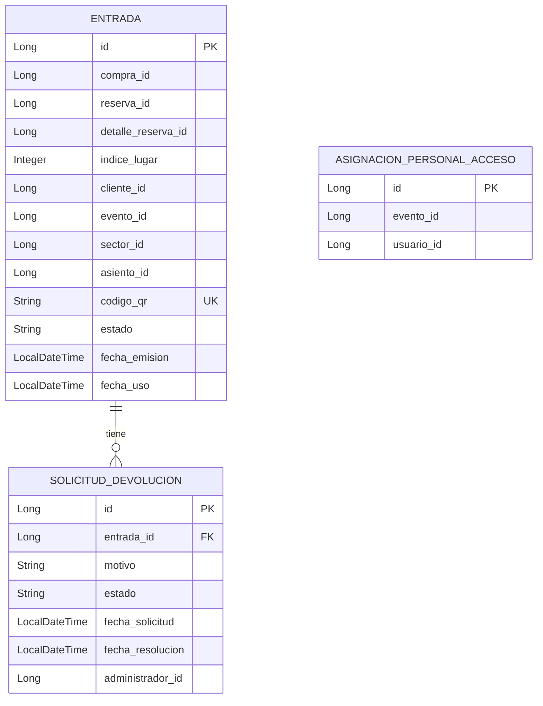

# 03 — Modelo de datos

## Descripción

El microservicio utiliza la base de datos MySQL `ticketya_entradas`, administrada mediante JPA.

El modelo contiene tres entidades persistentes:

### Entrada

Representa cada lugar adquirido por un cliente.

**Atributos principales:**

- `id`: identificador de entrada.
- `compraId`, `reservaId`, `detalleReservaId`: identificadores de la operación de origen.
- `indiceLugar`: posición del lugar dentro del detalle reservado.
- `clienteId`, `eventoId`, `sectorId`: identificadores del titular y del evento.
- `asientoId`: asiento asignado, nulo en sectores no numerados.
- `codigoQr`: código único de validación.
- `estado`: `EMITIDA`, `UTILIZADA` o `INVALIDADA`.
- `fechaEmision`, `fechaUso`: fechas de emisión y utilización.

Existe una restricción de unicidad sobre `reserva_id`, `detalle_reserva_id` e `indice_lugar`, además de la unicidad del código QR.

### SolicitudDevolucion

Registra las solicitudes realizadas por los clientes.

**Atributos principales:**

- `id`: identificador.
- `entrada`: entrada asociada.
- `motivo`: motivo informado.
- `estado`: `PENDIENTE`, `APROBADA` o `RECHAZADA`.
- `fechaSolicitud`, `fechaResolucion`: fechas del trámite.
- `administradorId`: usuario que resolvió la solicitud.

Cada solicitud corresponde a una entrada. Una entrada puede tener varias solicitudes históricas, pero la lógica de negocio impide registrar dos solicitudes pendientes simultáneas.

### AsignacionPersonalAcceso

Registra los usuarios autorizados para validar entradas de un evento.

**Atributos:**

- `id`: identificador.
- `eventoId`: evento al que se asigna el personal.
- `usuarioId`: usuario autorizado.

La combinación de `evento_id` y `usuario_id` tiene una restricción única.

## Diagrama entidad-relación

`AsignacionPersonalAcceso` es independiente de las entradas. Su relación con eventos y usuarios se representa mediante identificadores externos.

## Persistencia y restricciones

- `EntradaRepository` permite consultar entradas por compra, cliente, evento y código QR.
- La búsqueda por QR utiliza bloqueo pesimista para controlar el acceso concurrente.
- `SolicitudDevolucionRepository` permite consultar solicitudes por estado y detectar solicitudes pendientes de una entrada.
- `AsignacionPersonalAccesoRepository` administra las asignaciones de personal a eventos.

Los identificadores de entidades pertenecientes a otros microservicios se almacenan como valores simples, sin relaciones JPA distribuidas.