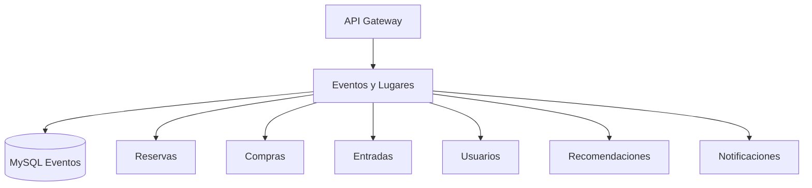
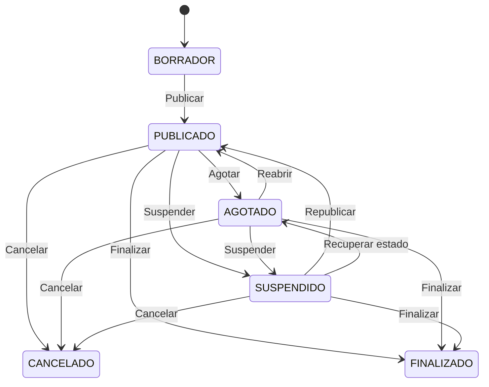

# Arquitectura — Eventos y Lugares

## 1. Tecnologías y organización

El microservicio está desarrollado con Java 21, Spring Boot, Spring Web, Spring Data JPA, Spring Security y MySQL.

Utiliza una arquitectura por capas:

| Capa | Responsabilidad |
|---|---|
| Controller | Expone endpoints REST y valida solicitudes. |
| Service / ServiceImpl | Implementa las reglas de negocio. |
| Repository | Gestiona la persistencia mediante JPA. |
| Model | Define las entidades y sus relaciones. |
| DTO | Define los datos intercambiados mediante la API. |
| Feign | Realiza comunicaciones HTTP con otros microservicios. |
| Security | Valida JWT, roles y propiedad de eventos. |

El servicio utiliza una base de datos propia, sin compartir entidades ni tablas con los demás microservicios.

## 2. Integración con TicketYa

Principales integraciones:

| Servicio | Finalidad |
|---|---|
| Usuarios | Validar cuentas asociadas a organizadores y obtener datos de contacto. |
| Reservas | Habilitar y cancelar eventos, consultar disponibilidad y generar datos de ocupación. |
| Compras | Procesar cancelaciones, consultar compradores y obtener información de ventas y reintegros. |
| Entradas | Comunicar cancelaciones para invalidar entradas. |
| Recomendaciones | Identificar clientes interesados en artistas favoritos. |
| Notificaciones | Enviar comunicaciones por publicaciones, modificaciones y cancelaciones. |
| Fila Virtual | Utilizar la configuración `altaDemanda` para controlar el acceso a reservas. |

Las comunicaciones se realizan mediante HTTP y clientes OpenFeign.

## 3. Ciclo de vida del evento

La publicación exige que el evento tenga una configuración completa. La finalización se permite una vez alcanzada la fecha del evento.

## 4. Cancelaciones y avisos persistentes

Al cancelar un evento:

1. Se actualiza su estado a `CANCELADO`.
2. Se registra la notificación de cancelación en la misma transacción.
3. Un proceso programado comunica la cancelación a Reservas, Entradas y Compras.
4. Se registra qué servicios procesaron correctamente la operación.
5. Las comunicaciones incompletas se reintentan.

Se utiliza `X-Operacion-Id` para identificar las operaciones de cancelación y evitar efectos duplicados.

También se registran avisos persistentes para los compradores cuando un evento se modifica o cancela. Estos avisos conservan el identificador de correlación y se procesan mediante un despachador programado.

## 5. Seguridad

El microservicio valida JWT y aplica autorización por rol y propiedad del recurso:

- `ADMINISTRADOR`: administra lugares, sectores, asientos, organizadores, participantes y cancelaciones.
- `ORGANIZADOR`: administra los eventos asociados a su cuenta.
- `CLIENTE`: consulta el catálogo público.
- Identidades de servicio: permiten las consultas e integraciones internas autorizadas.

Un organizador no puede modificar ni consultar reportes de un evento ajeno.

## 6. Observabilidad

Las solicitudes y operaciones relevantes generan logs estructurados en JSON, con identificación del servicio y `correlationId`.

Los registros son recolectados mediante Grafana Alloy, almacenados en Loki y consultados desde Grafana.