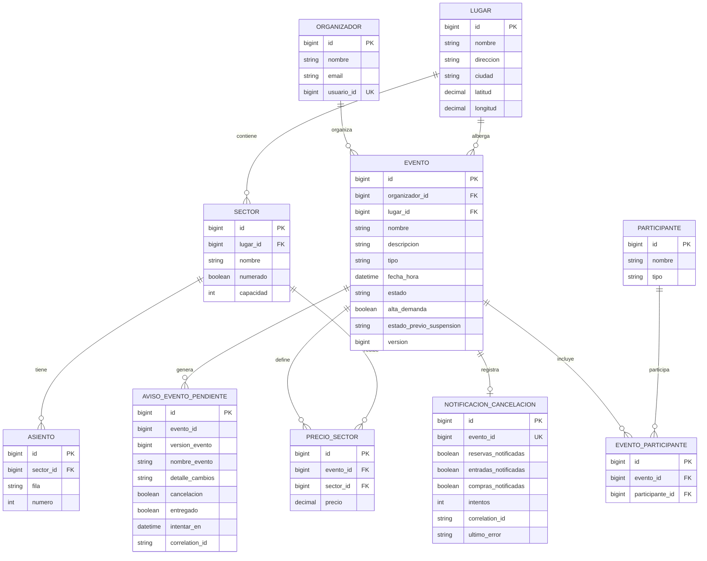

# Modelo de datos — Eventos y Lugares

## 1. Persistencia

El microservicio utiliza una base de datos MySQL propia y Spring Data JPA.

Su modelo administra lugares, sectores, asientos, eventos, organizadores, participantes, precios y registros persistentes de notificaciones.

## 2. Diagrama entidad-relación

Las relaciones de `NOTIFICACION_CANCELACION` y `AVISO_EVENTO_PENDIENTE` con `EVENTO` representan referencias lógicas por identificador, no asociaciones JPA con claves foráneas.

## 3. Relaciones principales

| Relación | Cardinalidad | Descripción |
|---|---|---|
| Lugar–Sector | 1:N | Un lugar contiene varios sectores. |
| Sector–Asiento | 1:N | Los sectores numerados contienen asientos. |
| Organizador–Evento | 1:N | Un organizador administra varios eventos. |
| Lugar–Evento | 1:N | Un lugar puede albergar diferentes eventos. |
| Evento–Participante | N:M | Se resuelve con `EventoParticipante`. |
| Evento–Sector | N:M | Se resuelve con `PrecioSector`, que almacena el precio. |
| Evento–NotificaciónCancelación | 1:0..1 | Se registra una cancelación por evento. |
| Evento–AvisoEventoPendiente | 1:N | Se registran avisos por cambios y cancelaciones. |

## 4. Restricciones importantes

- El nombre de un sector debe ser único dentro de su lugar.
- La combinación de fila y número de un asiento debe ser única dentro de su sector.
- Cada evento tiene un único precio por sector.
- No se repite un participante dentro del mismo evento.
- La vinculación `Organizador.usuarioId` es única y referencia lógicamente a Usuarios.
- Los avisos a compradores se identifican por evento, tipo de aviso y versión para evitar registros duplicados.

## 5. Separación entre microservicios

Eventos y Lugares mantiene la configuración de los espacios y sus precios.

Las reservas temporales, los asientos ocupados y la disponibilidad real pertenecen a Reservas. Compras administra pagos y reintegros; Entradas administra los tickets y sus QR.

Las integraciones utilizan identificadores y DTO, sin compartir tablas ni entidades JPA entre microservicios.