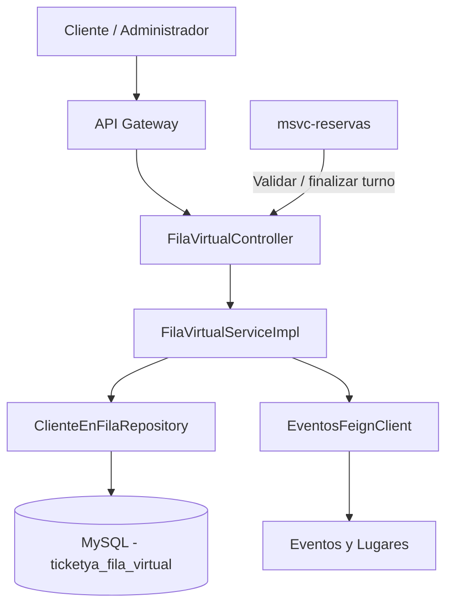
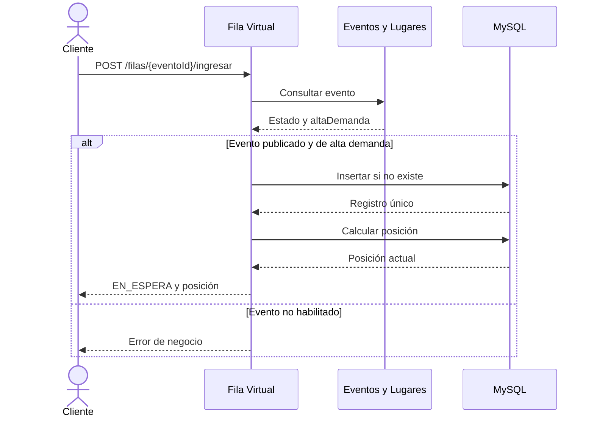
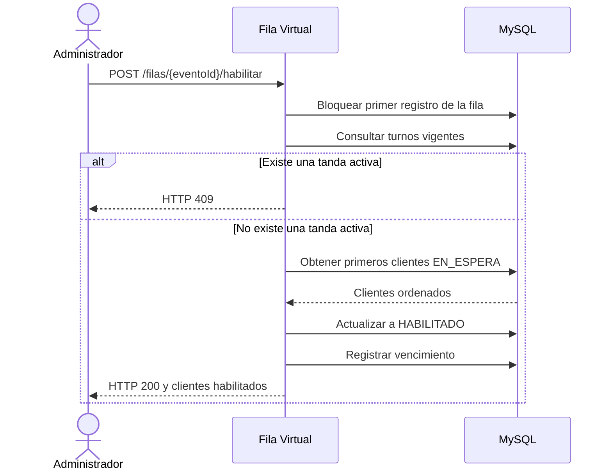
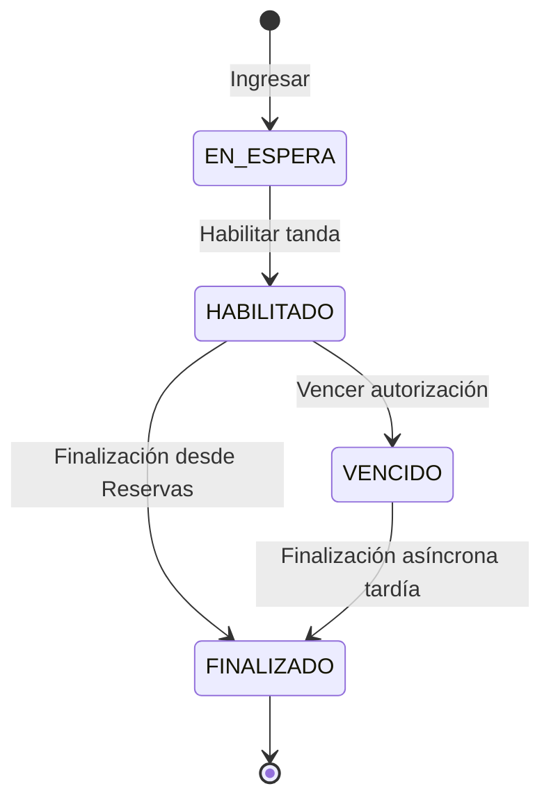
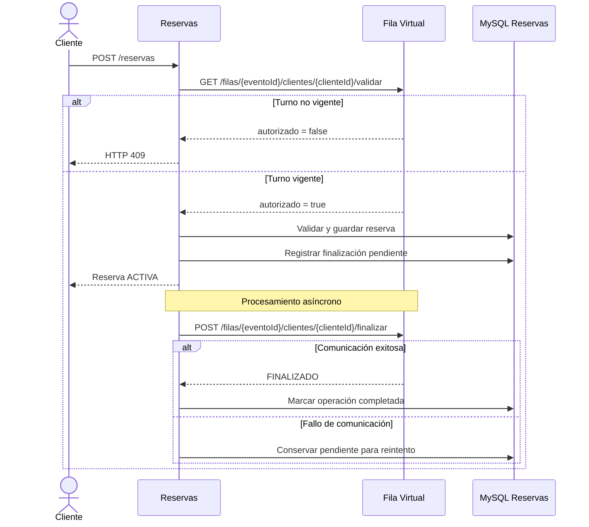

# 02 — Arquitectura y diagramas de Fila Virtual

## 1. Descripción general

El microservicio `msvc-fila-virtual` administra el acceso ordenado de clientes a las reservas de entradas para eventos de alta demanda.

Su función es organizar a los clientes en una lista de espera, habilitarlos por tandas y controlar la vigencia de sus turnos.

Cada cliente obtiene un registro asociado a un evento y puede consultar su estado y posición en la fila.

Cuando se habilita una tanda, los clientes seleccionados reciben una autorización temporal de 10 minutos. Durante ese período, el microservicio Reservas puede verificar si el cliente está autorizado para crear una reserva temporal.

El microservicio utiliza Java 21, Spring Boot, Spring Data JPA, MySQL y OpenFeign.

Se ejecuta en el puerto `8088`.

## 2. Responsabilidades del microservicio

Fila Virtual es responsable de:

- Registrar clientes en filas asociadas a eventos de alta demanda.
- Mantener el orden de ingreso.
- Evitar registros duplicados para un mismo cliente y evento.
- Calcular la posición de los clientes en espera.
- Habilitar clientes por tandas.
- Evitar habilitaciones simultáneas incompatibles.
- Registrar el inicio y vencimiento de cada autorización.
- Verificar si un turno se encuentra habilitado y vigente.
- Finalizar los turnos utilizados mediante solicitudes internas de Reservas.
- Actualizar automáticamente los turnos vencidos.
- Impedir la reutilización de autorizaciones finalizadas.

La disponibilidad de entradas, la ocupación de asientos y la creación de reservas pertenecen al microservicio Reservas.

## 3. Arquitectura del microservicio

El código se organiza en las siguientes capas:

| Paquete         | Responsabilidad                                                            |
| --------------- | -------------------------------------------------------------------------- |
| `controllers`   | Expone los endpoints REST y recibe las solicitudes HTTP.                   |
| `dtos`          | Define los datos intercambiados mediante la API.                           |
| `entities`      | Representa los registros persistentes y estados de la fila.                |
| `repositories`  | Realiza consultas y operaciones de persistencia mediante JPA.              |
| `services`      | Define las operaciones de negocio disponibles.                             |
| `services.impl` | Implementa las reglas de ingreso, habilitación, validación y finalización. |
| `clients`       | Contiene el cliente Feign para consultar Eventos y Lugares.                |
| `security`      | Configura la autenticación JWT y las restricciones de acceso.              |
| `exceptions`    | Centraliza el tratamiento de errores de las solicitudes.                   |

La lógica de negocio se implementa principalmente en `FilaVirtualServiceImpl`, que implementa la interfaz `FilaVirtualService`.

El acceso a la base de datos se realiza mediante `ClienteEnFilaRepository`.

## 4. Diagrama de componentes

Las solicitudes externas ingresan mediante el API Gateway.

El controlador delega las operaciones al servicio de negocio, que utiliza el repositorio para gestionar los registros de la fila.

Fila Virtual consulta Eventos y Lugares mediante OpenFeign para verificar que los eventos existan, estén publicados y sean de alta demanda.

Reservas utiliza los endpoints internos de validación y finalización de turnos.

## 5. Integración con Eventos y Lugares

Antes de registrar el ingreso de un cliente, Fila Virtual consulta la información del evento.

La integración se realiza mediante `EventosFeignClient`.

El microservicio verifica:

- Que el evento exista.
- Que su estado sea `PUBLICADO`.
- Que tenga habilitada la propiedad `altaDemanda`.

Si el evento no cumple estas condiciones, se rechaza el ingreso.

La información del evento se obtiene mediante HTTP. Fila Virtual no mantiene una copia de la entidad Evento en su base de datos.

## 6. Diagrama de secuencia — Ingreso a la fila

### Prevención de registros duplicados

La entidad `ClienteEnFila` define una restricción de unicidad sobre `evento_id` y `cliente_id`.

La operación de ingreso utiliza una inserción idempotente mediante MySQL.

Si un cliente realiza solicitudes repetidas o simultáneas para el mismo evento, se conserva un único registro y se devuelve la información existente.

## 7. Habilitación de turnos

La habilitación se realiza mediante:

`POST /filas/{eventoId}/habilitar`

Se indica la cantidad de clientes que deben habilitarse, comprendida entre 1 y 100.

El servicio selecciona los primeros clientes con estado `EN_ESPERA`, ordenados por su identificador de registro.

Los clientes seleccionados pasan a `HABILITADO` y reciben:

- Fecha y hora de habilitación.
- Fecha y hora de vencimiento.
- Estado actualizado.

La duración de cada turno es de 10 minutos.

Antes de habilitar una nueva tanda, el sistema verifica que no existan turnos habilitados y vigentes para el mismo evento.

### Control de concurrencia

La habilitación se realiza dentro de una transacción.

El repositorio utiliza un bloqueo pesimista `PESSIMISTIC_WRITE` sobre el primer registro de la fila correspondiente al evento.

Este bloqueo permite serializar las habilitaciones concurrentes que utilizan la misma base de datos MySQL.

De esta manera, dos solicitudes simultáneas no pueden habilitar tandas incompatibles.

## 8. Diagrama de secuencia — Habilitación de una tanda

## 9. Estados de la fila virtual

Cada registro puede encontrarse en uno de los siguientes estados:

| Estado       | Descripción                                           |
| ------------ | ----------------------------------------------------- |
| `EN_ESPERA`  | El cliente está registrado y aguarda su turno.        |
| `HABILITADO` | El cliente tiene autorización temporal para reservar. |
| `VENCIDO`    | El período de autorización terminó.                   |
| `FINALIZADO` | El turno fue utilizado y se encuentra cerrado.        |

### Diagrama de estados

La transición de `VENCIDO` a `FINALIZADO` contempla el caso en que Reservas creó correctamente una reserva, pero la solicitud de finalización se procesa después del vencimiento del turno.

Esto no significa que un turno vencido pueda utilizarse para crear una nueva reserva.

Los registros `VENCIDO` y `FINALIZADO` no vuelven automáticamente a `EN_ESPERA`.

## 10. Vencimiento automático

Cada autorización tiene una fecha de vencimiento calculada a partir de su habilitación.

Fila Virtual dispone de un proceso programado mediante `@Scheduled`, que identifica y actualiza periódicamente los turnos vencidos.

El proceso utiliza el repositorio para cambiar de `HABILITADO` a `VENCIDO` los registros cuyo plazo haya finalizado.

La tarea se ejecuta con un intervalo de 60 segundos entre ejecuciones.

Además, la vigencia se comprueba durante la consulta o validación del turno.

Por lo tanto, una autorización vencida no se considera válida aunque la tarea programada todavía no haya actualizado el estado persistido.

## 11. Integración con Reservas

Fila Virtual y Reservas se comunican mediante contratos REST.

Reservas utiliza `FilaVirtualClient`, implementado con OpenFeign.

### 11.1. Validación de turnos

Endpoint:

`GET /filas/{eventoId}/clientes/{clienteId}/validar`

La operación devuelve:

- Identificador del evento.
- Identificador del cliente.
- Resultado de autorización.
- Estado actual del turno.
- Fecha de vencimiento.

La autorización solamente es válida cuando el cliente está `HABILITADO` y su turno no ha vencido.

La consulta no consume ni finaliza el turno.

En eventos que no son de alta demanda, Reservas no necesita realizar esta validación.

### 11.2. Creación de reserva

Para un evento de alta demanda, Reservas verifica la autorización antes de permitir la creación de la reserva temporal.

Si el cliente no tiene un turno vigente, se rechaza la solicitud.

Si el turno es válido y se cumplen las demás reglas de disponibilidad, Reservas crea la reserva temporal.

### 11.3. Finalización de turnos

Endpoint:

`POST /filas/{eventoId}/clientes/{clienteId}/finalizar`

Después de crear correctamente la reserva, Reservas registra una operación pendiente de finalización.

Un proceso asíncrono intenta comunicar esa finalización a Fila Virtual.

Si la comunicación falla, Reservas conserva la operación pendiente y realiza reintentos.

Fila Virtual permite finalizar turnos en estado:

- `HABILITADO`.
- `VENCIDO`, para admitir una finalización tardía correspondiente a una reserva ya creada.

No se permite finalizar un turno que continúa en estado `EN_ESPERA`.

La operación es idempotente: si el turno ya está `FINALIZADO`, una solicitud repetida devuelve el estado existente.

Una vez finalizado, el turno no puede utilizarse para crear otra reserva.

### 11.4. Diagrama de secuencia — Reserva con fila virtual

Este mecanismo evita que la finalización del turno dependa de una operación distribuida dentro de la misma transacción de creación de reserva.

Fila Virtual administra las autorizaciones temporales, mientras Reservas mantiene la responsabilidad sobre la disponibilidad, ocupación y asignación de lugares.

## 12. Seguridad

Fila Virtual utiliza autenticación mediante JWT.

Las solicitudes se someten a las restricciones de acceso configuradas por Spring Security.

### Permisos principales

| Operación                    | Identidad autorizada          |
| ---------------------------- | ----------------------------- |
| Ingresar a una fila          | Cliente autenticado           |
| Consultar la propia posición | Cliente autenticado           |
| Habilitar tandas             | `ADMINISTRADOR`               |
| Validar turnos para reservas | Identidad interna de Reservas |
| Finalizar turnos utilizados  | Identidad interna de Reservas |

Los clientes no pueden consultar libremente los registros de otros usuarios.

La comunicación interna de Reservas utiliza credenciales de servicio.

El API Gateway centraliza el acceso externo a las APIs.

## 13. Persistencia y separación de datos

Fila Virtual utiliza su propia base de datos MySQL:

`ticketya_fila_virtual`

Los registros almacenan los identificadores del cliente y del evento, junto con las fechas y estados necesarios para gestionar la fila.

No se establecen relaciones JPA con las entidades de Eventos, Reservas o Usuarios.

Los identificadores externos se almacenan como valores simples.

Cada microservicio conserva la responsabilidad sobre sus propios datos.

## 14. Consideraciones de consistencia

- El ingreso de clientes utiliza una restricción única para prevenir duplicaciones.
- Las habilitaciones utilizan transacciones y bloqueo pesimista.
- La validación comprueba el estado y el vencimiento del turno.
- La finalización repetida de un turno conserva el estado `FINALIZADO`.
- Los turnos vencidos no autorizan nuevas reservas.
- Una finalización tardía puede cerrar un turno vencido cuando corresponde a una reserva creada anteriormente.
- Las consultas de posición consideran únicamente los clientes que continúan esperando.
- Las operaciones sobre la fila no modifican directamente reservas, compras ni entradas.
- Reservas conserva las finalizaciones pendientes y las procesa con reintentos.
- Las comunicaciones entre microservicios se realizan mediante contratos REST y autenticación.