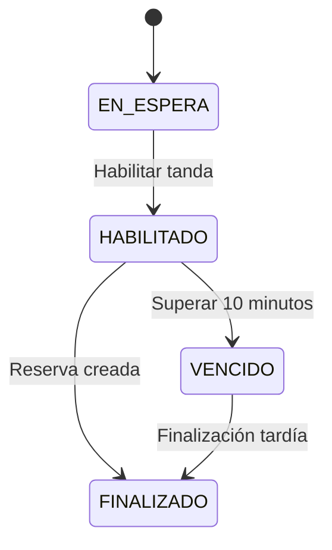

# 02 — Arquitectura y flujos

## Arquitectura

`msvc-fila-virtual` está desarrollado con Java 21, Spring Boot, Spring Data JPA, Spring Security y OpenFeign.

Utiliza una base de datos MySQL independiente y se ejecuta en el puerto **8088**.

La implementación está organizada en:

- **Controllers:** endpoints REST.
- **Service y ServiceImpl:** lógica de ingreso, habilitación y administración de turnos.
- **Repositories:** consultas y persistencia con JPA.
- **Entities:** registro de clientes y estados de la fila.
- **DTOs:** intercambio de información.
- **Clients:** comunicación con Eventos y Lugares.
- **Security:** autenticación JWT y permisos.

## Integración con otros microservicios

| Servicio | Responsabilidad |
|---|---|
| Eventos y Lugares | Informa el estado del evento y si es de alta demanda |
| Reservas | Consulta autorizaciones antes de reservar y finaliza los turnos utilizados |
| Usuarios | Emite JWT con la identidad y los permisos necesarios |
| API Gateway | Centraliza el acceso a las APIs |

Fila Virtual no administra la disponibilidad de entradas ni crea reservas. Estas operaciones pertenecen a Reservas.

## Funcionamiento

### Ingreso

1. Un cliente autenticado solicita ingresar a la fila.
2. Se verifica que el evento esté publicado y sea de alta demanda.
3. Se crea un registro `EN_ESPERA` o se recupera el existente.
4. Se informa la posición del cliente.

### Habilitación

El administrador indica cuántos clientes habilitar.

El servicio selecciona a los primeros clientes en espera y les asigna una autorización de 10 minutos.

No se permite habilitar otra tanda mientras exista una autorización activa para el mismo evento.

### Integración con Reservas

Para un evento de alta demanda:

1. El cliente solicita una reserva temporal.
2. Reservas consulta a Fila Virtual si el cliente tiene un turno habilitado y vigente.
3. Si el turno no está autorizado, Reservas rechaza la operación.
4. Si está autorizado y existe disponibilidad, Reservas crea la reserva.
5. Reservas registra la finalización del turno para comunicarla a Fila Virtual.
6. Si la comunicación falla, la finalización se procesa posteriormente mediante reintentos.

La consulta de autorización no consume el turno. La finalización ocurre después de la creación correcta de la reserva.

## Estados de la fila

Los turnos `FINALIZADO` y `VENCIDO` no permiten iniciar nuevas reservas.

## Vencimiento automático

El servicio ejecuta una tarea programada cada 60 segundos para marcar como `VENCIDO` los turnos cuya autorización expiró.

Las consultas y validaciones también comprueban el vencimiento al momento de realizarse.

## Consistencia y concurrencia

Se implementan:

- Restricción de unicidad por evento y cliente.
- Ingreso idempotente mediante una operación de base de datos.
- Bloqueo pesimista para coordinar la habilitación de tandas.
- Bloqueo transaccional al validar y finalizar turnos.
- Finalización idempotente.
- Reintentos de finalización administrados por Reservas.

## Seguridad

El microservicio verifica JWT y permisos:

- **CLIENTE:** ingresar a la fila y consultar su propio registro.
- **ADMINISTRADOR:** consultar registros y habilitar tandas.
- **Servicio Reservas:** validar y finalizar turnos mediante credenciales internas.

Las APIs están documentadas mediante Swagger/OpenAPI.