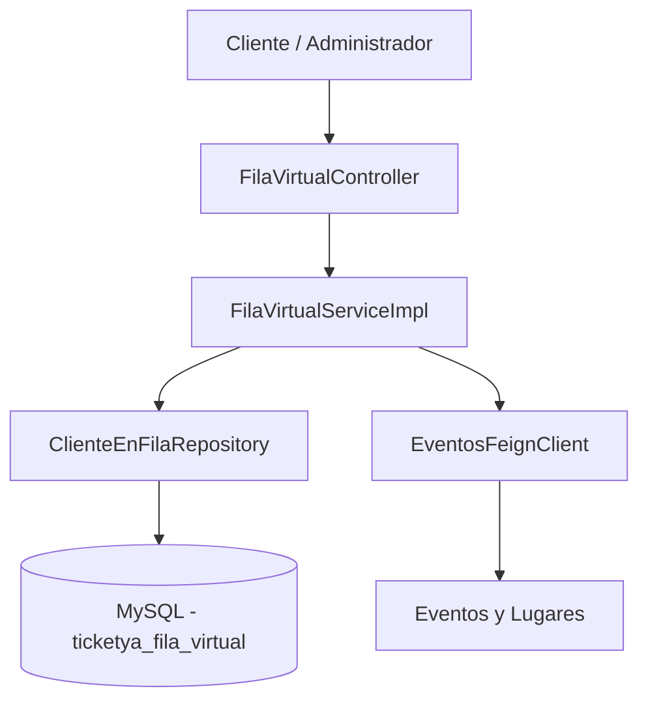
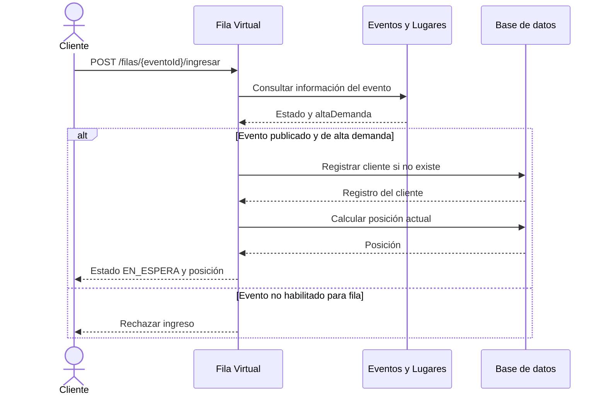
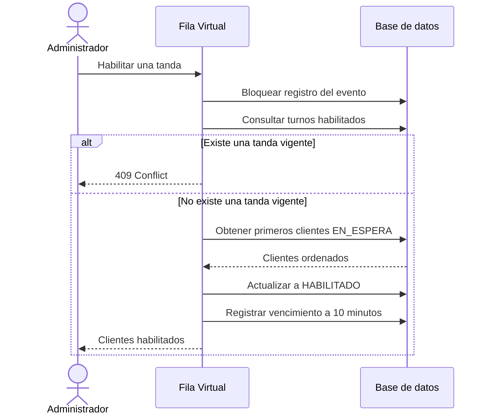
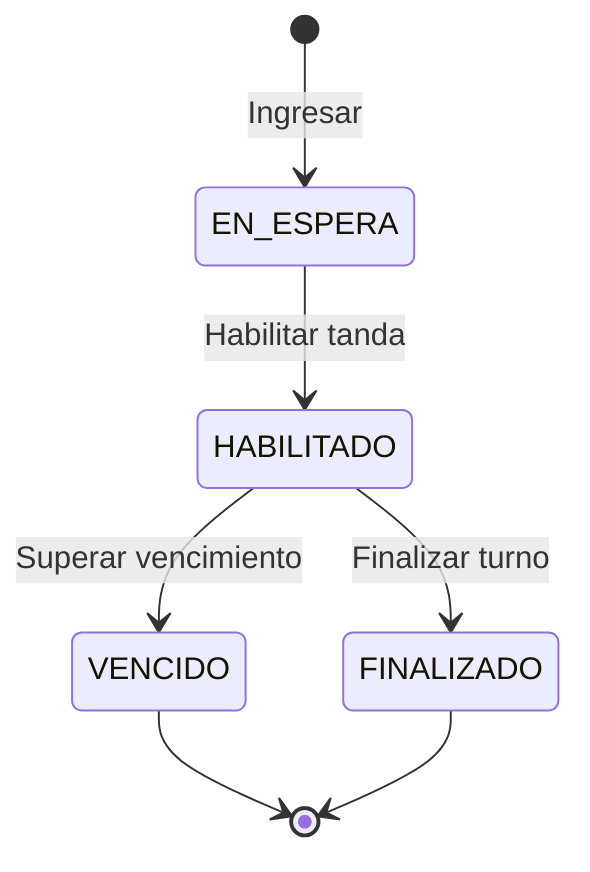

# 02 — Arquitectura y diagramas de Fila Virtual

## 1. Descripción general

El microservicio `msvc-fila-virtual` administra el acceso ordenado de clientes a la compra de entradas para eventos de alta demanda.

Su función es organizar a los clientes en una lista de espera, habilitarlos por tandas y controlar la vigencia de sus turnos.

Cada cliente obtiene un registro asociado a un evento y puede consultar su estado y posición en la fila.

Cuando se habilita una tanda, los clientes seleccionados reciben una autorización temporal de 10 minutos. Durante ese período, el microservicio permite consultar si el cliente está habilitado para continuar con el proceso de reserva.

El microservicio utiliza Java 21, Spring Boot, Spring Data JPA, MySQL y OpenFeign.

Se ejecuta en el puerto `8086`.

## 2. Responsabilidades del microservicio

Fila Virtual es responsable de:

- Registrar clientes en filas asociadas a eventos de alta demanda.
- Mantener el orden de ingreso.
- Evitar registros duplicados para un mismo cliente y evento.
- Calcular la posición de los clientes en espera.
- Habilitar clientes por tandas.
- Evitar habilitaciones simultáneas incompatibles.
- Registrar el inicio y vencimiento de cada autorización.
- Verificar si un turno se encuentra habilitado y vigente.
- Finalizar los turnos utilizados.
- Actualizar automáticamente los turnos vencidos.

La disponibilidad de entradas, la ocupación de asientos y la creación de reservas pertenecen al microservicio Reservas.

## 3. Arquitectura del microservicio

El código se organiza en las siguientes capas:

| Paquete | Responsabilidad |
|---|---|
| `controllers` | Expone los endpoints REST y recibe las solicitudes HTTP. |
| `dtos` | Define los datos intercambiados mediante la API. |
| `entities` | Representa los registros persistentes y estados de la fila. |
| `repositories` | Realiza las operaciones de consulta y persistencia mediante JPA. |
| `services` | Define las operaciones de negocio disponibles. |
| `services.impl` | Implementa las reglas de ingreso, habilitación, validación y finalización. |
| `clients` | Contiene el cliente Feign para consultar Eventos y Lugares. |
| `exceptions` | Centraliza el tratamiento de errores de las solicitudes. |

La lógica de negocio se implementa en `FilaVirtualServiceImpl`, que implementa la interfaz `FilaVirtualService`.

El acceso a la base de datos se realiza mediante `ClienteEnFilaRepository`.

## 4. Diagrama de componentes

Las solicitudes HTTP son recibidas por el controlador y delegadas al servicio de negocio.

El servicio utiliza el repositorio para gestionar los clientes y sus estados. Además, consulta Eventos y Lugares mediante Feign para comprobar que el evento se encuentra publicado y está configurado como de alta demanda.

## 5. Integración con Eventos y Lugares

Antes de registrar el ingreso de un cliente, Fila Virtual consulta la información del evento.

La integración se realiza mediante `EventosFeignClient`.

El microservicio verifica:

- Que el evento exista.
- Que su estado sea `PUBLICADO`.
- Que tenga habilitada la propiedad `altaDemanda`.

Si el evento no cumple estas condiciones, se rechaza el ingreso.

La información del evento se obtiene mediante HTTP. Fila Virtual no mantiene una copia de la entidad Evento en su base de datos.

## 6. Diagrama de secuencia — Ingreso a la fila

### Prevención de registros duplicados

La entidad `ClienteEnFila` define una restricción de unicidad sobre `evento_id` y `cliente_id`.

La operación de ingreso utiliza una inserción idempotente mediante MySQL.

De esta manera, si un cliente realiza solicitudes repetidas o simultáneas para el mismo evento, el sistema conserva un único registro y devuelve la información existente.

## 7. Habilitación de turnos

La habilitación se realiza mediante:

`POST /filas/{eventoId}/habilitar`

Se indica la cantidad de clientes que deben habilitarse.

El servicio selecciona los primeros clientes con estado `EN_ESPERA`, ordenados por su identificador de registro.

Los clientes seleccionados pasan a `HABILITADO` y reciben:

- Fecha y hora de habilitación.
- Fecha y hora de vencimiento.
- Estado actualizado.

La duración de cada turno es de 10 minutos.

Antes de habilitar una nueva tanda, se verifica que no existan turnos habilitados y vigentes para ese evento.

### Control de concurrencia

Las operaciones de habilitación utilizan transacciones y bloqueo pesimista mediante JPA.

El bloqueo permite coordinar solicitudes concurrentes de habilitación sobre un mismo evento cuando las instancias del microservicio utilizan la misma base MySQL.

Esto evita que dos solicitudes simultáneas habiliten tandas incompatibles.

## 8. Diagrama de secuencia — Habilitación de una tanda

## 9. Estados de la fila virtual

Cada registro puede encontrarse en uno de los siguientes estados:

| Estado | Descripción |
|---|---|
| `EN_ESPERA` | El cliente está registrado y aguarda su turno. |
| `HABILITADO` | El cliente tiene una autorización temporal para continuar con la reserva. |
| `VENCIDO` | El período de autorización finalizó sin utilizarse. |
| `FINALIZADO` | El turno fue utilizado y se encuentra cerrado. |

### Diagrama de estados

Un registro finalizado o vencido no vuelve automáticamente al estado `EN_ESPERA`.

## 10. Vencimiento automático

Cada autorización tiene una fecha de vencimiento calculada a partir de su habilitación.

El microservicio cuenta con un proceso programado mediante `@Scheduled`, que se ejecuta periódicamente para identificar turnos vencidos.

El proceso utiliza el repositorio para actualizar los registros cuyo estado sea `HABILITADO` y cuya fecha de vencimiento haya sido alcanzada.

La tarea se ejecuta con un intervalo de 60 segundos entre ejecuciones.

Además, la vigencia se comprueba al consultar o validar un turno, por lo que una autorización vencida no se considera válida aunque el proceso programado todavía no haya actualizado el registro.

## 11. Contrato de integración con Reservas

11. Comunicación con Reservas
Fila Virtual expone operaciones REST que permiten consultar y actualizar el estado de los turnos asociados a un cliente y evento.

Validación de turnos

`GET /filas/{eventoId}/clientes/{clienteId}/validar`

La operación devuelve:
- Identificador del evento.
- Identificador del cliente.
- Resultado de autorización.
- Estado actual del turno.
- Fecha de vencimiento.
La autorización es válida únicamente cuando el cliente se encuentra en estado HABILITADO y su turno no ha vencido.

La consulta no consume ni finaliza el turno.

Finalización de turnos

`POST /filas/{eventoId}/clientes/{clienteId}/finalizar`

Permite marcar como FINALIZADO un turno habilitado y vigente.

La operación es idempotente: las solicitudes repetidas sobre un turno finalizado conservan su estado.

Fila Virtual administra las autorizaciones temporales, mientras que Reservas mantiene la responsabilidad sobre la disponibilidad, ocupación y asignación de lugares

## 12. Persistencia y separación de datos

Fila Virtual utiliza su propia base de datos MySQL:

`ticketya_fila_virtual`

Los registros almacenan los identificadores de cliente y evento, junto con las fechas y estados necesarios para gestionar la fila.

No se establecen relaciones JPA con las entidades de Eventos, Reservas o Clientes.

Los identificadores externos se almacenan como valores simples.

Cada microservicio conserva la responsabilidad sobre sus propios datos.

## 13. Consideraciones de consistencia

- El ingreso de clientes utiliza una restricción única para prevenir duplicaciones.
- Las operaciones de habilitación utilizan transacciones y bloqueo pesimista.
- La validación comprueba tanto el estado como el vencimiento del turno.
- La finalización repetida de un turno conserva el estado `FINALIZADO`.
- Las consultas de posición consideran únicamente los clientes que continúan esperando.
- Las operaciones sobre la fila no modifican directamente reservas, compras ni entradas.
- Las comunicaciones entre microservicios se realizan mediante contratos REST.
