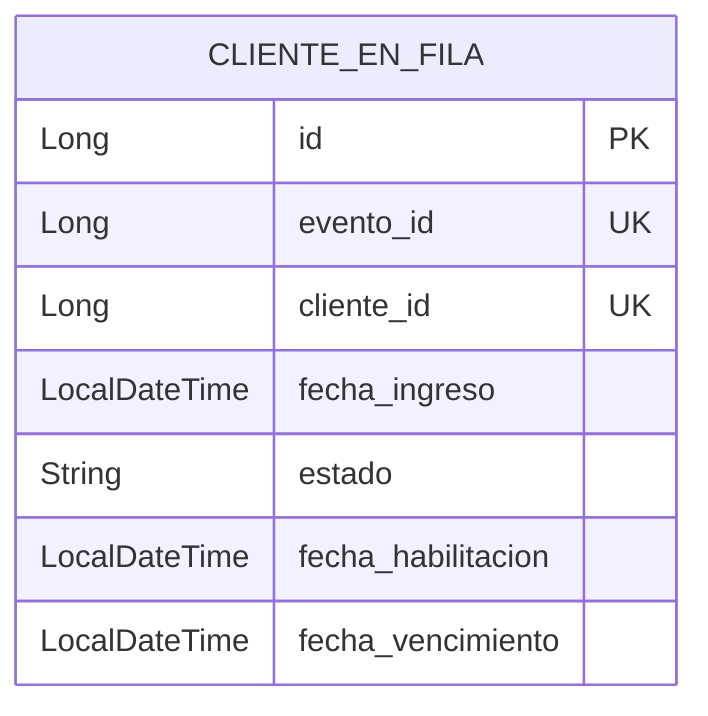

# 03 — Modelo de datos

## Descripción

Fila Virtual utiliza la base de datos MySQL `ticketya_fila_virtual`.

La persistencia se implementa mediante Spring Data JPA.

## Entidad ClienteEnFila

Representa la participación de un cliente en la fila virtual de un evento.

| Atributo | Tipo | Descripción |
|---|---|---|
| `id` | Long | Identificador único |
| `eventoId` | Long | Evento asociado |
| `clienteId` | Long | Cliente registrado |
| `fechaIngreso` | LocalDateTime | Momento de ingreso |
| `estado` | EstadoFila | Estado actual |
| `fechaHabilitacion` | LocalDateTime | Momento en que se habilitó |
| `fechaVencimiento` | LocalDateTime | Vencimiento de la autorización |

## Estados

- `EN_ESPERA`: cliente esperando su turno.
- `HABILITADO`: cliente autorizado temporalmente.
- `VENCIDO`: autorización expirada.
- `FINALIZADO`: turno cerrado después de una reserva.

## Diagrama entidad-relación

La combinación `evento_id` y `cliente_id` es única. Esta restricción impide registrar al mismo cliente más de una vez para un evento.

No existen claves foráneas hacia las bases de datos de Usuarios, Eventos o Reservas, ya que cada microservicio administra su información de manera independiente.

## Repositorio

`ClienteEnFilaRepository` proporciona:

- Consulta por evento y cliente.
- Listado por estado y orden de ingreso.
- Cálculo de posiciones.
- Registro idempotente de clientes.
- Bloqueo pesimista para coordinar habilitaciones y operaciones sobre turnos.
- Actualización de turnos expirados.

## Integridad y concurrencia

La restricción única evita registros duplicados incluso ante ingresos simultáneos.

Las transacciones y bloqueos permiten controlar la habilitación de tandas y la validación o finalización de turnos.

La finalización tardía permite mantener la consistencia con Reservas cuando una reserva ya fue creada y la comunicación entre servicios se completó posteriormente.