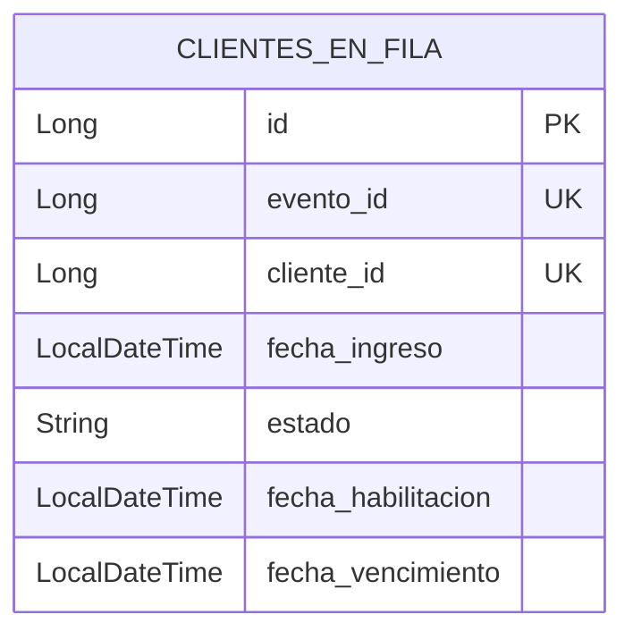

# 03 — Modelo de datos de Fila Virtual

## 1. Descripción general

El microservicio `msvc-fila-virtual` utiliza una base de datos MySQL propia, denominada `ticketya_fila_virtual`.

El modelo de datos permite registrar la participación de clientes en filas virtuales, mantener el orden de ingreso, gestionar autorizaciones temporales y controlar el vencimiento y la finalización de los turnos.

La persistencia se implementa mediante JPA y Spring Data JPA.

El modelo está compuesto por una entidad principal:

- `ClienteEnFila`: representa la participación de un cliente en la fila virtual de un evento.

La integración con Reservas no requiere compartir tablas ni incorporar entidades de Reservas dentro de la base de datos de Fila Virtual.

## 2. Entidad ClienteEnFila

La entidad `ClienteEnFila` representa el registro de un cliente dentro de la fila virtual de un evento de alta demanda.

Cada registro contiene los identificadores del evento y del cliente, la fecha de ingreso, el estado actual y las fechas asociadas a la habilitación y vencimiento del turno.

La información se almacena en la tabla `clientes_en_fila`.

### 2.1. Atributos

| Atributo Java       | Columna en la base de datos | Tipo          | Restricciones                |
| ------------------- | --------------------------- | ------------- | ---------------------------- |
| `id`                | `id`                        | Long          | Clave primaria autogenerada. |
| `eventoId`          | `evento_id`                 | Long          | Obligatorio.                 |
| `clienteId`         | `cliente_id`                | Long          | Obligatorio.                 |
| `fechaIngreso`      | `fecha_ingreso`             | LocalDateTime | Obligatorio.                 |
| `estado`            | `estado`                    | EstadoFila    | Obligatorio.                 |
| `fechaHabilitacion` | `fecha_habilitacion`        | LocalDateTime | Opcional.                    |
| `fechaVencimiento`  | `fecha_vencimiento`         | LocalDateTime | Opcional.                    |

### 2.2. Descripción de los atributos

- **id:** identificador único del registro en la fila virtual.
- **eventoId:** identificador del evento al que corresponde la fila.
- **clienteId:** identificador del cliente registrado.
- **fechaIngreso:** fecha y hora en que el cliente ingresó a la fila.
- **estado:** estado actual del cliente dentro del proceso de espera y habilitación.
- **fechaHabilitacion:** fecha y hora en que el cliente recibió autorización para continuar con la reserva.
- **fechaVencimiento:** fecha y hora límite de validez de la autorización.

Los atributos `fechaHabilitacion` y `fechaVencimiento` permanecen nulos mientras el cliente se encuentra en estado `EN_ESPERA`.

Cuando el turno pasa a `VENCIDO` o `FINALIZADO`, las fechas registradas se conservan.

## 3. Estados de la entidad

El atributo `estado` utiliza el enum `EstadoFila`.

Se almacena mediante `EnumType.STRING`, por lo que la base de datos conserva el nombre del estado.

Los valores posibles son:

| Estado       | Descripción                                            |
| ------------ | ------------------------------------------------------ |
| `EN_ESPERA`  | El cliente ingresó a la fila y espera su habilitación. |
| `HABILITADO` | El cliente tiene un turno habilitado temporalmente.    |
| `VENCIDO`    | La autorización superó su fecha de vencimiento.        |
| `FINALIZADO` | El turno fue utilizado y se encuentra cerrado.         |

Al crear un registro, el estado inicial es `EN_ESPERA`.

Cuando se habilita un cliente, se registra la fecha de habilitación y se calcula el vencimiento a los 10 minutos.

Las transiciones principales son:

- `EN_ESPERA` → `HABILITADO`: cuando se habilita una tanda.
- `HABILITADO` → `VENCIDO`: cuando vence la autorización.
- `HABILITADO` → `FINALIZADO`: cuando Reservas comunica la utilización del turno.
- `VENCIDO` → `FINALIZADO`: cuando llega una finalización asíncrona tardía correspondiente a una reserva creada anteriormente.

La última transición no habilita al cliente a crear nuevas reservas después del vencimiento. Solamente permite cerrar un turno cuya finalización quedó pendiente.

## 4. Restricciones de integridad

### 4.1. Clave primaria

El atributo `id` es la clave primaria de la tabla.

Se genera automáticamente mediante la estrategia `GenerationType.IDENTITY`.

Cada registro tiene un identificador único.

### 4.2. Restricción de unicidad

La entidad define una restricción única compuesta por:

- `evento_id`
- `cliente_id`

Esta restricción impide registrar dos veces al mismo cliente en la fila de un mismo evento.

Un cliente puede participar en filas de diferentes eventos, pero solo puede tener un registro por evento.

La restricción también permite proteger la integridad de los datos ante solicitudes simultáneas.

### 4.3. Campos obligatorios

Los siguientes atributos no admiten valores nulos:

- `eventoId`
- `clienteId`
- `fechaIngreso`
- `estado`

Las fechas de habilitación y vencimiento son opcionales porque solamente se asignan cuando el cliente obtiene un turno.

## 5. Diagrama entidad-relación

La tabla `CLIENTES_EN_FILA` representa la entidad persistente `ClienteEnFila`, almacenada físicamente como `clientes_en_fila`.

Los campos `evento_id` y `cliente_id` participan conjuntamente en una restricción de unicidad compuesta. No son claves únicas individuales.

Los identificadores de clientes y eventos son referencias lógicas a información administrada por otros microservicios.

No existen claves foráneas hacia las bases de datos de Usuarios, Eventos o Reservas.

## 6. Repositorio

El acceso a los datos se realiza mediante `ClienteEnFilaRepository`, que extiende `JpaRepository<ClienteEnFila, Long>`.

Además de las operaciones habituales de persistencia, define métodos específicos para administrar las filas.

| Método                                  | Función                                                                             |
| --------------------------------------- | ----------------------------------------------------------------------------------- |
| `findByEventoIdAndClienteId`            | Obtiene el registro de un cliente en la fila de un evento.                          |
| `countByEventoIdAndEstado`              | Cuenta los clientes de un evento que tienen un estado determinado.                  |
| `countByEventoIdAndEstadoAndIdLessThan` | Cuenta los registros anteriores que se encuentran en un estado determinado.         |
| `findByEventoIdAndEstadoOrderByIdAsc`   | Obtiene los clientes de un evento y estado, ordenados por identificador ascendente. |
| `findFirstByEventoIdOrderByIdAsc`       | Obtiene el primer registro de un evento utilizando bloqueo pesimista.               |
| `bloquearPorEventoYCliente`             | Obtiene el registro de un cliente y evento utilizando bloqueo pesimista.            |
| `ingresarSiNoExiste`                    | Registra un cliente si no existe previamente, evitando duplicaciones.               |
| `vencerTurnosExpirados`                 | Actualiza el estado de los turnos habilitados cuyo vencimiento fue alcanzado.       |

## 7. Control de concurrencia

La gestión de filas virtuales requiere controlar las operaciones simultáneas para preservar el orden de los clientes y evitar duplicaciones.

### 7.1. Ingreso de clientes

El ingreso utiliza una operación SQL con `ON DUPLICATE KEY UPDATE`, junto con la restricción única sobre `evento_id` y `cliente_id`.

Si dos solicitudes intentan registrar simultáneamente al mismo cliente en el mismo evento, la base de datos conserva un único registro.

Las solicitudes posteriores recuperan el registro existente sin modificar su posición original.

### 7.2. Habilitación de turnos

Las operaciones de habilitación utilizan transacciones y bloqueo pesimista mediante `LockModeType.PESSIMISTIC_WRITE`.

El bloqueo se aplica sobre el primer registro de la fila correspondiente al evento antes de seleccionar los clientes que recibirán autorización.

Este mecanismo permite coordinar solicitudes simultáneas de habilitación cuando las instancias del microservicio comparten la misma base de datos.

### 7.3. Validación y finalización

Las operaciones de validación y finalización utilizan bloqueo pesimista sobre el registro correspondiente al cliente y evento.

Esto permite coordinar modificaciones concurrentes del estado de un mismo turno.

La validación puede actualizar el estado a `VENCIDO` cuando detecta que la autorización superó su plazo.

La finalización es idempotente: si el turno ya está en estado `FINALIZADO`, una nueva solicitud conserva el estado existente.

## 8. Gestión del vencimiento

Los turnos habilitados tienen una duración de 10 minutos.

El vencimiento se determina mediante el atributo `fechaVencimiento`.

Una autorización se considera vencida cuando su fecha de vencimiento es anterior o igual al momento de la validación.

El microservicio utiliza dos mecanismos para controlar esta condición:

- **Validación durante las operaciones:** al consultar o validar un turno, se comprueba si su plazo terminó.
- **Actualización programada:** un proceso ejecutado mediante `@Scheduled` actualiza periódicamente los registros vencidos.

La actualización programada utiliza una consulta de modificación que cambia el estado de `HABILITADO` a `VENCIDO` cuando corresponde.

Los turnos vencidos no autorizan nuevas reservas.

Sin embargo, pueden pasar a `FINALIZADO` cuando Reservas comunica tardíamente la finalización de una reserva que ya había sido creada.

## 9. Relación con otros microservicios

Fila Virtual almacena los identificadores de eventos y clientes como atributos de tipo `Long`.

No utiliza relaciones JPA con entidades pertenecientes a otros microservicios.

| Información | Microservicio responsable | Uso en Fila Virtual                                                                |
| ----------- | ------------------------- | ---------------------------------------------------------------------------------- |
| Evento      | Eventos y Lugares         | Identificar el evento y verificar si es de alta demanda.                           |
| Cliente     | Usuarios                  | Identificar al cliente registrado y aplicar las reglas de acceso.                  |
| Reserva     | Reservas                  | Validar y finalizar las autorizaciones utilizadas durante la creación de reservas. |

La comunicación entre microservicios se realiza mediante contratos REST.

Reservas consulta la autorización del cliente antes de crear una reserva de alta demanda.

Después de crearla, registra una operación pendiente de finalización y la procesa de manera asíncrona.

La información de estas operaciones pendientes se almacena en la base de datos de Reservas, no en `ticketya_fila_virtual`.

Cada servicio administra su propia información y mantiene una base de datos independiente.

## 10. Consideraciones del modelo

- Cada registro representa un cliente dentro de la fila de un evento.
- La combinación de evento y cliente es única.
- Los clientes se ordenan según su identificador de registro.
- La posición se calcula considerando únicamente los clientes en estado `EN_ESPERA`.
- Los turnos habilitados tienen una duración de 10 minutos.
- Los estados `VENCIDO` y `FINALIZADO` no vuelven automáticamente a `EN_ESPERA`.
- Un turno finalizado no puede reutilizarse para crear otra reserva.
- Un turno vencido puede finalizarse por una operación interna tardía, pero no autoriza nuevas reservas.
- Las operaciones de ingreso y habilitación cuentan con mecanismos de protección frente a solicitudes simultáneas.
- Las referencias a datos de otros microservicios se almacenan mediante identificadores, sin claves foráneas entre bases de datos.
- Fila Virtual no almacena reservas, compras, pagos ni entradas.