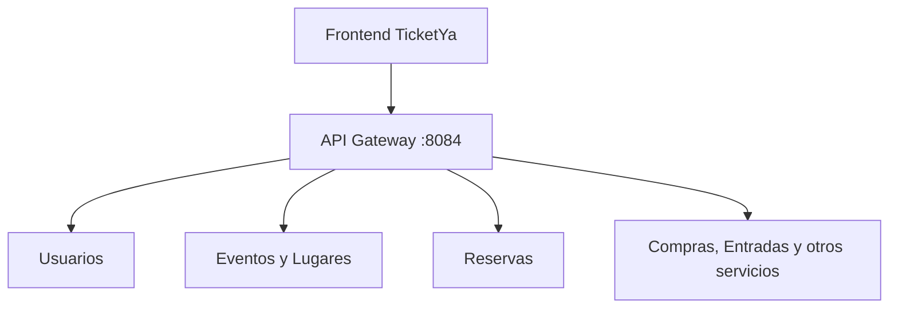

# Arquitectura y seguridad — API Gateway

## Arquitectura

El API Gateway centraliza el acceso a los microservicios de TicketYa mediante Spring Cloud Gateway WebFlux.

Recibe solicitudes del frontend, identifica el servicio de destino según la ruta y reenvía la petición conservando el método HTTP, los parámetros, el cuerpo y los encabezados necesarios.

El Gateway no implementa las operaciones de negocio ni accede directamente a las bases de datos.

## Enrutamiento

| Prefijo | Destino |
|---|---|
| `/auth/**`, `/usuarios/**` | Usuarios |
| `/eventos/**`, `/lugares/**`, `/sectores/**`, `/asientos/**`, `/organizadores/**`, `/participantes/**` | Eventos y Lugares |
| `/reservas/**`, `/disponibilidad/**` | Reservas |
| `/compras/**` | Compras y Pagos |
| `/entradas/**`, `/devoluciones/**` | Entradas |
| `/api/preferencias/**`, `/api/recomendaciones/**` | Recomendaciones |
| `/filas/**` | Fila Virtual |
| `GET /notificaciones/{id}` | Notificaciones |

Las solicitudes internas de registro de notificaciones se realizan entre microservicios, sin exponerse como operaciones de escritura públicas del Gateway.

## Seguridad

El Gateway valida tokens JWT utilizando la clave pública RSA configurada. Se comprueban la firma, la vigencia, el emisor, la audiencia y los datos de identidad del token.

Se aplican permisos según el método HTTP y la ruta:

- **Público:** inicio de sesión, registro, consultas públicas de eventos y documentación de las APIs.
- **CLIENTE:** creación de reservas y compras, preferencias, recomendaciones y solicitudes de devolución.
- **ORGANIZADOR:** creación y administración de eventos dentro de los permisos establecidos.
- **ADMINISTRADOR:** operaciones administrativas de eventos, usuarios, accesos y devoluciones.
- **PERSONAL_ACCESO:** validación de entradas mediante QR.
- **Tokens de servicio:** determinadas operaciones internas entre microservicios.

Las solicitudes no autenticadas a recursos protegidos reciben `401`. Las solicitudes autenticadas sin los permisos correspondientes reciben `403`.

Los microservicios de destino también validan los tokens y las reglas de titularidad correspondientes.

## Comunicación y disponibilidad

El Gateway utiliza las siguientes configuraciones de comunicación:

- Tiempo máximo de conexión: 3 segundos.
- Tiempo máximo de respuesta: 5 segundos.

Cuando un microservicio no está disponible, el Gateway evita que la solicitud quede esperando indefinidamente.

## Trazabilidad

Las solicitudes utilizan el encabezado `X-Correlation-ID` para identificar una operación a través de los servicios.

El Gateway conserva los identificadores válidos y genera uno nuevo cuando el recibido es inválido o inexistente.

## OpenAPI

Swagger UI agrupa la documentación de Usuarios, Eventos y Lugares, Reservas, Compras y Pagos, Entradas, Fila Virtual, Recomendaciones y Notificaciones.

La documentación se consulta desde:

`http://localhost:8084/swagger-ui.html`