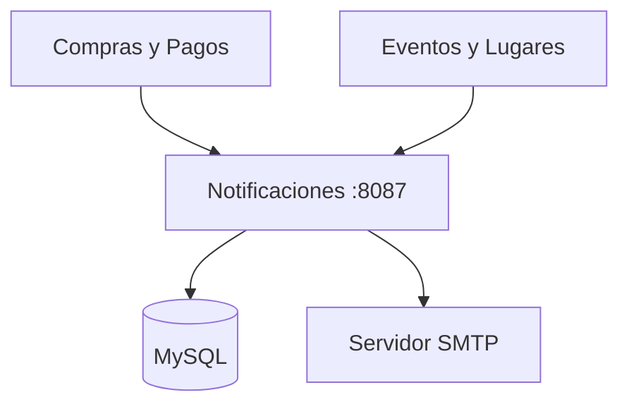

# Arquitectura — Notificaciones

## Responsabilidad

`msvc-notificaciones` es un microservicio desarrollado con Java 21 y Spring Boot. Se ejecuta en el puerto `8087`.

Su responsabilidad es recibir solicitudes de notificación, persistirlas y gestionar su envío por correo electrónico.

Utiliza Spring Web, Spring Data JPA, MySQL, Spring Mail, Spring Security y OpenAPI.

## Componentes

Los controladores reciben las solicitudes REST. `NotificacionServiceImpl` registra las notificaciones y aplica las reglas de idempotencia.

`NotificadorPendientes` ejecuta periódicamente la búsqueda de envíos pendientes. `ProcesadorNotificaciones` realiza los envíos mediante SMTP y actualiza sus estados.

## Procesamiento

1. Un microservicio autorizado solicita registrar una notificación.
2. Se validan los datos y se comprueba si existe un registro equivalente.
3. Si es nueva, se guarda con estado `PENDIENTE`.
4. La API responde sin esperar el envío del correo.
5. El proceso programado recupera las notificaciones cuyo intento está habilitado.
6. Se realiza el envío y se registra el resultado.

## Concurrencia e idempotencia

Una restricción única en la base de datos impide registrar dos notificaciones con la misma combinación de tipo, referencia, versión de evento y cliente.

El procesamiento utiliza bloqueo pesimista para evitar que dos procesos envíen simultáneamente una misma notificación.

## Reintentos

La configuración predeterminada establece:

- Revisión de pendientes cada segundo.
- Máximo de tres intentos de envío.
- Diez segundos entre intentos fallidos.

Los valores pueden modificarse mediante variables de entorno.

## Seguridad

Los endpoints de registro son internos y requieren tokens JWT de servicio:

- `SERVICE_compras`: confirmaciones de compra.
- `SERVICE_eventos`: cancelaciones, modificaciones y artistas favoritos.

La consulta del estado de una notificación también controla la identidad del cliente o el servicio que intenta acceder.

## Correo electrónico

El envío se realiza mediante SMTP. En el entorno local puede utilizarse Mailpit para recibir correos de prueba. Para enviar correos reales es necesario configurar un servidor SMTP apropiado.