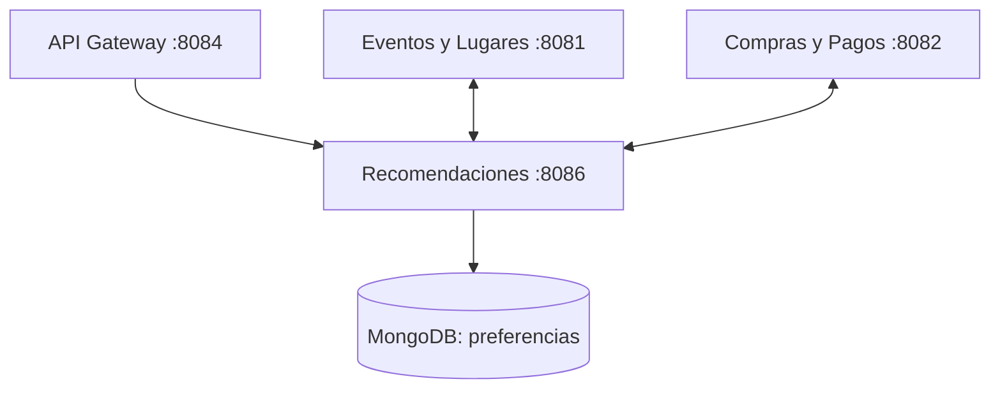

# Arquitectura — Recomendaciones

## Responsabilidad

`msvc-recomendaciones` está desarrollado con Java 21 y Spring Boot. Se ejecuta en el puerto `8086` y administra las preferencias de los clientes y la selección de eventos recomendados.

Utiliza:

- **Spring Web:** exposición de endpoints REST.
- **Spring Data MongoDB:** persistencia de preferencias.
- **Spring Cloud OpenFeign:** comunicación con Eventos y Lugares y Compras y Pagos.
- **Spring Security y JWT:** autenticación y autorización.
- **Springdoc OpenAPI:** documentación de la API.

## Diagrama de componentes

Cada microservicio administra sus propios datos. Recomendaciones consulta los servicios externos mediante HTTP y no accede directamente a sus bases de datos.

## Generación de recomendaciones

1. Se valida el JWT y se verifica que el cliente solicite sus propias recomendaciones o sea administrador.
2. Se recuperan sus preferencias desde MongoDB.
3. Se consultan los eventos publicados en Eventos y Lugares.
4. Se solicitan a Compras los identificadores de eventos sugeridos según el historial.
5. Para cada evento publicado y futuro se verifican las coincidencias por tipo, ciudad, artista o historial.
6. Se devuelve una lista de eventos recomendados.

La selección utiliza reglas de coincidencia: **no aplica puntuaciones, rankings ni modelos de aprendizaje automático**.

## Integración para notificaciones

Eventos y Lugares puede consultar los identificadores de clientes que tienen un artista entre sus favoritos y cuya ciudad coincide con la de un nuevo evento.

Esta consulta es interna y requiere un token de servicio autorizado.

## Seguridad y disponibilidad

Las operaciones de clientes requieren JWT con rol `CLIENTE` o `ADMINISTRADOR`. Los clientes solo pueden consultar o modificar sus propios registros.

La comunicación con el catálogo de Eventos contempla reintentos ante errores HTTP `502`, `503` y `504`. Si no se puede obtener el catálogo, se informa indisponibilidad mediante `503`.

Ante errores de servidor al consultar el historial en Compras, el servicio puede continuar utilizando únicamente las preferencias del cliente.

## Configuración

| Variable | Finalidad |
|---|---|
| `MONGODB_URI` | Conexión a MongoDB |
| `EVENTOS_URL` | Dirección de Eventos y Lugares |
| `COMPRAS_URL` | Dirección de Compras y Pagos |
| `JWT_PUBLIC_KEY` | Clave pública para validar JWT |
| `JWT_ISSUER` y `JWT_AUDIENCE` | Validación del emisor y destinatario de los tokens |