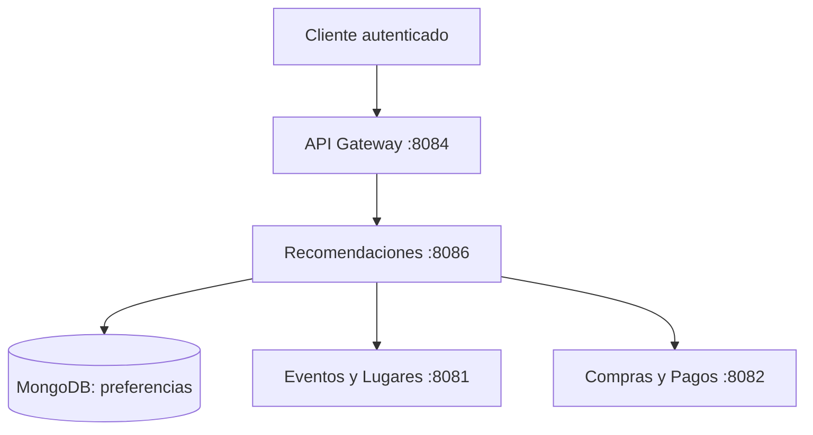
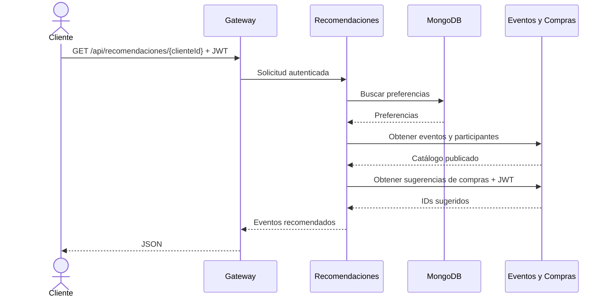

# 02 — Arquitectura y Diagramas

## 1. Responsabilidad y componentes

`msvc-recomendaciones` es un microservicio Spring Boot 4 (Java 21) que expone una API REST para administrar preferencias y sugerir eventos. Se ejecuta en el puerto `8086` y se integra a través del API Gateway (`8084`).

- **Controladores:** `PreferenciasController` y `RecomendacionesController`.
- **Servicios:** gestión de preferencias y selección de eventos recomendados.
- **Persistencia:** repositorio Spring Data MongoDB y colección `preferencias` en la base `ticketya_recomendaciones`.
- **Clientes Feign:** `EventoClient` obtiene eventos publicados y sus participantes; `CompraClient` obtiene sugerencias derivadas de compras confirmadas.
- **Seguridad:** Spring Security valida JWT y controla roles e identidad del cliente. La consulta Feign a Compras propaga el encabezado Bearer del solicitante.

## 2. Diagrama de módulos

El tráfico entre Recomendaciones y los demás microservicios es HTTP REST mediante Spring Cloud OpenFeign. Las llamadas Feign usan las direcciones internas de Docker Compose. No se accede a las bases de datos de Eventos ni de Compras.

## 3. Consulta de recomendaciones

1. El cliente envía `GET /api/recomendaciones/{clienteId}` con JWT al Gateway.
2. Gateway y Recomendaciones validan la autenticación y los roles. Recomendaciones verifica la identidad del cliente.
3. El servicio obtiene las preferencias de MongoDB.
4. Consulta en Eventos los eventos publicados y los participantes de cada evento elegible.
5. Consulta en Compras los identificadores sugeridos por historial, reenviando el JWT del cliente.
6. Combina las coincidencias por tipo, ciudad, artista e historial; filtra eventos publicados y futuros y evita duplicados.
7. Devuelve la lista de eventos recomendados.

## 4. Configuración y despliegue

| Configuración | Valor en Docker Compose | Uso |
|---|---|---|
| `MONGODB_URI` | `mongodb://db-recomendaciones:27017/ticketya_recomendaciones` | Persistencia propia |
| `EVENTOS_URL` | `http://eventos:8081` | Cliente Feign de Eventos |
| `COMPRAS_URL` | `http://compras:8082` | Cliente Feign de Compras |
| `RECOMENDACIONES_URL` (en Gateway) | `http://recomendaciones:8086` | Enrutamiento de API |
| `JWT_PUBLIC_KEY` | `file:/run/secrets/jwt-public.pem` | Validación de firma JWT |

En ejecución local, las URL de Eventos y Compras tienen como valores predeterminados `http://localhost:8081` y `http://localhost:8082`. La clave pública RSA se monta como volumen de solo lectura en el contenedor.

## 5. Decisiones de diseño

### 5.1. Elección de MongoDB

Se eligió **MongoDB** para persistir las preferencias porque cada cliente tiene un conjunto de datos que puede representarse naturalmente como un documento: identificador de cliente, tipos de eventos, artistas favoritos y ciudad. Los tipos y artistas son listas de longitud variable que MongoDB almacena dentro del mismo documento, sin tablas intermedias ni relaciones adicionales.

Esta elección ofrece las siguientes ventajas para el dominio de preferencias:

- **Modelo documental:** toda la información de intereses de un cliente se recupera y actualiza como una unidad lógica.
- **Flexibilidad:** el modelo admite incorporar nuevos atributos de preferencias sin migraciones rígidas de un esquema de tablas.
- **Listas de intereses:** tipos de eventos y artistas favoritos se guardan directamente como arreglos.
- **Autonomía:** Recomendaciones administra su propia base de datos, separada de las bases de Eventos, Compras y Usuarios.
- **Integración con Spring:** Spring Data MongoDB permite trabajar con la colección `preferencias` mediante repositorios y clases Java.

El uso de MongoDB está acotado a las preferencias. Las reservas, pagos y compras permanecen bajo la responsabilidad de sus microservicios con persistencia relacional, apropiada para sus transacciones e invariantes de negocio. Recomendaciones no replica esas tablas ni las modifica.

### 5.2. Otras decisiones

- **OpenFeign:** facilita la comunicación HTTP con los servicios dueños del catálogo y de las compras.
- **API Gateway y JWT:** ofrecen un punto de entrada común y control de acceso, complementado con validación de propiedad en Recomendaciones y Compras.
- **Recomendación colaborativa simple:** se utilizan relaciones entre compras confirmadas, sin modelos predictivos. Esta estrategia permite incorporar historial sin duplicar información de compras.
- **Consistencia de consulta:** se leen datos actuales de los otros servicios; la generación de recomendaciones no escribe en Eventos ni Compras.

## 6. Comportamiento ante dependencias

Una lista de eventos publicados vacía produce una lista de recomendaciones vacía. Un historial sin sugerencias no impide recomendar por preferencias. La generación de recomendaciones utiliza consultas síncronas a Eventos y Compras; la disponibilidad de ambos servicios resulta necesaria para completar la solicitud.
