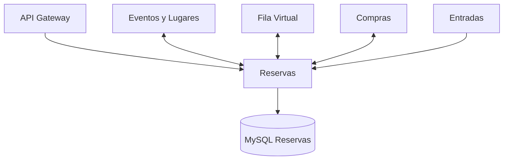

# Arquitectura — Reservas

## 1. Tecnologías

El microservicio está implementado con Java 21, Spring Boot, Spring Data JPA, Spring Security, OpenFeign y MySQL.

Se organiza en las siguientes capas:

| Capa | Responsabilidad |
|---|---|
| Controller | Expone los endpoints REST. |
| Service / ServiceImpl | Implementa las reglas de reservas y disponibilidad. |
| Repository | Administra el acceso a los datos mediante JPA. |
| Entities | Representa reservas, asignaciones, bloqueos y registros auxiliares. |
| DTO | Define las solicitudes y respuestas de la API. |
| Clients | Permite comunicarse con Eventos y Lugares y Fila Virtual. |
| Security | Valida JWT, identidades de servicio y permisos. |

## 2. Integraciones

| Microservicio | Integración |
|---|---|
| Eventos y Lugares | Consultar eventos, sectores, precios y asientos; habilitar o cancelar reservas. |
| Compras | Confirmar y liberar reservas según el resultado del pago. |
| Entradas | Liberar lugares correspondientes a devoluciones aprobadas. |
| Fila Virtual | Validar turnos de alta demanda y finalizar turnos utilizados. |

Reservas no accede directamente a las bases de datos de los otros microservicios.

## 3. Creación de reservas

El proceso de creación sigue estas etapas:

1. Se valida la identidad del cliente.
2. Se obtiene un bloqueo transaccional para la clave de idempotencia y el evento.
3. Se verifica si la solicitud ya fue procesada.
4. Se consulta la configuración del evento en Eventos y Lugares.
5. Si el evento es de alta demanda, se valida el turno en Fila Virtual.
6. Se verifica el límite de entradas y la disponibilidad.
7. Se registra la reserva temporal.
8. Para eventos de alta demanda, se registra la finalización pendiente del turno.

La reserva se crea en estado `ACTIVA` y vence después de 10 minutos.

## 4. Concurrencia e idempotencia

El microservicio utiliza transacciones con aislamiento `READ_COMMITTED` y bloqueos pesimistas `PESSIMISTIC_WRITE`.

La entidad `BloqueoEvento` permite serializar las operaciones que modifican la ocupación de un mismo evento.

Las claves de idempotencia evitan que un reintento genere una nueva reserva. Si una clave se utiliza con datos diferentes, la solicitud se rechaza.

## 5. Vencimiento de reservas

El vencimiento es lógico: las consultas de disponibilidad excluyen las reservas activas cuyo plazo terminó.

Cuando se consulta o procesa una reserva vencida, su estado puede actualizarse a `VENCIDA`.

Por lo tanto, no es necesario ejecutar una tarea periódica para que los lugares vuelvan a considerarse disponibles.

## 6. Integración con Fila Virtual

Para eventos de alta demanda se exige un turno autorizado, habilitado y vigente.

Después de registrar la reserva, se guarda una `FinalizacionFilaPendiente` dentro de la misma transacción.

Un proceso programado intenta finalizar el turno en Fila Virtual. Si la comunicación falla, conserva la operación y vuelve a intentarlo posteriormente.

Este mecanismo evita perder la finalización del turno cuando ocurre un fallo de comunicación.

## 7. Seguridad y observabilidad

Los JWT se validan localmente. Las operaciones internas requieren identidades de servicio autorizadas.

Los logs estructurados registran solicitudes, errores y el `correlationId`, que también se conserva durante los reintentos de finalización de turnos.