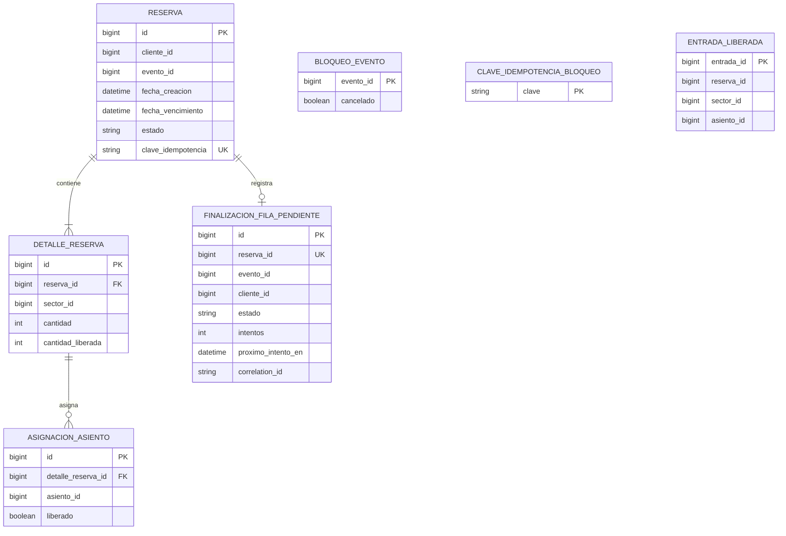

# Modelo de datos — Reservas

## 1. Persistencia

El microservicio utiliza MySQL y Spring Data JPA para almacenar reservas, detalles, asignaciones de asientos, bloqueos de eventos y registros de idempotencia.

También conserva las operaciones de finalización de turnos de Fila Virtual.

## 2. Diagrama entidad-relación

La relación entre `Reserva` y `FinalizacionFilaPendiente` es lógica mediante `reservaId`; no representa una asociación JPA con clave foránea.

## 3. Entidades principales

| Entidad | Responsabilidad |
|---|---|
| `Reserva` | Almacena cliente, evento, estado, fechas y clave de idempotencia. |
| `DetalleReserva` | Registra sectores, cantidades y lugares liberados. |
| `AsignacionAsiento` | Identifica los asientos reservados y su liberación individual. |
| `BloqueoEvento` | Coordina la concurrencia y registra cancelaciones locales. |
| `ClaveIdempotenciaBloqueo` | Serializa solicitudes que utilizan la misma clave de idempotencia. |
| `EntradaLiberada` | Evita procesar dos veces la devolución de una entrada. |
| `FinalizacionFilaPendiente` | Permite reintentar la finalización de turnos de alta demanda. |

## 4. Estados de reserva

| Estado | Significado |
|---|---|
| `ACTIVA` | Reserva temporal creada. |
| `CONFIRMADA` | Reserva confirmada después del pago. |
| `VENCIDA` | Reserva cuyo plazo terminó. |
| `LIBERADA` | Reserva liberada, por ejemplo, por un pago rechazado. |
| `CANCELADA` | Reserva temporal invalidada por la cancelación del evento. |

La fecha de vencimiento determina si una reserva activa continúa ocupando lugares.

## 5. Integridad

- `Reserva.claveIdempotencia` tiene una restricción de unicidad.
- Las asignaciones pertenecen a un detalle de reserva.
- `EntradaLiberada.entradaId` identifica de forma única una liberación procesada.
- `FinalizacionFilaPendiente.reservaId` es único.
- Las operaciones de ocupación se coordinan mediante bloqueos transaccionales.

Los identificadores `clienteId`, `eventoId`, `sectorId` y `asientoId` hacen referencia lógica a recursos externos, sin claves foráneas hacia otros microservicios.