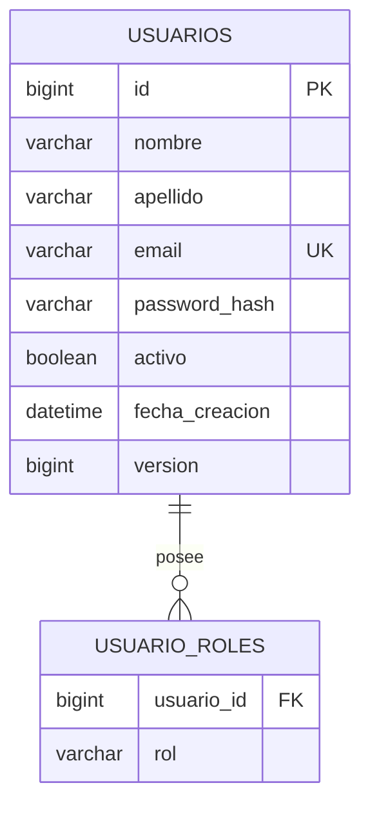

# Arquitectura y modelo de datos — Usuarios

## Responsabilidad

`msvc-usuarios` centraliza el registro, autenticación y administración de identidades. Es el único microservicio que emite JWT de usuario y credenciales internas.

Los demás microservicios validan los tokens mediante la clave pública correspondiente, sin acceder directamente a la base de datos de Usuarios.

## Arquitectura interna

La implementación está organizada en las siguientes capas:

| Capa | Responsabilidad |
|---|---|
| Controllers | Exposición de endpoints REST y validación de solicitudes |
| Services / ServicesImpl | Lógica de registro, autenticación, usuarios y emisión de tokens |
| Repositories | Persistencia mediante Spring Data JPA |
| Entities | Modelo de usuarios y roles |
| Security | Configuración JWT, autorización y protección del login |
| Config | Configuración de claves, administrador inicial y OpenAPI |

Se utiliza inyección de dependencias por constructor y separación entre interfaces de servicios y sus implementaciones.

## Modelo de datos

### Entidades

**Usuario:** almacena los datos de identificación, correo electrónico, contraseña cifrada, estado y fecha de creación.

**Rol:** enumeración con los valores `CLIENTE`, `ORGANIZADOR`, `ADMINISTRADOR` y `PERSONAL_ACCESO`.

Los roles se almacenan mediante la tabla `usuario_roles`, relacionada con `usuarios`.

El correo electrónico tiene una restricción de unicidad. La entidad también utiliza control de versiones optimista mediante JPA.

## Autenticación JWT

Se utiliza el algoritmo RS256 con un par de claves RSA:

- **Clave privada:** disponible únicamente para Usuarios, que firma los tokens.
- **Clave pública:** utilizada por el Gateway y los microservicios para validar los JWT.

Los tokens contienen identificador del sujeto, emisor, audiencia, fechas de emisión y vencimiento, identificador único, roles y tipo de token.

Existen dos tipos:

| Tipo | Vigencia predeterminada | Uso |
|---|---|---|
| Usuario | 60 minutos | Operaciones de usuarios autenticados |
| Servicio | 5 minutos | Comunicaciones internas autorizadas |

Los tokens de servicio identifican al microservicio que realiza la operación y no contienen roles de usuario.

## Seguridad

Las contraseñas se almacenan mediante BCrypt con costo 12.

El registro público asigna exclusivamente el rol `CLIENTE`. Los roles administrativos se asignan mediante operaciones protegidas.

El primer administrador puede crearse mediante un mecanismo de inicialización controlado por variables de entorno.

La aplicación limita los intentos fallidos de autenticación y rechaza JWT inválidos, vencidos o con permisos insuficientes.

Los cambios de roles y estado afectan nuevos inicios de sesión. Los JWT ya emitidos conservan su vigencia hasta el vencimiento; no se implementa revocación inmediata.

## Integración con otros microservicios

- El Gateway valida los JWT y controla el acceso a las rutas.
- Los microservicios aplican sus propias reglas de autorización.
- Eventos consulta la identidad de usuarios para vincular organizadores.
- Eventos y Compras pueden consultar datos mínimos de contacto mediante un endpoint interno.
- Las operaciones internas utilizan identidades de servicio.

Cada servicio mantiene su propia base de datos. La relación con Usuarios se realiza mediante identificadores y contratos REST, sin compartir entidades JPA.